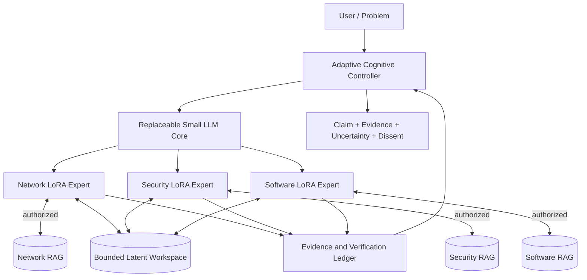

# Conceptual architecture — not a deployed system

## Components and interfaces

**Logical block diagram only.** There is no claim that latent transfers, adapters, manager or full integration have been coded.

## Expert package

A role expert is defined logically as **adapter weights + controller policy + dedicated RAG namespace + retrieval/authorization policy + version metadata**. Roles may share a base model but their KV caches are not automatically interchangeable. The coordinator decides whether another expert is useful; it must not instantiate all roles on every question.

## Three-level policy

L1 direct for narrow/easy/low-risk questions; L2 adds bounded iterative thinking, verified tools and retrieval; L3 may be activated if new evidence, independent domain analysis or explicit contradiction could materially improve the answer. Disagreement is retained where not resolved by evidence. Control decisions must be replayable; stopping must prevent unbounded loops.

## Two data planes

**Fast cognitive plane:** latent-first in-process state references, selective memory read/write, future trained projection/compression; no forced per-transfer textual decoding. **Evidence plane:** typed events, claims, reference document IDs, revisions, quality measurements, decisions and rejection reasons. Do **not** confuse retrieval embeddings with hidden activations or KV cache.

## Minimal future seams

`CaseContext(case_id, state, budget)`; `ExpertInvocation(case_id, role, adapter_revision, action)`; `MemoryHandle(case_id, representation, model_revision, adapter_revision, lease)`; `KnowledgeRequest(case_id, scope, source_refs)`. These are **conceptual contracts** for a one-case lab, not APIs implemented in this repository. Future multiuser isolation is deferred.

## Resource and correctness cautions

Zero-copy helps only if supported, safe and measured. Tensor transport may exceed text serialization cost; adapter changes can invalidate cached state. Prototype acceptance is conditional on task quality, peak RAM/VRAM, cold/warm latency and verifiable evidence.
