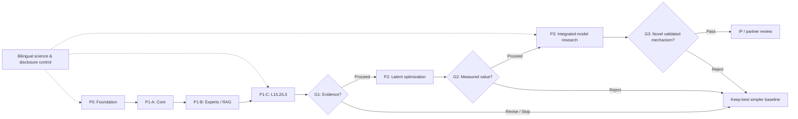

# Detailed research and delivery roadmap

This versioned roadmap supersedes the short v0.1.0 outline as the **public, disclosure-safe execution plan**. Work has been designed, **not performed**. Selection of a language model, LoRA training, complete DEC implementation or measured benchmark superiority is **not claimed**.

## 1. Status and guiding decisions

**Current evidence:** E0 architecture plus linked public prior art and an internal 39-item planned study backlog. The initial bilingual research dossier has been published. **No DEC execution result or selected core exists.**

**Scope:** one trusted local cognitive domain, one active case at a time; replaceable small LLM; domain LoRA and own-RAG; authorized default-on Cross-RAG with opt-out; three L1/L2/L3 reasoning levels; evidence-aware, bounded latent-first communication. Later, contingent native model integration. Multi-user/multi-server remains deferred.

**Project control principle:** research before selection; gates rather than fixed commitments; maintain a best-simple-baseline alternative; measure quality per *total* compute, not token count alone.

## 2. Phases, planning duration and evidence gates

| Phase | Indicative duration* | Gate | Major outcome | State |
|---|---:|---|---|---|
| **P0** | 2?4 weeks | G0 | Snapshot, licensed bilingual golden set, harness, risk/IP gate | planned |
| **P1A** | 3?5 weeks | G1A | Rank core models, verify tools and adaptive routing | planned |
| **P1B** | 4?6 weeks | G1B | Trained LoRAs, expert-owned RAG, evidence and cache contracts | planned |
| **P1C** | 4?6 weeks | G1 | Runnable L1/L2/L3 plus matched-budget empirical acceptance | planned |
| **P2** | 6?10 weeks | G2 | Measured and reversible latent/cache/runtime improvements | conditional |
| **P3** | 12?20 weeks | G3 | Ablated learned architecture / valid negative result, prior-art review | conditional |
| **CONT** | continuous | G-PUB | Bilingual disclosures, citations, results and contributor policy | ongoing |
| **FUTURE** | not scheduled | G-FUT | Separate feasibility authorisation, not a current deliverable | deferred |

*All durations are provisional, not an approval or promise of delivery. They assume a dedicated researcher and are subject to a fresh hardware/resource and data audit. P2/P3 may be rejected. No fixed dates are assigned to GitHub Milestones until P0 confirms capacity.*

## 3. Phase dependencies and critical path

**Critical dependency chain:** rights-cleared tasks ? verified hardware ? frozen model benchmark ? LoRA/RAG/evidence mechanisms ? runnable L1/L2/L3 ? matched-budget acceptance ? latency/memory bottleneck profiling ? optional latent optimization ? optional new learned architecture. *Do not* train adapters on held-out evaluation sets or start native architecture work before a positive P1/P2 gate.

## 4. Work breakdown structure ? complete package definitions

### P0 ? foundations and preregistration

#### DEC-WP-001 ? Governance, risk and project charter

**Scope / method:** Confirm current DEC research boundaries, decision authority, requirements and register risks/changes. Ensure bilingual issue and artifact contracts.

**Deliverable:** Charter, decision register, risk and change register / baseline.

**Acceptance / verification:** Every requirement has unique ID, phase, accountable decision maker and acceptance evidence.

**Depends on:** None � **Links to original internal DEC-BK items (identifiers only):** None
**Accountable role:** Project owner � **Estimate:** 3 person-days � **State:** `planned` (`E0`)

#### DEC-WP-002 ? Audit existing LDI and evidence retrieval

**Scope / method:** Read-only inspect actual LDI APIs, indexes, corpus rights, revisions and compatibility. No corpus copying to public GitHub.

**Deliverable:** Internal interface inventory and reuse/replace ADR.

**Acceptance / verification:** API and retrieval behavior are demonstrated with authorized test documents; unknowns marked.

**Depends on:** DEC-WP-001 � **Links to original internal DEC-BK items (identifiers only):** DEC-BK-001
**Accountable role:** Research engineering lead � **Estimate:** 4 person-days � **State:** `planned` (`E0`)

#### DEC-WP-003 ? Verify compute, runtime and model inventory

**Scope / method:** Collect fresh, read-only CPU/GPU/RAM/disk and model/runtimes hashes and availability, storage and isolated experiment capacity.

**Deliverable:** Private signed/hash inventory snapshot with non-sensitive public summary.

**Acceptance / verification:** At least one target machine and two model artifacts are identified with measured available capacity; no prior history masquerades as current state.

**Depends on:** DEC-WP-001 � **Links to original internal DEC-BK items (identifiers only):** DEC-BK-002, DEC-BK-032
**Accountable role:** Research engineering lead � **Estimate:** 3 person-days � **State:** `planned` (`E0`)

#### DEC-WP-004 ? Create bilingual evaluation golden set

**Scope / method:** Curate licensed/author-created task cases across network, information security, programming, management, conflicting evidence and abstention.

**Deliverable:** Versioned task JSON, oracle, rubrics, public synthetic subset and private held-out subset.

**Acceptance / verification:** Provisional target >=160 cases incl >=40% FA and >=30% EN, mixed-language, negative/abstention; stratification and reviewer sign-off before runs.

**Depends on:** DEC-WP-001 � **Links to original internal DEC-BK items (identifiers only):** DEC-BK-003
**Accountable role:** Independent evaluation lead � **Estimate:** 9 person-days � **State:** `planned` (`E0`)

#### DEC-WP-005 ? Build experiment and reproducibility harness

**Scope / method:** Pin dependencies and container/venv; capture corpus/model hashes, metrics and failure cases. Evaluate MLflow only if simpler log files insufficient.

**Deliverable:** Runnable local test runner, schema and controlled trace exporter.

**Acceptance / verification:** Same run configuration yields repeatable artifacts; missing metrics reported null; secret review before public output.

**Depends on:** DEC-WP-003, DEC-WP-004 � **Links to original internal DEC-BK items (identifiers only):** DEC-BK-012
**Accountable role:** Independent evaluation lead � **Estimate:** 6 person-days � **State:** `planned` (`E0`)

#### DEC-WP-006 ? Research prior art, licenses and rights

**Scope / method:** Maintain pinned literature/method/product matrix, model and dataset licenses, candidate IP disclosure and human/AI authorship/chain-of-title reviews.

**Deliverable:** Versioned evidence/permission matrix, disclosure gate, legal review queue.

**Acceptance / verification:** Each shortlisted artifact has original URL, version, license unknown/verified flag, risks and a release classification.

**Depends on:** DEC-WP-001 � **Links to original internal DEC-BK items (identifiers only):** None
**Accountable role:** Research / publication steward � **Estimate:** 5 person-days � **State:** `planned` (`E0`)

### P1-A ? core and tool/router baselines

#### DEC-WP-007 ? Benchmark replaceable small-model cores

**Scope / method:** Compare MiniCPM5-1B, Qwen3.5-0.8B, Granite H-1B, LFM3-1.7B and historical controls on equal tasks/hardware.

**Deliverable:** Comparable score/resource Pareto frontier and conditional core ADR.

**Acceptance / verification:** Report paired held-out FA/EN quality, cold/warm latency, TTFT, peak memory and model hashes; winner only within tested scope.

**Depends on:** DEC-WP-003, DEC-WP-004, DEC-WP-005, DEC-WP-006 � **Links to original internal DEC-BK items (identifiers only):** DEC-BK-004, DEC-BK-026, DEC-BK-033
**Accountable role:** Research engineering lead � **Estimate:** 10 person-days � **State:** `planned` (`E0`)

#### DEC-WP-008 ? Validate tool calling and Think control

**Scope / method:** Check model-specific templates/parser, valid call boundaries, retry/abort and false tool execution, MiniCPM Think modes.

**Deliverable:** Portable structured tool adapter plus scenario tests.

**Acceptance / verification:** Correct tool selection/JSON or XML parsing and safe denial measured on held-out scenarios; no claimed access to private model reasoning.

**Depends on:** DEC-WP-007 � **Links to original internal DEC-BK items (identifiers only):** DEC-BK-006, DEC-BK-027
**Accountable role:** Research engineering lead � **Estimate:** 5 person-days � **State:** `planned` (`E0`)

#### DEC-WP-009 ? Validate adaptive router and stopping

**Scope / method:** Benchmark rule-based baseline against small-router candidates with risk/cost-aware L1/L2/L3 action selection.

**Deliverable:** Router specification, confusion matrix and hard-stop policy.

**Acceptance / verification:** Missed escalation, false escalation, abstention, time and compute measured; unbounded cycle test fails safely.

**Depends on:** DEC-WP-004, DEC-WP-005, DEC-WP-007 � **Links to original internal DEC-BK items (identifiers only):** DEC-BK-007, DEC-BK-029, DEC-BK-034
**Accountable role:** Research engineering lead � **Estimate:** 7 person-days � **State:** `planned` (`E0`)

### P1-B ? trained expertise and retrieval

#### DEC-WP-010 ? Implement expert-owned RAG and Cross-RAG

**Scope / method:** Use existing LDI when verified; otherwise compare pgvector, LightRAG, Qdrant on same documents; Cross-RAG opt-out and source provenance.

**Deliverable:** Expert RAG adapters, provenance references, benchmark report and reuse ADR.

**Acceptance / verification:** Document citations trace to exact revision; disabled Cross-RAG makes no cross-source call; retrieval quality measured on held-out items.

**Depends on:** DEC-WP-002, DEC-WP-004, DEC-WP-005 � **Links to original internal DEC-BK items (identifiers only):** DEC-BK-009, DEC-BK-011
**Accountable role:** Research engineering lead � **Estimate:** 8 person-days � **State:** `planned` (`E0`)

#### DEC-WP-011 ? Train and test first real role LoRAs

**Scope / method:** Compare role prompt and RAG against at least two trained adapters on identical model revision. Confirm adapter/GGUF convertibility separately.

**Deliverable:** Adapter artifacts/hash privately, training card, eval and regression results publicly where safe.

**Acceptance / verification:** Held-out skill uplift or explicit negative result, no unacceptable regression, exact base/LoRA compatibility and memory tracked.

**Depends on:** DEC-WP-007, DEC-WP-010 � **Links to original internal DEC-BK items (identifiers only):** DEC-BK-005, DEC-BK-028
**Accountable role:** Research engineering lead � **Estimate:** 10 person-days � **State:** `planned` (`E0`)

#### DEC-WP-012 ? Implement typed expert collaboration protocol

**Scope / method:** Define PROPOSE, SUPPORT, CHALLENGE, REVISE, REQUEST_EXPERT, VERIFY, DISSENT, ABSTAIN actions; durable evidence ledger.

**Deliverable:** Typed state machine, event contract and deterministic replay tests.

**Acceptance / verification:** All critical state transitions replayable; malformed events and cycles handled with bounded behavior.

**Depends on:** DEC-WP-005 � **Links to original internal DEC-BK items (identifiers only):** DEC-BK-008
**Accountable role:** Research engineering lead � **Estimate:** 7 person-days � **State:** `planned` (`E0`)

#### DEC-WP-013 ? Ensure case/KV state correctness and lab boundary

**Scope / method:** Check per-case lifecycle, adapter cache validity, model revision, denied external actions, bounded trace publication without heavy per-tensor IAM.

**Deliverable:** Compatibility assertions, negative cache tests and sanitized telemetry.

**Acceptance / verification:** Cross-case stale states never reused in defined tests; forbidden external action blocked; all failures logged.

**Depends on:** DEC-WP-008, DEC-WP-012 � **Links to original internal DEC-BK items (identifiers only):** DEC-BK-013, DEC-BK-014
**Accountable role:** Research engineering lead � **Estimate:** 6 person-days � **State:** `planned` (`E0`)

#### DEC-WP-014 ? Compare council orchestration implementations

**Scope / method:** Compare lightweight state machine with LangGraph, Microsoft Agent Framework and CrewAI; avoid extra services by default.

**Deliverable:** Council-controller ADR with CPU/latency/recovery comparison.

**Acceptance / verification:** Selection supported by measured local overhead and sufficient replay/failure recovery.

**Depends on:** DEC-WP-012, DEC-WP-005 � **Links to original internal DEC-BK items (identifiers only):** DEC-BK-039
**Accountable role:** Research engineering lead � **Estimate:** 4 person-days � **State:** `planned` (`E0`)

### P1-C ? runnable three-level cognitive system

#### DEC-WP-015 ? Deliver Level 1 direct specialist path

**Scope / method:** One expert, direct evidence-aware answer with low overhead, status and abstention support.

**Deliverable:** Runnable L1 path and trace-to-answer tests.

**Acceptance / verification:** Passes smoke and regression tests with no council activation on simple cases.

**Depends on:** DEC-WP-007, DEC-WP-010, DEC-WP-012 � **Links to original internal DEC-BK items (identifiers only):** None
**Accountable role:** Research engineering lead � **Estimate:** 4 person-days � **State:** `planned` (`E0`)

#### DEC-WP-016 ? Deliver Level 2 iterative interactive thinking

**Scope / method:** Implement bounded single-expert tools/retrieval/verify/revise cycles with cancellation and externally observable events.

**Deliverable:** Runnable L2 and iterative trace scenarios.

**Acceptance / verification:** Evidence-refresh and model continuation work on fixtures; bounded iterations and timeouts verified.

**Depends on:** DEC-WP-008, DEC-WP-009, DEC-WP-013, DEC-WP-015 � **Links to original internal DEC-BK items (identifiers only):** None
**Accountable role:** Research engineering lead � **Estimate:** 6 person-days � **State:** `planned` (`E0`)

#### DEC-WP-017 ? Deliver Level 3 dynamic specialist council

**Scope / method:** Dynamic expert recruitment, independent criticism, evidence-based revision, retained dissent, shared bounded session state.

**Deliverable:** Runnable L3 council and adversarial cross-domain fixtures.

**Acceptance / verification:** Shows distinct experts contribute or rejects extra council; avoid forced consensus, loops and stale memory.

**Depends on:** DEC-WP-011, DEC-WP-013, DEC-WP-014, DEC-WP-016 � **Links to original internal DEC-BK items (identifiers only):** None
**Accountable role:** Research engineering lead � **Estimate:** 8 person-days � **State:** `planned` (`E0`)

#### DEC-WP-018 ? Run fair ablations across three reasoning levels

**Scope / method:** Compare direct, prompt-only, RAG, LoRA, deep thinking, fixed council, adaptive council and larger reference with matched compute and evidence.

**Deliverable:** Raw reproducible performance traces, comparison and falsified/confirmed hypotheses.

**Acceptance / verification:** Report task correctness, evidence, abstention, p50/p95, peak memory, paired uncertainty; record weak/negative gains.

**Depends on:** DEC-WP-015, DEC-WP-016, DEC-WP-017, DEC-WP-005 � **Links to original internal DEC-BK items (identifiers only):** DEC-BK-010
**Accountable role:** Independent evaluation lead � **Estimate:** 9 person-days � **State:** `planned` (`E0`)

#### DEC-WP-019 ? Issue P1 acceptance decision and reproducibility dossier

**Scope / method:** Independent review of all P1 evidence, benchmark leakage, resource envelope and whether P2 is justified.

**Deliverable:** P1 gate decision: proceed, revise, stop or conditional follow-up with risks.

**Acceptance / verification:** No P2 work starts before a signed decision citing hashes, failures, confidence and measured marginal benefit.

**Depends on:** DEC-WP-018 � **Links to original internal DEC-BK items (identifiers only):** None
**Accountable role:** Project owner � **Estimate:** 4 person-days � **State:** `planned` (`E0`)

### P2 ? latent/in-process efficiency, conditional

#### DEC-WP-020 ? Profile and prototype hidden-state expert transfer

**Scope / method:** Inspect LatentMAS-SLoRA and LatentMAS code; implement a small same-core typed-vs-hidden transfer on compatible adapters.

**Deliverable:** P2 repeatable compatibility/latency/quality report.

**Acceptance / verification:** No transfer until correct shape/model/adapter contracts; real end-to-end gain versus short typed event required.

**Depends on:** DEC-WP-019 � **Links to original internal DEC-BK items (identifiers only):** DEC-BK-015, DEC-BK-030, DEC-BK-035
**Accountable role:** Research engineering lead � **Estimate:** 10 person-days � **State:** `planned` (`E0`)

#### DEC-WP-021 ? Evaluate bounded latent compression

**Scope / method:** Compare full hidden-state, bounded slots, LatCom/CondenseFlow-like trained projectors and fallback to short structured events.

**Deliverable:** Memory saturation and quality/overhead ablation.

**Acceptance / verification:** Profile end-to-end and reject compression when quality cost outweighs resources; no assumed tensor savings.

**Depends on:** DEC-WP-020 � **Links to original internal DEC-BK items (identifiers only):** DEC-BK-016
**Accountable role:** Research engineering lead � **Estimate:** 8 person-days � **State:** `planned` (`E0`)

#### DEC-WP-022 ? Benchmark adapter-aware shared KV and cache engines

**Scope / method:** Evaluate LRAgent/RelayCaching/LMCache ideas against same-case in-process cache, switching adapters and model revisions.

**Deliverable:** Cache contract and measured compatibility and overhead.

**Acceptance / verification:** No invalid cache reuse; measured benefit beyond added kernel/memory overhead.

**Depends on:** DEC-WP-019 � **Links to original internal DEC-BK items (identifiers only):** DEC-BK-017, DEC-BK-037
**Accountable role:** Research engineering lead � **Estimate:** 7 person-days � **State:** `planned` (`E0`)

#### DEC-WP-023 ? Compare learned and fixed expert routing

**Scope / method:** PEFT Arrow vs task-level router vs token/layer MoLE and existing alternatives with identical budgets.

**Deliverable:** Router model card and Pareto ablation.

**Acceptance / verification:** Show added value and compatibility; do not adopt a learned router for complexity alone.

**Depends on:** DEC-WP-019 � **Links to original internal DEC-BK items (identifiers only):** DEC-BK-018
**Accountable role:** Research engineering lead � **Estimate:** 7 person-days � **State:** `planned` (`E0`)

#### DEC-WP-024 ? Study local-only C2C and latent primitives

**Scope / method:** Local pair-compatible projector only; compare Agent Primitives review/vote/plan against event-loop baseline. No multi-server.

**Deliverable:** Prior-art and code reproducibility report with rejection reasons.

**Acceptance / verification:** Each tested projector has pinned source-target; primitives run with repeatable tests or are marked unimplemented.

**Depends on:** DEC-WP-020 � **Links to original internal DEC-BK items (identifiers only):** DEC-BK-019, DEC-BK-021, DEC-BK-038
**Accountable role:** Research engineering lead � **Estimate:** 7 person-days � **State:** `planned` (`E0`)

#### DEC-WP-025 ? Assess recurrent and native low-bit alternatives

**Scope / method:** Profile RWKV/Mamba/Granite/BitNet memory-state semantics and native kernels against DEC's actual bottlenecks.

**Deliverable:** Architecture trade-off and fit/no-fit feasibility report.

**Acceptance / verification:** Cost, compatibility and language quality measured or explicit research-only disposition.

**Depends on:** DEC-WP-019 � **Links to original internal DEC-BK items (identifiers only):** DEC-BK-020, DEC-BK-036
**Accountable role:** Research engineering lead � **Estimate:** 6 person-days � **State:** `planned` (`E0`)

#### DEC-WP-026 ? Optimize runtime only where profiling justifies it

**Scope / method:** Assess fused kernels, in-process buffers, batching, vLLM/SGLang only if measured bottlenecks warrant migration.

**Deliverable:** Performance profile + no/low-risk migration ADR.

**Acceptance / verification:** Improvement reproducible and no functional regression; fallback/rollback tested.

**Depends on:** DEC-WP-020, DEC-WP-022 � **Links to original internal DEC-BK items (identifiers only):** None
**Accountable role:** Research engineering lead � **Estimate:** 7 person-days � **State:** `planned` (`E0`)

#### DEC-WP-027 ? P2 gate: decide whether native model research is warranted

**Scope / method:** Quantify whether P1/P2 integrated substrate outperforms best fair modular baseline; choose native research only if justified.

**Deliverable:** P2 gate report with proceed/revise/stop and next investment decision.

**Acceptance / verification:** Independent evidence review with confidence, negative cases and IP review before P3 disclosure.

**Depends on:** DEC-WP-021, DEC-WP-022, DEC-WP-023, DEC-WP-024, DEC-WP-025, DEC-WP-026 � **Links to original internal DEC-BK items (identifiers only):** None
**Accountable role:** Project owner � **Estimate:** 5 person-days � **State:** `planned` (`E0`)

### P3 ? native integrated cognition, conditional

#### DEC-WP-028 ? Council-to-student distillation feasibility

**Scope / method:** Study MiniCPM OPD/AgentArk ideas and construct controlled teacher/student experiment with rare-case criticism and abstention labels.

**Deliverable:** Teacher trace dataset under rights gate, student baseline and held-out eval.

**Acceptance / verification:** Preserve quality and disagreement or document failure; compare at matched end-to-end budget.

**Depends on:** DEC-WP-027, DEC-WP-006 � **Links to original internal DEC-BK items (identifiers only):** DEC-BK-022, DEC-BK-031
**Accountable role:** Research engineering lead � **Estimate:** 12 person-days � **State:** `planned` (`E0`)

#### DEC-WP-029 ? Research learned integrated cognitive model

**Scope / method:** Investigate trainable expert gating, bounded memory and control signals against best modular and distillation references.

**Deliverable:** Reproducible compact integrated model prototype or transparent negative finding.

**Acceptance / verification:** Distinct mechanism independently ablated; quality, compute and robustness compared; no novelty claim without prior art.

**Depends on:** DEC-WP-028 � **Links to original internal DEC-BK items (identifiers only):** DEC-BK-023
**Accountable role:** Research engineering lead � **Estimate:** 16 person-days � **State:** `planned` (`E0`)

#### DEC-WP-030 ? Protect and evaluate technical novelty and title

**Scope / method:** Record early prior art, authorship, invention disclosures and license chain; external qualified legal review before inventive disclosures or filing.

**Deliverable:** Private invention and rights dossier; public redacted novelty map.

**Acceptance / verification:** No patent/ownership claim before expert legal clearance and actual inventor/contract review.

**Depends on:** DEC-WP-006, DEC-WP-029 � **Links to original internal DEC-BK items (identifiers only):** None
**Accountable role:** Project owner � **Estimate:** 6 person-days � **State:** `planned` (`E0`)

#### DEC-WP-031 ? Release candidate and research-to-product decision

**Scope / method:** Assess reproducibility, model card, risk/performance, source rights and possible licensing/partnership; do not infer production readiness.

**Deliverable:** Research release or stop recommendation and rights-cleared demo synopsis.

**Acceptance / verification:** Scientific acceptance and IP gate passed; productization separately approved with costs.

**Depends on:** DEC-WP-029, DEC-WP-030 � **Links to original internal DEC-BK items (identifiers only):** None
**Accountable role:** Project owner � **Estimate:** 7 person-days � **State:** `planned` (`E0`)

### Ongoing ? scientific publication & governance

#### DEC-WP-034 ? Maintain bilingual publication and scientific change log

**Scope / method:** Keep EN/FA docs synchronized, triage issues, tag research releases, publish only sanitized evidence and honest negative outcomes.

**Deliverable:** Periodic public roadmap/status, changelog, dated experiment summaries with disclosure approval.

**Acceptance / verification:** Each publication has matching bilingual docs, CI pass, source references, E grade and rights gate.

**Depends on:** DEC-WP-001, DEC-WP-006 � **Links to original internal DEC-BK items (identifiers only):** None
**Accountable role:** Research / publication steward � **Estimate:** 3 person-days � **State:** `planned` (`E0`)

#### DEC-WP-035 ? Build collaboration and commercial evaluation pipeline

**Scope / method:** Provide public non-confidential participation channel and private due diligence/permission routes; record human contributions and rights.

**Deliverable:** Contributor guidance, collaboration template and partner-interest tracking without promises.

**Acceptance / verification:** No external code/data merged without authorization/rights agreement; confidential details not disclosed in public issues.

**Depends on:** DEC-WP-034 � **Links to original internal DEC-BK items (identifiers only):** None
**Accountable role:** Project owner � **Estimate:** 3 person-days � **State:** `planned` (`E0`)

### Future ? multitenancy/distribution deferred

#### DEC-WP-032 ? Investigate future multi-user/multitask design

**Scope / method:** After proven model and owner approval: tenant/session isolation, scheduling, quotas and concurrent quality.

**Deliverable:** Separate future threat/performance model and project charter.

**Acceptance / verification:** Explicit post-P3 authorization and representative workload; no current implementation.

**Depends on:** DEC-WP-031 � **Links to original internal DEC-BK items (identifiers only):** DEC-BK-024
**Accountable role:** Research engineering lead � **Estimate:** deferred � **State:** `planned` (`E0`)

#### DEC-WP-033 ? Investigate future distributed C2C

**Scope / method:** Multi-server latent/caching system considered only with approved topology and reproducible local benefit.

**Deliverable:** Separate architectural proposal and transport/security feasibility tests.

**Acceptance / verification:** Owner authorization and local C2C success required before remote execution.

**Depends on:** DEC-WP-031 � **Links to original internal DEC-BK items (identifiers only):** DEC-BK-025
**Accountable role:** Research engineering lead � **Estimate:** deferred � **State:** `planned` (`E0`)

## 5. Effort and scheduling assumptions

- Estimates are relative, not commitments. Phase durations assume roughly one focused full-time research engineer with intermittent subject-matter and legal review. Hardware, Internet, data preparation and training constraints may lengthen the critical path.
- No numerical success threshold is approved yet; P0 must preregister the smallest worthwhile effect, sample sizes, statistical procedure, latency/resource budgets, unacceptable regressions and owner sign-off before held-out testing.
- Only public-safe abstractions are in this document. Potentially novel equations/weights/implementation, private LDI corpus, lab addresses and confidential results stay outside GitHub until cleared.

**First-cut effort envelope:** 216 person-days for research phases P0?P3 if all phases pass, plus ongoing publication/governance; **not** funded, assigned or approved. P0?P1C = 118 person-days. Detailed estimates require P0 capacity review and explicit contingency; public GitHub issue labels do not constitute funding or engineering assignment.

## 6. Preregistered evaluation design (proposed values)

- **Proposed gold set:** initial >= 160 independently adjudicable tasks, >= 40% Persian and >= 30% English, including mixed-language and counterexamples. This is an **unapproved planning target**, not a prepared dataset.
- **Primary outcomes:** held-out correctness; evidence citation faithfulness; accepted task quality at matched total compute.
- **Secondary outcomes:** abstention/error calibration; cold/warm TTFT; end-to-end p50/p95; peak host/GPU RAM incl. LoRA and KV; total in/out tokens, tensor bytes and cost per correct answer.
- **Validity:** preregister effect sizes, noninferiority margins and failure thresholds in P0; use paired comparisons and 95% paired bootstrap intervals when appropriate, plus at least three controlled timing repeats; report uncertainty and negative cases. Human/LLM judges require calibration.
- **No numeric performance target is presently an approved success criterion.** Quality must be protected first, and the measured total-resource trade-off must justify added system complexity.

## 7. Go / No-go decision rules

### G0 ? P0 ? foundations and preregistration

**Acceptance / verification:** Versioned rights-cleared bilingual reference set, hardware/runtime inventory, signed study plan, measurable experiment harness and P1 baseline budget.

**Approval role:** project-owner + independent technical reviewer � **Fallback:** revise P0; no model tuning before benchmark freeze

### G1A ? P1-A ? core and tool/router baselines

**Acceptance / verification:** Core shortlist compared on identical held-out tests and hardware; model/adapter/template fit identified, no unsupported winner claim.

**Approval role:** project-owner + evaluation reviewer � **Fallback:** keep 2 candidates, obtain improved benchmark or smaller core

### G1B ? P1-B ? trained expertise and retrieval

**Acceptance / verification:** Working expert-owned retrieval with opt-out Cross-RAG, real trained LoRAs or explicit failed adaptation, replayable evidence and cache compatibility.

**Approval role:** technical lead + evaluation reviewer � **Fallback:** retain prompt+RAG baseline if adapters fail

### G1 ? P1-C ? runnable three-level cognitive system

**Acceptance / verification:** Runnable L1/L2/L3 and matched-budget ablation with held-out quality, latency/memory, negative cases and independent review; owner decides whether P2 is justified.

**Approval role:** project-owner � **Fallback:** retain best simpler level; revise hypotheses or stop branch

### G2 ? P2 ? latent/in-process efficiency, conditional

**Acceptance / verification:** Demonstrable net benefit for at least one latent/integration mechanism over strong typed-event baseline, with correctness and reversible implementation; otherwise reject.

**Approval role:** project-owner + independent technical reviewer � **Fallback:** stay with modular proven runtime; publish scoped negative findings

### G3 ? P3 ? native integrated cognition, conditional

**Acceptance / verification:** Native integrated learned prototype validated by ablation vs best modular baseline; novelty, IP rights, licensing and disclosure independently reviewed.

**Approval role:** project-owner + technical/IP specialist � **Fallback:** publish modular science only or continue scoped research privately

### G-PUB ? Ongoing ? scientific publication & governance

**Acceptance / verification:** Every public change has EN/FA parity, source provenance, evidence grades, rights approval, CI and reversible git record (not reversible public disclosure).

**Approval role:** project maintainer � **Fallback:** withhold disclosure or publish redacted status

### G-FUT ? Future ? multitenancy/distribution deferred

**Acceptance / verification:** Future expansion needs separate real-world capacity, risk and owner authorization, not implied by P3 success.

**Approval role:** project-owner � **Fallback:** defer

## 8. Risk register

| ID | Risk | Initial severity | Mitigation / response |
|---|---|---|---|
| R01 | Benchmark leakage or biased oracle | high | Independent held-out split, dataset hashes, second reviewer; stop claims |
| R02 | Core inadequate in Persian | high | FA/EN controls; compare larger/smaller, abstain, domain RAG; do not fake gain |
| R03 | 6GB-class GPU / CPU bottleneck | high | Fresh resource inventory, QLoRA short context, profiling, scope control |
| R04 | LoRA?KV latent incompatibility | high | Pinned compatibility IDs and negative tests; fallback to typed events |
| R05 | Council lacks marginal value | high | Equal-compute single-agent counterfactual; cancel unnecessary council |
| R06 | Excessive latent tensor overhead | high | Measure full wall time+bytes/memory; cap slots and abort bad branch |
| R07 | Third-party licensing or chain-of-title conflicts | critical | Artifact-by-artifact license review and private rights ledger before publishing |
| R08 | Premature novelty disclosure | critical | Publication/IP gate, no unpublished inventive mechanism in public issues |
| R09 | Infrastructure scope creep and cross-project leakage | high | Private lab independent; sanitized public artifacts only; controlled changes |
| R10 | Unreproducible or vendor-biased result | high | Locked run recipes, raw measurements, independent review and negative results |
| R11 | Over-engineering multiuser/multiserver | medium | Owner deferment enforced until P3 and dedicated scope |
| R12 | Commercial overclaiming | high | Separate research, IP, pilot and product readiness; no invented valuations |

## 9. Scientific publication, collaboration and commercial protections

Maintain a two-tier evidence/publication policy: **private, access-controlled original experiment and invention records** vs **public bilingual disclosure-safe summaries**. GitHub's public version history is not proof of sole copyright ownership or patent priority, and public disclosure may damage later claims. Do not copy sensitive LDI corpus, model weights, internal infrastructure or unpublished original technical mechanisms into public issues.

Every public result needs source/revision, rights clearance, independently evaluated grade (E0?E3), baseline, confidence/limitations and the related ADR. Commercial proposals must distinguish rights to original implementation from third-party models, dependencies and methods. Collaborator contribution and licensing rights must be agreed in writing before merging external code/data. No patent registered or commercial product is claimed.

See [Publication and IP](publication-ip.md), [Contributing](contributing.md), [Security](security.md).

## 10. Operating rhythm, traceability and status reporting

- **Daily execution:** one task at a time where practical; note environment/config and result before switching models or experts.
- **Weekly technical review:** update work package state, blockers, next experiments, reproducibility and time/resource consumption.
- **Every two weeks:** owner reviews any changed scope, risk/quality gate and project critical path; no silent moving acceptance thresholds.
- **Monthly public review:** update both languages together, source catalogue, ADRs, negative results and public status without exposing unapproved mechanisms.
- **On each GitHub pull request:** automatic EN/FA structural validation, JSON schema/reference integrity, secret scanning and owner review. A green workflow is not an IP/legal sign-off.
- **State semantics:** `planned`, `ready`, `in_progress`, `blocked`, `review`, `accepted`, `rejected`, `deferred`. Change state only with linked evidence; current roadmap entries remain `planned`.

## 11. First actionable tasks

- **DEC-WP-001** ? Governance, risk and project charter: Charter, decision register, risk and change register / baseline.
- **DEC-WP-002** ? Audit existing LDI and evidence retrieval: Internal interface inventory and reuse/replace ADR.
- **DEC-WP-003** ? Verify compute, runtime and model inventory: Private signed/hash inventory snapshot with non-sensitive public summary.
- **DEC-WP-004** ? Create bilingual evaluation golden set: Versioned task JSON, oracle, rubrics, public synthetic subset and private held-out subset.
- **DEC-WP-005** ? Build experiment and reproducibility harness: Runnable local test runner, schema and controlled trace exporter.
- **DEC-WP-006** ? Research prior art, licenses and rights: Versioned evidence/permission matrix, disclosure gate, legal review queue.

**Start gate:** P0 can start without committing to a base model or introducing a new runtime. LDI read-only audit, hardware snapshot and synthetic benchmark design are the first evidence-producing tasks. The roadmap itself is a documented plan (E0), not a completed P0 result.

## 12. Methodological references and related records

- [ISO/IEC/IEEE 29119-1:2022 ? software testing concepts](https://www.iso.org/standard/81291.html)
- [NIST AI RMF GenAI Profile ? governance, measurement and risk](https://www.nist.gov/publications/artificial-intelligence-risk-management-framework-generative-artificial-intelligence)
- [GitHub Milestones ? issue tracking and completion](https://docs.github.com/en/issues/using-labels-and-milestones-to-track-work/about-milestones)
- [MLflow evaluation datasets ? golden sets, lineage](https://mlflow.org/docs/latest/genai/datasets)

Public linked datasets and references: [research catalogue](../../research/catalogue.json) � [initial experiment register](../../research/experiment-register.json) � [machine-readable roadmap](../../research/roadmap.json).

**Versioning:** document `DEC-DOC-007`, public roadmap `0.2.0`, created 2026-11-12; detailed implementation and novel algorithms may be withheld pending publication/IP review. No roadmap milestone is declared completed by this version.
