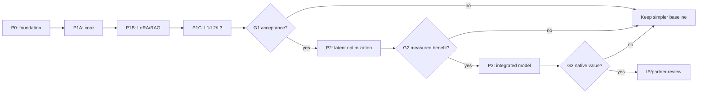

# Detailed research and implementation roadmap

This is the controlled, versioned research and delivery plan (E0). No DEC model, LoRA specialization, complete three-level council, benchmark result or new architecture is claimed to have been implemented.

## 1. Current state and scope

**E0 facts:** Public research dossier exists; 39 previously planned internal tasks are mapped to 35 packages. No DEC performance tests have been executed.

**Scope:** one trusted local cognitive domain, one active case; shared swappable LLM, role LoRA, own RAG and opt-out authorized Cross-RAG, three L1/L2/L3 levels, evidence-preserving latent-first communication; future integration conditioned on experiments. Multiuser/multiserver explicitly deferred.

## 2. Phases and estimated durations

| Phase | Estimated duration | Gate | State | Outcome |
|---|---:|---|---|---|
| P0 | 2-4 weeks | G0 | planned | Verified environment, benchmark and governance |
| P1A | 3-5 weeks | G1A | planned | Core, tool and router baseline |
| P1B | 4-6 weeks | G1B | planned | Specialist LoRA, RAG and evidence transport |
| P1C | 4-6 weeks | G1 | planned | Runnable three-level cognition and acceptance |
| P2 | 6-10 weeks | G2 | conditional | Measured local latent/state integration |
| P3 | 12-20 weeks | G3 | conditional | Optional learned model architecture |
| CONT | Continuous | G-PUB | ongoing | Continuous bilingual public science |
| FUTURE | Not scheduled | G-FUT | deferred | Deferred expansion |

## 3. Critical path and dependencies

The critical path is: legally usable bilingual benchmark and actual hardware audit -> fair small-model core selection -> real LoRA and RAG + typed evidence protocol -> executable L1/L2/L3 -> matched-budget independent acceptance -> conditional latent/cache optimization -> conditional native learned model architecture. Do not switch to an advanced phase before its evidence gate.

## 4. Work breakdown and acceptance contracts

### P0 — P0 - Research foundation

#### DEC-WP-001 — Governance, risk and project charter

**GitHub tracking issue:** [DEC-WP-001](https://github.com/khosravimm/dec-research/issues/3)

**Scope/method:** Confirm current DEC research boundaries, decision authority, requirements and register risks/changes. Ensure bilingual issue and artifact contracts.

**Deliverable:** Charter, decision register, risk and change register / baseline.

**Acceptance evidence:** Every requirement has unique ID, phase, accountable decision maker and acceptance evidence.

**Dependencies:** None

**Historical backlog IDs:** None

**Accountable role:** project-owner | **Estimated effort:** 3 person-days | **State:** planned (E0)

#### DEC-WP-002 — Audit existing LDI and evidence retrieval

**GitHub tracking issue:** [DEC-WP-002](https://github.com/khosravimm/dec-research/issues/4)

**Scope/method:** Read-only inspect actual LDI APIs, indexes, corpus rights, revisions and compatibility. No corpus copying to public GitHub.

**Deliverable:** Internal interface inventory and reuse/replace ADR.

**Acceptance evidence:** API and retrieval behavior are demonstrated with authorized test documents; unknowns marked.

**Dependencies:** DEC-WP-001

**Historical backlog IDs:** DEC-BK-001

**Accountable role:** research-engineering | **Estimated effort:** 4 person-days | **State:** planned (E0)

#### DEC-WP-003 — Verify compute, runtime and model inventory

**GitHub tracking issue:** [DEC-WP-003](https://github.com/khosravimm/dec-research/issues/5)

**Scope/method:** Collect fresh, read-only CPU/GPU/RAM/disk and model/runtimes hashes and availability, storage and isolated experiment capacity.

**Deliverable:** Private signed/hash inventory snapshot with non-sensitive public summary.

**Acceptance evidence:** At least one target machine and two model artifacts are identified with measured available capacity; no prior history masquerades as current state.

**Dependencies:** DEC-WP-001

**Historical backlog IDs:** DEC-BK-002, DEC-BK-032

**Accountable role:** research-engineering | **Estimated effort:** 3 person-days | **State:** planned (E0)

#### DEC-WP-004 — Create bilingual evaluation golden set

**GitHub tracking issue:** [DEC-WP-004](https://github.com/khosravimm/dec-research/issues/6)

**Scope/method:** Curate licensed/author-created task cases across network, information security, programming, management, conflicting evidence and abstention.

**Deliverable:** Versioned task JSON, oracle, rubrics, public synthetic subset and private held-out subset.

**Acceptance evidence:** Provisional target >=160 cases incl >=40% FA and >=30% EN, mixed-language, negative/abstention; stratification and reviewer sign-off before runs.

**Dependencies:** DEC-WP-001

**Historical backlog IDs:** DEC-BK-003

**Accountable role:** evaluation | **Estimated effort:** 9 person-days | **State:** planned (E0)

#### DEC-WP-005 — Build experiment and reproducibility harness

**GitHub tracking issue:** [DEC-WP-005](https://github.com/khosravimm/dec-research/issues/7)

**Scope/method:** Pin dependencies and container/venv; capture corpus/model hashes, metrics and failure cases. Evaluate MLflow only if simpler log files insufficient.

**Deliverable:** Runnable local test runner, schema and controlled trace exporter.

**Acceptance evidence:** Same run configuration yields repeatable artifacts; missing metrics reported null; secret review before public output.

**Dependencies:** DEC-WP-003, DEC-WP-004

**Historical backlog IDs:** DEC-BK-012

**Accountable role:** evaluation | **Estimated effort:** 6 person-days | **State:** planned (E0)

#### DEC-WP-006 — Research prior art, licenses and rights

**GitHub tracking issue:** [DEC-WP-006](https://github.com/khosravimm/dec-research/issues/8)

**Scope/method:** Maintain pinned literature/method/product matrix, model and dataset licenses, candidate IP disclosure and human/AI authorship/chain-of-title reviews.

**Deliverable:** Versioned evidence/permission matrix, disclosure gate, legal review queue.

**Acceptance evidence:** Each shortlisted artifact has original URL, version, license unknown/verified flag, risks and a release classification.

**Dependencies:** DEC-WP-001

**Historical backlog IDs:** None

**Accountable role:** research-governance | **Estimated effort:** 5 person-days | **State:** planned (E0)

### P1A — P1-A - Core model selection

#### DEC-WP-007 — Benchmark replaceable small-model cores

**GitHub tracking issue:** [DEC-WP-007](https://github.com/khosravimm/dec-research/issues/1)

**Scope/method:** Compare MiniCPM5-1B, Qwen3.5-0.8B, Granite H-1B, LFM3-1.7B and historical controls on equal tasks/hardware.

**Deliverable:** Comparable score/resource Pareto frontier and conditional core ADR.

**Acceptance evidence:** Report paired held-out FA/EN quality, cold/warm latency, TTFT, peak memory and model hashes; winner only within tested scope.

**Dependencies:** DEC-WP-003, DEC-WP-004, DEC-WP-005, DEC-WP-006

**Historical backlog IDs:** DEC-BK-004, DEC-BK-026, DEC-BK-033

**Accountable role:** research-engineering | **Estimated effort:** 10 person-days | **State:** planned (E0)

#### DEC-WP-008 — Validate tool calling and Think control

**GitHub tracking issue:** [DEC-WP-008](https://github.com/khosravimm/dec-research/issues/9)

**Scope/method:** Check model-specific templates/parser, valid call boundaries, retry/abort and false tool execution, MiniCPM Think modes.

**Deliverable:** Portable structured tool adapter plus scenario tests.

**Acceptance evidence:** Correct tool selection/JSON or XML parsing and safe denial measured on held-out scenarios; no claimed access to private model reasoning.

**Dependencies:** DEC-WP-007

**Historical backlog IDs:** DEC-BK-006, DEC-BK-027

**Accountable role:** research-engineering | **Estimated effort:** 5 person-days | **State:** planned (E0)

#### DEC-WP-009 — Validate adaptive router and stopping

**GitHub tracking issue:** [DEC-WP-009](https://github.com/khosravimm/dec-research/issues/10)

**Scope/method:** Benchmark rule-based baseline against small-router candidates with risk/cost-aware L1/L2/L3 action selection.

**Deliverable:** Router specification, confusion matrix and hard-stop policy.

**Acceptance evidence:** Missed escalation, false escalation, abstention, time and compute measured; unbounded cycle test fails safely.

**Dependencies:** DEC-WP-004, DEC-WP-005, DEC-WP-007

**Historical backlog IDs:** DEC-BK-007, DEC-BK-029, DEC-BK-034

**Accountable role:** research-engineering | **Estimated effort:** 7 person-days | **State:** planned (E0)

### P1B — P1-B - Expertise and retrieval

#### DEC-WP-010 — Implement expert-owned RAG and Cross-RAG

**GitHub tracking issue:** [DEC-WP-010](https://github.com/khosravimm/dec-research/issues/11)

**Scope/method:** Use existing LDI when verified; otherwise compare pgvector, LightRAG, Qdrant on same documents; Cross-RAG opt-out and source provenance.

**Deliverable:** Expert RAG adapters, provenance references, benchmark report and reuse ADR.

**Acceptance evidence:** Document citations trace to exact revision; disabled Cross-RAG makes no cross-source call; retrieval quality measured on held-out items.

**Dependencies:** DEC-WP-002, DEC-WP-004, DEC-WP-005

**Historical backlog IDs:** DEC-BK-009, DEC-BK-011

**Accountable role:** research-engineering | **Estimated effort:** 8 person-days | **State:** planned (E0)

#### DEC-WP-011 — Train and test first real role LoRAs

**GitHub tracking issue:** [DEC-WP-011](https://github.com/khosravimm/dec-research/issues/12)

**Scope/method:** Compare role prompt and RAG against at least two trained adapters on identical model revision. Confirm adapter/GGUF convertibility separately.

**Deliverable:** Adapter artifacts/hash privately, training card, eval and regression results publicly where safe.

**Acceptance evidence:** Held-out skill uplift or explicit negative result, no unacceptable regression, exact base/LoRA compatibility and memory tracked.

**Dependencies:** DEC-WP-007, DEC-WP-010

**Historical backlog IDs:** DEC-BK-005, DEC-BK-028

**Accountable role:** research-engineering | **Estimated effort:** 10 person-days | **State:** planned (E0)

#### DEC-WP-012 — Implement typed expert collaboration protocol

**GitHub tracking issue:** [DEC-WP-012](https://github.com/khosravimm/dec-research/issues/13)

**Scope/method:** Define PROPOSE, SUPPORT, CHALLENGE, REVISE, REQUEST_EXPERT, VERIFY, DISSENT, ABSTAIN actions; durable evidence ledger.

**Deliverable:** Typed state machine, event contract and deterministic replay tests.

**Acceptance evidence:** All critical state transitions replayable; malformed events and cycles handled with bounded behavior.

**Dependencies:** DEC-WP-005

**Historical backlog IDs:** DEC-BK-008

**Accountable role:** research-engineering | **Estimated effort:** 7 person-days | **State:** planned (E0)

#### DEC-WP-013 — Ensure case/KV state correctness and lab boundary

**GitHub tracking issue:** [DEC-WP-013](https://github.com/khosravimm/dec-research/issues/14)

**Scope/method:** Check per-case lifecycle, adapter cache validity, model revision, denied external actions, bounded trace publication without heavy per-tensor IAM.

**Deliverable:** Compatibility assertions, negative cache tests and sanitized telemetry.

**Acceptance evidence:** Cross-case stale states never reused in defined tests; forbidden external action blocked; all failures logged.

**Dependencies:** DEC-WP-008, DEC-WP-012

**Historical backlog IDs:** DEC-BK-013, DEC-BK-014

**Accountable role:** research-engineering | **Estimated effort:** 6 person-days | **State:** planned (E0)

#### DEC-WP-014 — Compare council orchestration implementations

**GitHub tracking issue:** [DEC-WP-014](https://github.com/khosravimm/dec-research/issues/15)

**Scope/method:** Compare lightweight state machine with LangGraph, Microsoft Agent Framework and CrewAI; avoid extra services by default.

**Deliverable:** Council-controller ADR with CPU/latency/recovery comparison.

**Acceptance evidence:** Selection supported by measured local overhead and sufficient replay/failure recovery.

**Dependencies:** DEC-WP-012, DEC-WP-005

**Historical backlog IDs:** DEC-BK-039

**Accountable role:** research-engineering | **Estimated effort:** 4 person-days | **State:** planned (E0)

### P1C — P1-C - Cognitive prototype

#### DEC-WP-015 — Deliver Level 1 direct specialist path

**GitHub tracking issue:** [DEC-WP-015](https://github.com/khosravimm/dec-research/issues/16)

**Scope/method:** One expert, direct evidence-aware answer with low overhead, status and abstention support.

**Deliverable:** Runnable L1 path and trace-to-answer tests.

**Acceptance evidence:** Passes smoke and regression tests with no council activation on simple cases.

**Dependencies:** DEC-WP-007, DEC-WP-010, DEC-WP-012

**Historical backlog IDs:** None

**Accountable role:** research-engineering | **Estimated effort:** 4 person-days | **State:** planned (E0)

#### DEC-WP-016 — Deliver Level 2 iterative interactive thinking

**GitHub tracking issue:** [DEC-WP-016](https://github.com/khosravimm/dec-research/issues/17)

**Scope/method:** Implement bounded single-expert tools/retrieval/verify/revise cycles with cancellation and externally observable events.

**Deliverable:** Runnable L2 and iterative trace scenarios.

**Acceptance evidence:** Evidence-refresh and model continuation work on fixtures; bounded iterations and timeouts verified.

**Dependencies:** DEC-WP-008, DEC-WP-009, DEC-WP-013, DEC-WP-015

**Historical backlog IDs:** None

**Accountable role:** research-engineering | **Estimated effort:** 6 person-days | **State:** planned (E0)

#### DEC-WP-017 — Deliver Level 3 dynamic specialist council

**GitHub tracking issue:** [DEC-WP-017](https://github.com/khosravimm/dec-research/issues/18)

**Scope/method:** Dynamic expert recruitment, independent criticism, evidence-based revision, retained dissent, shared bounded session state.

**Deliverable:** Runnable L3 council and adversarial cross-domain fixtures.

**Acceptance evidence:** Shows distinct experts contribute or rejects extra council; avoid forced consensus, loops and stale memory.

**Dependencies:** DEC-WP-011, DEC-WP-013, DEC-WP-014, DEC-WP-016

**Historical backlog IDs:** None

**Accountable role:** research-engineering | **Estimated effort:** 8 person-days | **State:** planned (E0)

#### DEC-WP-018 — Run fair ablations across three reasoning levels

**GitHub tracking issue:** [DEC-WP-018](https://github.com/khosravimm/dec-research/issues/19)

**Scope/method:** Compare direct, prompt-only, RAG, LoRA, deep thinking, fixed council, adaptive council and larger reference with matched compute and evidence.

**Deliverable:** Raw reproducible performance traces, comparison and falsified/confirmed hypotheses.

**Acceptance evidence:** Report task correctness, evidence, abstention, p50/p95, peak memory, paired uncertainty; record weak/negative gains.

**Dependencies:** DEC-WP-015, DEC-WP-016, DEC-WP-017, DEC-WP-005

**Historical backlog IDs:** DEC-BK-010

**Accountable role:** evaluation | **Estimated effort:** 9 person-days | **State:** planned (E0)

#### DEC-WP-019 — Issue P1 acceptance decision and reproducibility dossier

**GitHub tracking issue:** [DEC-WP-019](https://github.com/khosravimm/dec-research/issues/20)

**Scope/method:** Independent review of all P1 evidence, benchmark leakage, resource envelope and whether P2 is justified.

**Deliverable:** P1 gate decision: proceed, revise, stop or conditional follow-up with risks.

**Acceptance evidence:** No P2 work starts before a signed decision citing hashes, failures, confidence and measured marginal benefit.

**Dependencies:** DEC-WP-018

**Historical backlog IDs:** None

**Accountable role:** project-owner | **Estimated effort:** 4 person-days | **State:** planned (E0)

### P2 — P2 - Latent compute integration

#### DEC-WP-020 — Profile and prototype hidden-state expert transfer

**GitHub tracking issue:** [DEC-WP-020](https://github.com/khosravimm/dec-research/issues/2)

**Scope/method:** Inspect LatentMAS-SLoRA and LatentMAS code; implement a small same-core typed-vs-hidden transfer on compatible adapters.

**Deliverable:** P2 repeatable compatibility/latency/quality report.

**Acceptance evidence:** No transfer until correct shape/model/adapter contracts; real end-to-end gain versus short typed event required.

**Dependencies:** DEC-WP-019

**Historical backlog IDs:** DEC-BK-015, DEC-BK-030, DEC-BK-035

**Accountable role:** research-engineering | **Estimated effort:** 10 person-days | **State:** planned (E0)

#### DEC-WP-021 — Evaluate bounded latent compression

**GitHub tracking issue:** [DEC-WP-021](https://github.com/khosravimm/dec-research/issues/21)

**Scope/method:** Compare full hidden-state, bounded slots, LatCom/CondenseFlow-like trained projectors and fallback to short structured events.

**Deliverable:** Memory saturation and quality/overhead ablation.

**Acceptance evidence:** Profile end-to-end and reject compression when quality cost outweighs resources; no assumed tensor savings.

**Dependencies:** DEC-WP-020

**Historical backlog IDs:** DEC-BK-016

**Accountable role:** research-engineering | **Estimated effort:** 8 person-days | **State:** planned (E0)

#### DEC-WP-022 — Benchmark adapter-aware shared KV and cache engines

**GitHub tracking issue:** [DEC-WP-022](https://github.com/khosravimm/dec-research/issues/22)

**Scope/method:** Evaluate LRAgent/RelayCaching/LMCache ideas against same-case in-process cache, switching adapters and model revisions.

**Deliverable:** Cache contract and measured compatibility and overhead.

**Acceptance evidence:** No invalid cache reuse; measured benefit beyond added kernel/memory overhead.

**Dependencies:** DEC-WP-019

**Historical backlog IDs:** DEC-BK-017, DEC-BK-037

**Accountable role:** research-engineering | **Estimated effort:** 7 person-days | **State:** planned (E0)

#### DEC-WP-023 — Compare learned and fixed expert routing

**GitHub tracking issue:** [DEC-WP-023](https://github.com/khosravimm/dec-research/issues/23)

**Scope/method:** PEFT Arrow vs task-level router vs token/layer MoLE and existing alternatives with identical budgets.

**Deliverable:** Router model card and Pareto ablation.

**Acceptance evidence:** Show added value and compatibility; do not adopt a learned router for complexity alone.

**Dependencies:** DEC-WP-019

**Historical backlog IDs:** DEC-BK-018

**Accountable role:** research-engineering | **Estimated effort:** 7 person-days | **State:** planned (E0)

#### DEC-WP-024 — Study local-only C2C and latent primitives

**GitHub tracking issue:** [DEC-WP-024](https://github.com/khosravimm/dec-research/issues/24)

**Scope/method:** Local pair-compatible projector only; compare Agent Primitives review/vote/plan against event-loop baseline. No multi-server.

**Deliverable:** Prior-art and code reproducibility report with rejection reasons.

**Acceptance evidence:** Each tested projector has pinned source-target; primitives run with repeatable tests or are marked unimplemented.

**Dependencies:** DEC-WP-020

**Historical backlog IDs:** DEC-BK-019, DEC-BK-021, DEC-BK-038

**Accountable role:** research-engineering | **Estimated effort:** 7 person-days | **State:** planned (E0)

#### DEC-WP-025 — Assess recurrent and native low-bit alternatives

**GitHub tracking issue:** [DEC-WP-025](https://github.com/khosravimm/dec-research/issues/25)

**Scope/method:** Profile RWKV/Mamba/Granite/BitNet memory-state semantics and native kernels against DEC's actual bottlenecks.

**Deliverable:** Architecture trade-off and fit/no-fit feasibility report.

**Acceptance evidence:** Cost, compatibility and language quality measured or explicit research-only disposition.

**Dependencies:** DEC-WP-019

**Historical backlog IDs:** DEC-BK-020, DEC-BK-036

**Accountable role:** research-engineering | **Estimated effort:** 6 person-days | **State:** planned (E0)

#### DEC-WP-026 — Optimize runtime only where profiling justifies it

**GitHub tracking issue:** [DEC-WP-026](https://github.com/khosravimm/dec-research/issues/26)

**Scope/method:** Assess fused kernels, in-process buffers, batching, vLLM/SGLang only if measured bottlenecks warrant migration.

**Deliverable:** Performance profile + no/low-risk migration ADR.

**Acceptance evidence:** Improvement reproducible and no functional regression; fallback/rollback tested.

**Dependencies:** DEC-WP-020, DEC-WP-022

**Historical backlog IDs:** None

**Accountable role:** research-engineering | **Estimated effort:** 7 person-days | **State:** planned (E0)

#### DEC-WP-027 — P2 gate: decide whether native model research is warranted

**GitHub tracking issue:** [DEC-WP-027](https://github.com/khosravimm/dec-research/issues/27)

**Scope/method:** Quantify whether P1/P2 integrated substrate outperforms best fair modular baseline; choose native research only if justified.

**Deliverable:** P2 gate report with proceed/revise/stop and next investment decision.

**Acceptance evidence:** Independent evidence review with confidence, negative cases and IP review before P3 disclosure.

**Dependencies:** DEC-WP-021, DEC-WP-022, DEC-WP-023, DEC-WP-024, DEC-WP-025, DEC-WP-026

**Historical backlog IDs:** None

**Accountable role:** project-owner | **Estimated effort:** 5 person-days | **State:** planned (E0)

### P3 — P3 - Integrated model research

#### DEC-WP-028 — Council-to-student distillation feasibility

**GitHub tracking issue:** [DEC-WP-028](https://github.com/khosravimm/dec-research/issues/28)

**Scope/method:** Study MiniCPM OPD/AgentArk ideas and construct controlled teacher/student experiment with rare-case criticism and abstention labels.

**Deliverable:** Teacher trace dataset under rights gate, student baseline and held-out eval.

**Acceptance evidence:** Preserve quality and disagreement or document failure; compare at matched end-to-end budget.

**Dependencies:** DEC-WP-027, DEC-WP-006

**Historical backlog IDs:** DEC-BK-022, DEC-BK-031

**Accountable role:** research-engineering | **Estimated effort:** 12 person-days | **State:** planned (E0)

#### DEC-WP-029 — Research learned integrated cognitive model

**GitHub tracking issue:** [DEC-WP-029](https://github.com/khosravimm/dec-research/issues/29)

**Scope/method:** Investigate trainable expert gating, bounded memory and control signals against best modular and distillation references.

**Deliverable:** Reproducible compact integrated model prototype or transparent negative finding.

**Acceptance evidence:** Distinct mechanism independently ablated; quality, compute and robustness compared; no novelty claim without prior art.

**Dependencies:** DEC-WP-028

**Historical backlog IDs:** DEC-BK-023

**Accountable role:** research-engineering | **Estimated effort:** 16 person-days | **State:** planned (E0)

#### DEC-WP-030 — Protect and evaluate technical novelty and title

**GitHub tracking issue:** [DEC-WP-030](https://github.com/khosravimm/dec-research/issues/30)

**Scope/method:** Record early prior art, authorship, invention disclosures and license chain; external qualified legal review before inventive disclosures or filing.

**Deliverable:** Private invention and rights dossier; public redacted novelty map.

**Acceptance evidence:** No patent/ownership claim before expert legal clearance and actual inventor/contract review.

**Dependencies:** DEC-WP-006, DEC-WP-029

**Historical backlog IDs:** None

**Accountable role:** project-owner | **Estimated effort:** 6 person-days | **State:** planned (E0)

#### DEC-WP-031 — Release candidate and research-to-product decision

**GitHub tracking issue:** [DEC-WP-031](https://github.com/khosravimm/dec-research/issues/31)

**Scope/method:** Assess reproducibility, model card, risk/performance, source rights and possible licensing/partnership; do not infer production readiness.

**Deliverable:** Research release or stop recommendation and rights-cleared demo synopsis.

**Acceptance evidence:** Scientific acceptance and IP gate passed; productization separately approved with costs.

**Dependencies:** DEC-WP-029, DEC-WP-030

**Historical backlog IDs:** None

**Accountable role:** project-owner | **Estimated effort:** 7 person-days | **State:** planned (E0)

### CONT — Ongoing - Research governance and public science

#### DEC-WP-034 — Maintain bilingual publication and scientific change log

**GitHub tracking issue:** [DEC-WP-034](https://github.com/khosravimm/dec-research/issues/34)

**Scope/method:** Keep EN/FA docs synchronized, triage issues, tag research releases, publish only sanitized evidence and honest negative outcomes.

**Deliverable:** Periodic public roadmap/status, changelog, dated experiment summaries with disclosure approval.

**Acceptance evidence:** Each publication has matching bilingual docs, CI pass, source references, E grade and rights gate.

**Dependencies:** DEC-WP-001, DEC-WP-006

**Historical backlog IDs:** None

**Accountable role:** research-governance | **Estimated effort:** 3 person-days | **State:** planned (E0)

#### DEC-WP-035 — Build collaboration and commercial evaluation pipeline

**GitHub tracking issue:** [DEC-WP-035](https://github.com/khosravimm/dec-research/issues/35)

**Scope/method:** Provide public non-confidential participation channel and private due diligence/permission routes; record human contributions and rights.

**Deliverable:** Contributor guidance, collaboration template and partner-interest tracking without promises.

**Acceptance evidence:** No external code/data merged without authorization/rights agreement; confidential details not disclosed in public issues.

**Dependencies:** DEC-WP-034

**Historical backlog IDs:** None

**Accountable role:** project-owner | **Estimated effort:** 3 person-days | **State:** planned (E0)

### FUTURE — Future - Multiuser/distributed (deferred)

#### DEC-WP-032 — Investigate future multi-user/multitask design

**GitHub tracking issue:** [DEC-WP-032](https://github.com/khosravimm/dec-research/issues/32)

**Scope/method:** After proven model and owner approval: tenant/session isolation, scheduling, quotas and concurrent quality.

**Deliverable:** Separate future threat/performance model and project charter.

**Acceptance evidence:** Explicit post-P3 authorization and representative workload; no current implementation.

**Dependencies:** DEC-WP-031

**Historical backlog IDs:** DEC-BK-024

**Accountable role:** research-engineering | **Estimated effort:** 0 person-days | **State:** planned (E0)

#### DEC-WP-033 — Investigate future distributed C2C

**GitHub tracking issue:** [DEC-WP-033](https://github.com/khosravimm/dec-research/issues/33)

**Scope/method:** Multi-server latent/caching system considered only with approved topology and reproducible local benefit.

**Deliverable:** Separate architectural proposal and transport/security feasibility tests.

**Acceptance evidence:** Owner authorization and local C2C success required before remote execution.

**Dependencies:** DEC-WP-031

**Historical backlog IDs:** DEC-BK-025

**Accountable role:** research-engineering | **Estimated effort:** 0 person-days | **State:** planned (E0)

## 5. Resource estimates and assumptions

Phase and work-package estimates are provisional planning assumptions for one focused full-time research engineer plus occasional evaluation and legal review. They are not funded commitments or project deadlines; P2/P3 might be rejected. Replan after P0 based on resource constraints and measured bottlenecks.

- Estimates are relative, not commitments. Phase durations assume roughly one focused full-time research engineer with intermittent subject-matter and legal review. Hardware, Internet, data preparation and training constraints may lengthen the critical path.
- No numerical success threshold is approved yet; P0 must preregister the smallest worthwhile effect, sample sizes, statistical procedure, latency/resource budgets, unacceptable regressions and owner sign-off before held-out testing.
- Only public-safe abstractions are in this document. Potentially novel equations/weights/implementation, private LDI corpus, lab addresses and confidential results stay outside GitHub until cleared.

**Planning envelope:** 216 person-days (P0-P3 if all gates pass); P0-P1C: 118 person-days. No funded commitment.

## 6. Measurement and statistical validity

Proposed pre-registered evaluation (NOT yet approved): at least 160 independently reviewable FA/EN cases, at least 40% Persian and 30% English, with mixed-language and negative/abstention examples. Compare quality and evidence faithfulness at matched total compute. Capture p50/p95 end-to-end time, TTFT cold/warm, peak RAM/VRAM including adapters/KV, total prefill/output tokens, tensor bytes, failures and abstention. Preregister minimal useful improvement and noninferiority margins in P0. Use paired tests, uncertainty estimates (e.g. 95% paired bootstrap when appropriate), and at least three timing repeats. Missing metrics are unknown, never zero.

## 7. Evidence gates (Go/No-go)

### G0 / P0

**Acceptance evidence:** Versioned rights-cleared bilingual reference set, hardware/runtime inventory, signed study plan, measurable experiment harness and P1 baseline budget.

**Accountable role:** project-owner + independent technical reviewer

**Fallback:** revise P0; no model tuning before benchmark freeze

### G1A / P1A

**Acceptance evidence:** Core shortlist compared on identical held-out tests and hardware; model/adapter/template fit identified, no unsupported winner claim.

**Accountable role:** project-owner + evaluation reviewer

**Fallback:** keep 2 candidates, obtain improved benchmark or smaller core

### G1B / P1B

**Acceptance evidence:** Working expert-owned retrieval with opt-out Cross-RAG, real trained LoRAs or explicit failed adaptation, replayable evidence and cache compatibility.

**Accountable role:** technical lead + evaluation reviewer

**Fallback:** retain prompt+RAG baseline if adapters fail

### G1 / P1C

**Acceptance evidence:** Runnable L1/L2/L3 and matched-budget ablation with held-out quality, latency/memory, negative cases and independent review; owner decides whether P2 is justified.

**Accountable role:** project-owner

**Fallback:** retain best simpler level; revise hypotheses or stop branch

### G2 / P2

**Acceptance evidence:** Demonstrable net benefit for at least one latent/integration mechanism over strong typed-event baseline, with correctness and reversible implementation; otherwise reject.

**Accountable role:** project-owner + independent technical reviewer

**Fallback:** stay with modular proven runtime; publish scoped negative findings

### G3 / P3

**Acceptance evidence:** Native integrated learned prototype validated by ablation vs best modular baseline; novelty, IP rights, licensing and disclosure independently reviewed.

**Accountable role:** project-owner + technical/IP specialist

**Fallback:** publish modular science only or continue scoped research privately

### G-PUB / CONT

**Acceptance evidence:** Every public change has EN/FA parity, source provenance, evidence grades, rights approval, CI and reversible git record (not reversible public disclosure).

**Accountable role:** project maintainer

**Fallback:** withhold disclosure or publish redacted status

### G-FUT / FUTURE

**Acceptance evidence:** Future expansion needs separate real-world capacity, risk and owner authorization, not implied by P3 success.

**Accountable role:** project-owner

**Fallback:** defer

## 8. Risk register

| ID | Risk | Severity | Response |
|---|---|---|---|
| R01 | Benchmark leakage or biased oracle | high | Independent held-out split, dataset hashes, second reviewer; stop claims |
| R02 | Core inadequate in Persian | high | FA/EN controls; compare larger/smaller, abstain, domain RAG; do not fake gain |
| R03 | 6GB-class GPU / CPU bottleneck | high | Fresh resource inventory, QLoRA short context, profiling, scope control |
| R04 | LoRA?KV latent incompatibility | high | Pinned compatibility IDs and negative tests; fallback to typed events |
| R05 | Council lacks marginal value | high | Equal-compute single-agent counterfactual; cancel unnecessary council |
| R06 | Excessive latent tensor overhead | high | Measure full wall time+bytes/memory; cap slots and abort bad branch |
| R07 | Third-party licensing or chain-of-title conflicts | critical | Artifact-by-artifact license review and private rights ledger before publishing |
| R08 | Premature novelty disclosure | critical | Publication/IP gate, no unpublished inventive mechanism in public issues |
| R09 | Infrastructure scope creep and cross-project leakage | high | Private lab independent; sanitized public artifacts only; controlled changes |
| R10 | Unreproducible or vendor-biased result | high | Locked run recipes, raw measurements, independent review and negative results |
| R11 | Over-engineering multiuser/multiserver | medium | Owner deferment enforced until P3 and dedicated scope |
| R12 | Commercial overclaiming | high | Separate research, IP, pilot and product readiness; no invented valuations |

## 9. Research, publication, IP and change governance

Public work is bilingual and source-linked, with an explicit E0-E3 evidence grade and outcome even when negative. Novel mechanisms, unfiled IP, private LDI corpus, sensitive infrastructure, unlicensed data and implementation details requiring clearance remain private. GitHub commits do not prove ownership or patent rights. Publication has its own legal review gate. Do not promise commercial value or open-source licences.

Daily: complete one traceable task/test before switching context. Weekly: update blockers, evidence, performance and work-package states. Fortnightly: owner gate and resource review. Monthly: bilingual publication after source/rights checks. Status changes require a linked experiment/result or decision, never a cosmetic percentage.

## 10. Immediate action sequence

Begin with P0: governance, read-only LDI audit, verified compute/model inventory, evaluation gold set, reproducibility harness and rights/prior-art review. The roadmap is not proof that these tasks are already done.

- **DEC-WP-001** — Governance, risk and project charter: Charter, decision register, risk and change register / baseline.
- **DEC-WP-002** — Audit existing LDI and evidence retrieval: Internal interface inventory and reuse/replace ADR.
- **DEC-WP-003** — Verify compute, runtime and model inventory: Private signed/hash inventory snapshot with non-sensitive public summary.
- **DEC-WP-004** — Create bilingual evaluation golden set: Versioned task JSON, oracle, rubrics, public synthetic subset and private held-out subset.
- **DEC-WP-005** — Build experiment and reproducibility harness: Runnable local test runner, schema and controlled trace exporter.
- **DEC-WP-006** — Research prior art, licenses and rights: Versioned evidence/permission matrix, disclosure gate, legal review queue.

## 11. Normative and technical references

- [ISO/IEC/IEEE 29119-1:2022 — Software testing](https://www.iso.org/standard/81291.html)
- [NIST AI RMF Generative AI Profile](https://www.nist.gov/publications/artificial-intelligence-risk-management-framework-generative-artificial-intelligence)
- [GitHub Milestones](https://docs.github.com/en/issues/using-labels-and-milestones-to-track-work/about-milestones)
- [MLflow evaluation datasets](https://mlflow.org/docs/latest/genai/datasets)

- [Research catalogue / کاتالوگ](../../research/catalogue.json)
- [Experiments / آزمایش‌ها](../../research/experiment-register.json)
- [Machine-readable roadmap / رودمپ ماشین‌خوان](../../research/roadmap.json)

All work packages remain planned; deferred future items have not been authorized. This document is generated from research/roadmap.json, not hand-edited.
