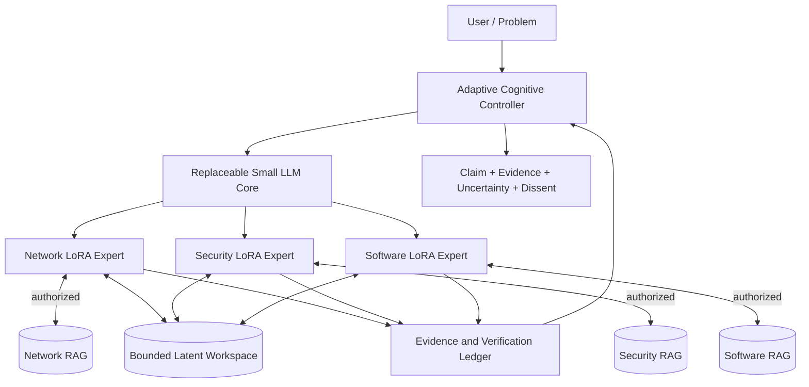

# معماری مفهومی — هنوز سامانه‌ای مستقر نشده است

## اجزا و رابط‌ها

**این نمودار منطقی است**؛ ادعا نمی‌شود که انتقال نهفته، Adapterها، مدیر شورا یا یکپارچه‌سازی کامل برنامه‌نویسی شده‌اند.

## بسته متخصص

متخصص یک نقش منطقی شامل **وزن‌های Adapter + سیاست کنترلر + فضای دانش RAG اختصاصی + سیاست بازیابی و مجوز + اطلاعات نسخه** است. نقش‌ها می‌توانند مدل پایه مشترک داشته باشند، ولی KV Cache آن‌ها خودکار قابل جابه‌جایی نیست. کنترلر فقط در صورت نیاز متخصص جدید را فعال می‌کند، نه برای هر پرسش تمام نقش‌ها را.

## سیاست سه‌سطحی

L1 برای سؤال محدود، ساده و کم‌ریسک؛ L2 با استدلال چندمرحله‌ای محدود، ابزار تأییدشده و بازیابی دانش؛ L3 زمانی فعال می‌شود که شاهد جدید، تحلیل مستقل حوزه دیگر یا تناقض واقعی ممکن است پاسخ را بهتر کند. اختلاف حل‌نشده حفظ می‌شود. تصمیم‌ها باید قابل بازپخش و حلقه‌ها محدود باشند.

## دو مسیر داده

**مسیر شناختی سریع:** اولویت ارتباط نهفته درون‌فرایندی، خواندن/نوشتن انتخابی حافظه و در آینده Projection/Compression آموزش‌دیده؛ بدون اجبار به بازسازی متن در هر انتقال. **مسیر شواهد:** رویداد ساختاریافته، ادعا، شناسه و نسخه منبع، سنجه کیفیت، تصمیم و دلیل رد. Embedding بازیابی با Activation نهفته یا KV Cache یکی نیست.

## رابط‌های حداقلی برای آینده

`CaseContext(case_id, state, budget)`؛ `ExpertInvocation(case_id, role, adapter_revision, action)`؛ `MemoryHandle(case_id, representation, model_revision, adapter_revision, lease)`؛ `KnowledgeRequest(case_id, scope, source_refs)`. این‌ها **قراردادهای مفهومی** نمونه تک‌پرونده‌ای‌اند، نه API پیاده‌سازی‌شده در این مخزن. جداسازی چندکاربره به آینده موکول شده است.

## احتیاط درباره منابع و صحت

Zero-copy تنها در صورت پشتیبانی، ایمنی و اثبات کارایی سودمند است. انتقال Tensor ممکن است از پیام کوتاه گران‌تر باشد و تغییر Adapter می‌تواند اعتبار Cache را از بین ببرد. پذیرش نمونه به کیفیت پاسخ، بیشینه RAM/VRAM، تأخیر سرد/گرم و شواهد قابل راستی‌آزمایی وابسته است.
