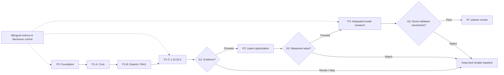

# ����? ��?�? ??�� � ����? DEC

�?� ����? 뫦�?���? ᩥ ?�? v0.1.0 �� ��?���� **����� ����? � ?��?�?��� ����??** ����� �??��. ����?�? ?��? **᩟�? ���?��? �� ����**. �뢦�� ���? ��? ����� LoRA? ??���?���? ?��� DEC ?� ����� ����? ��?꟩? ��� ��??���.

## 1. ���?� � ���?�?�? ��?�

**��� ���?:** ��꟩? E0? ??�?�� ꫢ� � ?? �租� ??��? �����?�?�??��� �� Backlog ����?. ?���� ����? ������� �뢬� ��� ���? �� **�?? �?�� ���?� DEC ?� �� ?�?� �뢦� 맟�?�.**

**�����:** ?? ���� �럦�? ��? ���� ��꟧ � ?? ?���� ��� �� � ���? LLM ?�?? 矠� ���?�? LoRA? RAG ������?? Cross-RAG ꤟ� � 矠� �����?? �� �� L1/L2/L3? ������ ���� ꥧ�� � ꠢ�? �� ���. ���� �� ����? ꬩ�� �� �?�� ���. ?�?����� � ?맫���? ���� �??���.

**��� �?�?�:** ���?� ??� �� �뢦��? ??� �?�� ��?��? ��� ���?� ����? ��� ?�?�� ����?�� ��?���� ��?�? �뤬 ??�?� ��?���? **?� �럠� ꥟����?**? �� ��� �㧟� ��?�.

## 2. 埪�? ꧢ ������? � ��ퟪ�?�? ���

| 埪 | ꧢ ��?�?* | ??� | �?�� ���? | ���?� |
|---|---:|---|---|---|
| **P0** | 2?4 ��� | G0 | �����?? ���� ꩤ� �������? ����� �뤬 � ?뢩� ���� | planned |
| **P1A** | 3?5 ��� | G1A | ��?�� 쫢�?�? ������ � Router ��?�? | planned |
| **P1B** | 4?6 ��� | G1B | LoRA ���?? RAG ����?? 穟���� ��� � Cache | planned |
| **P1C** | 4?6 ��� | G1 | ����? L1/L2/L3 � ���?� �� ��?�� ����� | planned |
| **P2** | 6?10 ��� | G2 | ��?��?���? ����/Cache/Runtime �� ���� ���? � ���?�� | conditional |
| **P3** | 12?20 ��� | G3 | �� ?��?���? �� Ablation ?� �?�� ꫢ�? ����? ??�?�� | conditional |
| **CONT** | ??���� | G-PUB | �뢬�� �������? ���럧? �?�� � �?��� ꬟�?� | ongoing |
| **FUTURE** | ���?��??묧� | G-FUT | ��� ����? ꫢ�� �?��? �� ���?� ?���? | deferred |

*��� ꧢ?� �������? �� ��??� ����� ?� ��� ���?�. �� ??��?� ��?� ��� � ?� �� ��?�? �럠� � ���� ����?�? �??���. ��?� ��� P2/P3 �� ���. �� ꬦ�?��� ��?� P0 ���? Milestone� ���?� ���? ��??� ��??���.*

## 3. ퟠ��?? 埪� � �?� �����?

**�?� ퟠ��?? �����?:** ���� ����? �� ���埧� ? ���?�媟� ��??���� ? ��?꟩? ���� 쫢� ? LoRA/RAG/��� ? L1/L2/L3 矠� ���� ? ����� �� ����� ����� ? ?���?� ?��?�� ? ��?��?���? ���� ���?��? ? ??�� �� ����? ꬩ��. ����� Adapter ��? ���� ����� ��?? ?� ���� ��꟩? ��?� ??� �� Gate �㢠� ꤟ� �?��.

## 4. �?�� ?�� (WBS) � ��� ?��� ����?�

### P0 ? �꟧�?���? � ??�?��� �����

#### DEC-WP-001 ? ����? ��?�?� � �?�?

**����� / ���:** ���?� ����� ??��? ���?���� ���?�? �骟꟢ � ��� ��??� � �?�?? 穟���� ��� �������.

**����? 矠� ���?�:** ����? �墩 ���?�? �?�? � ��??�.

**��?�� ?�?�� / ���:** � �骟� �럫�? 埪? ꩤ� ���?� � ��� ?�?�� ����.

**??�?�?��:** 맟�� � **�럫� ??�� �� Backlog ����? DEC-BK (���� ���� ����?):** 맟��
**�� ?���??�:** ��? ?��?� � **������:** 3 �婩�� � **���?�:** `planned` (`E0`)

#### DEC-WP-002 ? ��?�? LDI � ���?��? ��� �����

**����� / ���:** ��?�? ���?����? ����?�? �?�?�?�? ���� ��럧 � 뫦�?�? LDI � ���?��?.

**����? 矠� ���?�:** �쩫� ���� ����? � ADR ���埧� ꤧ�/��??�?�?.

**��?�� ?�?�� / ���:** �墟� API � ���?��? �� ��럧 ꤟ� ������ � ���韢 ꬦ� ���.

**??�?�?��:** DEC-WP-001 � **�럫� ??�� �� Backlog ����? DEC-BK (���� ���� ����?):** DEC-BK-001
**�� ?���??�:** ꫞�� ��맫? ??�� � **������:** 4 �婩�� � **���?�:** `planned` (`E0`)

#### DEC-WP-003 ? ���?��? ���?�媟�? Runtime � ��?�

**����� / ���:** ��� ���� � ���?����? �럠� CPU/GPU/RAM/�?�?? 뫦� �� � Runtime � ��?� �?� ���?�.

**����? 矠� ���?�:** ���?� ���?� �?��� ����? � �韭� ��� ����?.

**��?�� ?�?�� / ���:** ����� ?? �?���� � �� �� �� ��?� ���? ꬦ� ���? ���� ���?�? ��?��? ���?� ���? ���? ���.

**??�?�?��:** DEC-WP-001 � **�럫� ??�� �� Backlog ����? DEC-BK (���� ���� ����?):** DEC-BK-002, DEC-BK-032
**�� ?���??�:** ꫞�� ��맫? ??�� � **������:** 3 �婩�� � **���?�:** `planned` (`E0`)

#### DEC-WP-004 ? ���� ����� ꩤ� ����� �������

**����� / ���:** ���� ?���?�? ����? �� �뢬�� �� ��?�? ���?�? �����?��?�?? �?�?�? �㟩� � ?��� ���.

**����? 矠� ���?�:** ���� 뫦�?���? ?��� ꩤ�? Rubric? �?������ ����? ����? � ����� ��?? ����?.

**��?�� ?�?�� / ���:** �� ���?� ���??� ??? ?���� ���� ����� ??? 埩�? � ??? ��?�?�? � �ퟩ� ���?? ��??� ���?� � ����? ??� �� ����.

**??�?�?��:** DEC-WP-001 � **�럫� ??�� �� Backlog ����? DEC-BK (���� ���� ����?):** DEC-BK-003
**�� ?���??�:** ꫞�� ���?��? ꫢ�� � **������:** 9 �婩�� � **���?�:** `planned` (`E0`)

#### DEC-WP-005 ? ���� ����� ����? ����� � ������?�

**����� / ���:** ��� ퟠ��??? �?�? � ����/��? ��� � ��? MLflow ��� �� ���� �?�� ���?.

**����? 矠� ���?�:** ����? ���?� ��?? Schema � ����? Trace ?뢩�?���.

**��?�� ?�?�� / ���:** ���?꟢ ??��� ���㟢 矠� �?��� ��? ���� ���� Null � �뢬�� ���� Secret ����.

**??�?�?��:** DEC-WP-003, DEC-WP-004 � **�럫� ??�� �� Backlog ����? DEC-BK (���� ���� ����?):** DEC-BK-012
**�� ?���??�:** ꫞�� ���?��? ꫢ�� � **������:** 6 �婩�� � **���?�:** `planned` (`E0`)

#### DEC-WP-006 ? ����? ??�?��? ���� � ���� ����

**����� / ���:** ��� ��� � ��� 뫦� ��?� ��/����/����� � ?뢩� �嬟? ������ �����? � ��?�� ��??�.

**����? 矠� ���?�:** ꟢�?� ��� � ��� 뫦�?���? ??� �뢬�� � �쩫� ����? ����?.

**��?�� ?�?�� / ���:** � �ꪧ ��� � 뫦�? ���?� ���? �?�? � ���� �뢬�� ꬦ� ����.

**??�?�?��:** DEC-WP-001 � **�럫� ??�� �� Backlog ����? DEC-BK (���� ���� ����?):** 맟��
**�� ?���??�:** ꫞�� �뢬�� � ��?�?� ??�� � **������:** 5 �婩�� � **���?�:** `planned` (`E0`)

### P1-A ? 쫢�? ����� � Router

#### DEC-WP-007 ? ��?꟩? 쫢�?�? ?�?? 矠� ���?�

**����� / ���:** ��?�� MiniCPM5-1B? Qwen3.5-0.8B? Granite H-1B? LFM3-1.7B � ?뢩�?� �� ���?�媟� � ���� �����.

**����? 矠� ���?�:** ������ ?����? ??�?�/�럠� � ADR �뢦�� ���.

**��?�� ?�?�� / ���:** ??�?� 埩�?/��?�?�?? ���?� ���/?��? ����� � � ���? �뢦�� ��� �� ����� �����.

**??�?�?��:** DEC-WP-003, DEC-WP-004, DEC-WP-005, DEC-WP-006 � **�럫� ??�� �� Backlog ����? DEC-BK (���� ���� ����?):** DEC-BK-004, DEC-BK-026, DEC-BK-033
**�� ?���??�:** ꫞�� ��맫? ??�� � **������:** 10 �婩�� � **���?�:** `planned` (`E0`)

#### DEC-WP-008 ? �㢠����? ����� � ?뢩� Thinking

**����� / ���:** ?뢩� �� ������? ��? Parser? ꩪ �㢠� �����? �?���/��� � ��� Thinking.

**����? 矠� ���?�:** �?� ����� ������?��� 矠� ���?� � �����?�.

**��?�� ?�?�� / ���:** �뢦�� �����? ��� Parser � �� �?�� ��? ����� ��?? ��?�� ���? ���? ?뢩� ������ ����? �� 렟��.

**??�?�?��:** DEC-WP-007 � **�럫� ??�� �� Backlog ����? DEC-BK (���� ���� ����?):** DEC-BK-006, DEC-BK-027
**�� ?���??�:** ꫞�� ��맫? ??�� � **������:** 5 �婩�� � **���?�:** `planned` (`E0`)

#### DEC-WP-009 ? �㢠����? Router ��?�? � ����

**����� / ���:** ��?�� Router ���? � �� ?�?? �� �뢦�� L1/L2/L3 �� ���� �?�? � �?��.

**����? 矠� ���?�:** ꬦ��� Router? ꟢�?� �� � �?��� ����.

**��?�� ?�?�� / ���:** ��? �� ���?�? ���?� ����?? ����? ��� � �럠� ��?�� � ���� �ꥧ�� ��� ���.

**??�?�?��:** DEC-WP-004, DEC-WP-005, DEC-WP-007 � **�럫� ??�� �� Backlog ����? DEC-BK (���� ���� ����?):** DEC-BK-007, DEC-BK-029, DEC-BK-034
**�� ?���??�:** ꫞�� ��맫? ??�� � **������:** 7 �婩�� � **���?�:** `planned` (`E0`)

### P1-B ? ����? LoRA � ���?��? ���

#### DEC-WP-010 ? ??���?���? RAG ����? � Cross-RAG

**����� / ���:** ���埧� ꤧ� �� LDI ?� �� ��??� ?� ��?�� pgvector/LightRAG/Qdrant �� ��럧 ??���? Cross-RAG 矠� �?����?���?.

**����? 矠� ���?�:** ���� RAG ꢦ��? ����� �묚? ?���� ��?꟩? � ADR.

**��?�� ?�?�� / ���:** ���럧 �� 뫦� ��� ��� � �� �����? Cross-RAG ���?��? ���� �뤟� ���? ??�?� ��?�� ���.

**??�?�?��:** DEC-WP-002, DEC-WP-004, DEC-WP-005 � **�럫� ??�� �� Backlog ����? DEC-BK (���� ���� ����?):** DEC-BK-009, DEC-BK-011
**�� ?���??�:** ꫞�� ��맫? ??�� � **������:** 8 �婩�� � **���?�:** `planned` (`E0`)

#### DEC-WP-011 ? ����� � ����� 릫�?� LoRA�? ���?

**����� / ���:** ��?�� Prompt � RAG �� ���??� �� Adapter �����?�?�� ��? 뫦� ??���? ���?� GGUF ���?��� ������ ���.

**����? 矠� ���?�:** ��� � � Adapter �� ꦪ� ꤟ�? ?��� ����� � ?���� ����� �� ���? ����? ���.

**��?�� ?�?�� / ���:** ���� ���? �� ����� ��?? ?� �?�� ���? ?뢩� ?��� � ���?��? �� �럠� �맟��???�? ���.

**??�?�?��:** DEC-WP-007, DEC-WP-010 � **�럫� ??�� �� Backlog ����? DEC-BK (���� ���� ����?):** DEC-BK-005, DEC-BK-028
**�� ?���??�:** ꫞�� ��맫? ??�� � **������:** 10 �婩�� � **���?�:** `planned` (`E0`)

#### DEC-WP-012 ? ??���?���? 穟���� ��?��? ������?���

**����� / ���:** ��?� ��?����? ??��쟧? ���럧? ��? ��韥? ���ퟫ� ꢦ��? ����??���??? ����� � ����.

**����? 矠� ���?�:** ꟬?� ���? 穟���� ��?��� � ����� ���?�� ���?.

**��?�� ?�?�� / ���:** ?���� 矠� ���?�� � ��?��� ��?��/���� ?뢩�?��� ����.

**??�?�?��:** DEC-WP-005 � **�럫� ??�� �� Backlog ����? DEC-BK (���� ���� ����?):** DEC-BK-008
**�� ?���??�:** ꫞�� ��맫? ??�� � **������:** 7 �婩�� � **���?�:** `planned` (`E0`)

#### DEC-WP-013 ? ��� ���?� ?���� � KV � ꩪ ���?�?��

**����� / ���:** ?뢩� ?��� ?����? ���?��? KV/LoRA? 뫦� ��? ��� �租� �?���? � �뢬�� ��� ���� IAM ��??� ��? Tensor.

**����? 矠� ���?�:** 穟���� ���?��?? ��� Cache ���? � ���?ꢩ? ?��?�?���.

**��?�� ?�?�� / ���:** �� ����� ��?�?��� Cache ?���� �??� ���埧� ���? ���?�� ����� ���� � �� ��� ���.

**??�?�?��:** DEC-WP-008, DEC-WP-012 � **�럫� ??�� �� Backlog ����? DEC-BK (���� ���� ����?):** DEC-BK-013, DEC-BK-014
**�� ?���??�:** ꫞�� ��맫? ??�� � **������:** 6 �婩�� � **���?�:** `planned` (`E0`)

#### DEC-WP-014 ? ��?�� ?뢩��? ����

**����� / ���:** ��?�� ꟬?� ��� ��? �� LangGraph? Microsoft Agent Framework � CrewAI? ?��?� �� ���?� ����?.

**����? 矠� ���?�:** ADR ?뢩� �꩟� ��?�� CPU? ���?� � ���?��?.

**��?�� ?�?�� / ���:** �뢦�� �� ����� ���? ��? � ��� ���?��/���?��? ꫢ� ���.

**??�?�?��:** DEC-WP-012, DEC-WP-005 � **�럫� ??�� �� Backlog ����? DEC-BK (���� ���� ����?):** DEC-BK-039
**�� ?���??�:** ꫞�� ��맫? ??�� � **������:** 4 �婩�� � **���?�:** `planned` (`E0`)

### P1-C ? ����� �럦�? ��?��? 矠� ����

#### DEC-WP-015 ? ���?� �?� �� ??: ?��� ꫢ�?� ꢦ��

**����� / ���:** �?� ?��� ꫢ�?� ?? ꢦ�� �꩟� �묚? ��?���?� � ����.

**����? 矠� ���?�:** �?� L1 矠� ���� � ��� ��?��? ?���.

**��?�� ?�?�� / ���:** ��� ?�?� � ?��� ���� ���?���? �?����? ���� ?�� ���.

**??�?�?��:** DEC-WP-007, DEC-WP-010, DEC-WP-012 � **�럫� ??�� �� Backlog ����? DEC-BK (���� ���� ����?):** 맟��
**�� ?���??�:** ꫞�� ��맫? ??�� � **������:** 4 �婩�� � **���?�:** `planned` (`E0`)

#### DEC-WP-016 ? ���?� �� ��: ������ ����?

**����� / ���:** ���� ꥧ�� �����? ���?��?? ��??� � ��韥 ꢦ�� ퟥ� �꩟� ��� � ��?��� 矠� ꬟��.

**����? 矠� ���?�:** ����? L2 � �럩?��? Trace ?�ꩥ��?�?.

**��?�� ?�?�� / ���:** ����?���? ��� � ����� �� Fixture ���� � ?��� �?���/��� ��??� ���.

**??�?�?��:** DEC-WP-008, DEC-WP-009, DEC-WP-013, DEC-WP-015 � **�럫� ??�� �� Backlog ����? DEC-BK (���� ���� ����?):** 맟��
**�� ?���??�:** ꫞�� ��맫? ??�� � **������:** 6 �婩�� � **���?�:** `planned` (`E0`)

#### DEC-WP-017 ? ���?� �� ��: ����? ?�?�? ꢦ����

**����� / ���:** ���� ?�?�? ꢦ��? �� ꫢ��? ��韥 ꠢ�? �� ���? ��� ����� � ����� ꥧ��.

**����? 矠� ���?�:** ����? L3 矠� ���� � Fixture �?��?����?�?/�㟩�?.

**��?�� ?�?�� / ���:** ��� ���? ꢦ��?� ?� ��?�?�� ��� ���? ���� �����?/����/����� ����� 렟��.

**??�?�?��:** DEC-WP-011, DEC-WP-013, DEC-WP-014, DEC-WP-016 � **�럫� ??�� �� Backlog ����? DEC-BK (���� ���� ����?):** 맟��
**�� ?���??�:** ꫞�� ��맫? ??�� � **������:** 8 �婩�� � **���?�:** `planned` (`E0`)

#### DEC-WP-018 ? ����? Ablation ����� �� ��

**����� / ���:** ��?�� ꫢ�?�? Prompt? RAG? LoRA? ��?� ��?�? ����? ����/?�?� � �� ���? �� �럠�/��� �����.

**����? 矠� ���?�:** Trace ��� ������?�?�?�? ��?�� � ���?� ������ ��?�?�.

**��?�� ?�?�� / ���:** ���? ���? ����? ���? ����� � ��?���?� �꩟� �?��?� ?���� ���.

**??�?�?��:** DEC-WP-015, DEC-WP-016, DEC-WP-017, DEC-WP-005 � **�럫� ??�� �� Backlog ����? DEC-BK (���� ���� ����?):** DEC-BK-010
**�� ?���??�:** ꫞�� ���?��? ꫢ�� � **������:** 9 �婩�� � **���?�:** `planned` (`E0`)

#### DEC-WP-019 ? ���� ���?� ?�?�� P1 � ?���� ������?�

**����� / ���:** ����?�? ꫢ�� ��� P1? 묢? ���� �����? �럠� � ���?� �䟪 P2.

**����? 矠� ���?�:** ���?� �����/��韥/���� P1 �꩟� �?�?.

**��?�� ?�?�� / ���:** ���� ���?� ����? ���? �? �� � ��� ���?? P2 �䟪 ���.

**??�?�?��:** DEC-WP-018 � **�럫� ??�� �� Backlog ����? DEC-BK (���� ���� ����?):** 맟��
**�� ?���??�:** ��? ?��?� � **������:** 4 �婩�� � **���?�:** `planned` (`E0`)

### P2 ? ��?��?���? ������ � ꥟��� ���� (ꬩ��)

#### DEC-WP-020 ? ?���?� � ����� ���� Hidden State

**����� / ���:** ���?� ?� LatentMAS-SLoRA/LatentMAS? ����� ���� ������?��� �� ����� ���� ��? 쫢� ꬢ�?.

**����? 矠� ���?�:** ?���� 矠� ������?� ���?��?/���/??�?�.

**��?�� ?�?�� / ���:** �� ���?��? Shape/Model/LoRA ꥩ� ��� ���� �뤟� ���? ���� ��?? ��?�� ���.

**??�?�?��:** DEC-WP-019 � **�럫� ??�� �� Backlog ����? DEC-BK (���� ���� ����?):** DEC-BK-015, DEC-BK-030, DEC-BK-035
**�� ?���??�:** ꫞�� ��맫? ??�� � **������:** 10 �婩�� � **���?�:** `planned` (`E0`)

#### DEC-WP-021 ? ����� 嬩��?���? ����� ����

**����� / ���:** ��?�� Hidden State ?���? Slot ꥧ��? Projector � ??�� ?����.

**����? 矠� ���?�:** Ablation ꭩ� �����? ����� � ??�?�.

**��?�� ?�?�� / ���:** �?�� ?��� �맟��???�? � ��� �?��?��� �� ���? ����?��?? �� ���.

**??�?�?��:** DEC-WP-020 � **�럫� ??�� �� Backlog ����? DEC-BK (���� ���� ����?):** DEC-BK-016
**�� ?���??�:** ꫞�� ��맫? ??�� � **������:** 8 �婩�� � **���?�:** `planned` (`E0`)

#### DEC-WP-022 ? ��?꟩? KV ퟠ��� �� LoRA � ������? Cache

**����� / ���:** ����� LRAgent/RelayCaching/LMCache �� ����� Cache ����? �� ���?� Adapter � ��.

**����? 矠� ���?�:** 穟���� Cache � ?���� ���/�����.

**��?�� ?�?�� / ���:** ������埧� 럫��?�� �� �� �럩?��? ��?�?���? ���� �� ����� �?��� ����.

**??�?�?��:** DEC-WP-019 � **�럫� ??�� �� Backlog ����? DEC-BK (���� ���� ����?):** DEC-BK-017, DEC-BK-037
**�� ?���??�:** ꫞�� ��맫? ??�� � **������:** 7 �婩�� � **���?�:** `planned` (`E0`)

#### DEC-WP-023 ? ��?�� Routing ?��?���? � ���? ꢦ��

**����� / ���:** ��?�� PEFT Arrow? Router �� ��?�� � MoLE �?�/��?� �� �럠� �����.

**����? 矠� ���?�:** ?��� Router � Ablation ?����.

**��?�� ?�?�� / ���:** ���� ����� � ���?��? ����? ????�?? ��?���?? ��?� ?�?�� �?��.

**??�?�?��:** DEC-WP-019 � **�럫� ??�� �� Backlog ����? DEC-BK (���� ���� ����?):** DEC-BK-018
**�� ?���??�:** ꫞�� ��맫? ??�� � **������:** 7 �婩�� � **���?�:** `planned` (`E0`)

#### DEC-WP-024 ? ����? C2C ��? � ���??�? �럦�?

**����� / ���:** Projector ���?�� ��? � ��?�� Review/Vote/Plan �� ���� ��?���?? ���� ?맫���?.

**����? 矠� ���?�:** ?���� ??�?�� � ������?� ?� �꩟� ��?� ��.

**��?�� ?�?�� / ���:** � Projector �� 뫦� ꬦ� ����? ���??� ���?� ?� ��?����� ���� 묧� ��� �����.

**??�?�?��:** DEC-WP-020 � **�럫� ??�� �� Backlog ����? DEC-BK (���� ���� ����?):** DEC-BK-019, DEC-BK-021, DEC-BK-038
**�� ?���??�:** ꫞�� ��맫? ??�� � **������:** 7 �婩�� � **���?�:** `planned` (`E0`)

#### DEC-WP-025 ? ����? �� ���?��? � ?�?�?� ���?

**����� / ���:** ����? RWKV/Mamba/Granite/BitNet � ���?� �����/Kernel 뫠� �� ?��?�� ���?.

**����? 矠� ���?�:** ?���� ��?��?��? ��꟩? � ��?� �럫�/�� �럫�.

**��?�� ?�?�� / ���:** �?��? ���?��? � ??�?� ���� ��?�� ?� ?�?�� ??��?� ����?묧� ���? ���.

**??�?�?��:** DEC-WP-019 � **�럫� ??�� �� Backlog ����? DEC-BK (���� ���� ����?):** DEC-BK-020, DEC-BK-036
**�� ?���??�:** ꫞�� ��맫? ??�� � **������:** 6 �婩�� � **���?�:** `planned` (`E0`)

#### DEC-WP-026 ? ��?��?���? Runtime ��� �� ?�?� ?��?�� ���?

**����� / ���:** ����? Kernel? Buffer? Batching � Runtime ��??�?� ��� �� ���� ?��?�� ���?.

**����? 矠� ���?�:** ?���?� � ADR �쟤�� ?� �� �쟤��.

**��?�� ?�?�� / ���:** ���� �?���?�?� � ���� ?���? ���?�� ������ ���.

**??�?�?��:** DEC-WP-020, DEC-WP-022 � **�럫� ??�� �� Backlog ����? DEC-BK (���� ���� ����?):** 맟��
**�� ?���??�:** ꫞�� ��맫? ??�� � **������:** 7 �婩�� � **���?�:** `planned` (`E0`)

#### DEC-WP-027 ? ??� P2: ���?� ������ ��꟩? �� ��?�

**����� / ���:** �맟��???�? ����? ���� 뫠� �� �� ��? �?�韩 � ���?� ������ ���?� �� ��?�.

**����? 矠� ���?�:** ?���� ??� P2 �� �����/��韥/���� � ���?� �?��.

**��?�� ?�?�� / ���:** ����? ꫢ��? ��?���?�? �?�� � ?뢩� ���� ??� �� �嬟? P3.

**??�?�?��:** DEC-WP-021, DEC-WP-022, DEC-WP-023, DEC-WP-024, DEC-WP-025, DEC-WP-026 � **�럫� ??�� �� Backlog ����? DEC-BK (���� ���� ����?):** 맟��
**�� ?���??�:** ��? ?��?� � **������:** 5 �婩�� � **���?�:** `planned` (`E0`)

### P3 ? ??�� ��꟩? �럦�? ����? (ꬩ��)

#### DEC-WP-028 ? ��?��?��? ���?� ���� �� �� ���?����

**����� / ���:** ����� MiniCPM OPD/AgentArk � ����� ����/���?���� �� �� �ퟩ� 럧� � ����.

**����? 矠� ���?�:** ����� Trace ���� �� ?뢩� ����? �� ���?���� � ����� ��??.

**��?�� ?�?�� / ���:** ��� ??�?� � ����� ?� �?�� ���? ��?�� �럠� �����.

**??�?�?��:** DEC-WP-027, DEC-WP-006 � **�럫� ??�� �� Backlog ����? DEC-BK (���� ���� ����?):** DEC-BK-022, DEC-BK-031
**�� ?���??�:** ꫞�� ��맫? ??�� � **������:** 12 �婩�� � **���?�:** `planned` (`E0`)

#### DEC-WP-029 ? ??�� �� �럦�? ?��?���? ???��?�

**����� / ���:** ����? Routing �����??�?�? ����� ꥧ�� � �??�� ?뢩� �� ����� ��? �?�韩 � ���?�.

**����? 矠� ���?�:** ����� 矠� ������?� ��꟩? ???��?� ?� ?���� �?�� ���?.

**��?�� ?�?�� / ���:** �?��?�� ��?� �� Ablation? ??�?�/�럠�/?�?���? ��?��? ���� ���? ����? �????�?��.

**??�?�?��:** DEC-WP-028 � **�럫� ??�� �� Backlog ����? DEC-BK (���� ���� ����?):** DEC-BK-023
**�� ?���??�:** ꫞�� ��맫? ??�� � **������:** 16 �婩�� � **���?�:** `planned` (`E0`)

#### DEC-WP-030 ? ���?��? ����? � ���� ��??� ��?

**����� / ���:** ��� ??�?��? ��� ?�?������? �嬟? ������ ����?? ��?�� ��� � �� ����? ??� �� �뢬��.

**����? 矠� ���?�:** ?���� ����? ������/���� � ��� ??�?�� ?��?�?��� ����?.

**��?�� ?�?�� / ���:** ���? ���/�륭�� ���� ����? ����? � ��� ����� �ᩥ ���.

**??�?�?��:** DEC-WP-006, DEC-WP-029 � **�럫� ??�� �� Backlog ����? DEC-BK (���� ���� ����?):** 맟��
**�� ?���??�:** ��? ?��?� � **������:** 6 �婩�� � **���?�:** `planned` (`E0`)

#### DEC-WP-031 ? ���?� 뫦� ??��? 矠� ����� � ?��� ꥭ��

**����� / ���:** ����? 矠�?� �?���? ?��� ��? �?�?? ���� ��� � �?� ��?��?/��� ���� ���? �꟧?? ���?�.

**����? 矠� ���?�:** 뫦� ??��?/���?� ���� � ��� ��?�? ����? ��� �뢬��.

**��?�� ?�?�� / ���:** ??� ���? � ����? ���? ����??���? �� �?��/��� ꫢ��.

**??�?�?��:** DEC-WP-029, DEC-WP-030 � **�럫� ??�� �� Backlog ����? DEC-BK (���� ���� ����?):** 맟��
**�� ?���??�:** ��? ?��?� � **������:** 7 �婩�� � **���?�:** `planned` (`E0`)

### ??���� ? �뢬��? ���� � ��?�?�

#### DEC-WP-034 ? ����� �뢬�� ������� � ���?�?� ���?

**����� / ���:** ����?? ��럧 埩�?/��?�?�?? Issue? Release? ��� ?��?�?��� � ���?� ���? �㢠�.

**����? 矠� ���?�:** ���?� � ��� ����? ����?�?? ��??��� � 뢟?� ����? ���.

**��?�� ?�?�� / ���:** � �뢬�� �� ����? CI ����? �����? ��� ��� � ?뢩� ���� ����.

**??�?�?��:** DEC-WP-001, DEC-WP-006 � **�럫� ??�� �� Backlog ����? DEC-BK (���� ���� ����?):** 맟��
**�� ?���??�:** ꫞�� �뢬�� � ��?�?� ??�� � **������:** 3 �婩�� � **���?�:** `planned` (`E0`)

#### DEC-WP-035 ? �?��� �?� ��?��? � ���?��? ����?

**����� / ���:** ?��� ��?��? ����?� �?�ꥩ��� � ����? ����? ����? 穟���� � ��� �婟�.

**����? 矠� ���?�:** �����? ꬟�?�? �� ��?��? � ????�? ����?�맟� ���� ��� ����?.

**��?�� ?�?�� / ���:** ���� 穟����? ?�/���� ����� ��� ���� ��� � ���㟢 ꥩ��� ����? �?���.

**??�?�?��:** DEC-WP-034 � **�럫� ??�� �� Backlog ����? DEC-BK (���� ���� ����?):** 맟��
**�� ?���??�:** ��? ?��?� � **������:** 3 �婩�� � **���?�:** `planned` (`E0`)

### �?�� ? ?�?����� � ?맫���? ����

#### DEC-WP-032 ? ??�� ��? ?�?����� � ?���?��?�?

**����� / ���:** ?� �� ����?� �� � ��??� ��?: ������? 묫�? ���?��?? ���?� � ??�?� ��?���.

**����? 矠� ���?�:** �� ��?�/���?�� � ���� ꫢ�� �?��.

**��?�� ?�?�� / ���:** ��� ꫢ�� ?� �� P3 � ��� ?��? ���?? �?��� ���� ��??���.

**??�?�?��:** DEC-WP-031 � **�럫� ??�� �� Backlog ����? DEC-BK (���� ���� ����?):** DEC-BK-024
**�� ?���??�:** ꫞�� ��맫? ??�� � **������:** ���� � **���?�:** `planned` (`E0`)

#### DEC-WP-033 ? ??�� ��? C2C ���?�?���

**����� / ���:** ?맫���? ��� ?� �� ��??� ��?���?? � ���� ���? ��?.

**����? 矠� ���?�:** ??��쟧 ��꟩? � ����� ꫢ�� ����/���?�.

**��?�� ?�?�� / ���:** ��� ��? � ����?� C2C ��? ??� �� ����? ���?�?���.

**??�?�?��:** DEC-WP-031 � **�럫� ??�� �� Backlog ����? DEC-BK (���� ���� ����?):** DEC-BK-025
**�� ?���??�:** ꫞�� ��맫? ??�� � **������:** ���� � **���?�:** `planned` (`E0`)

## 5. ������ �럠�? ���?��? � ��?�

- ꧢ?� ������ 뫠??��? �� ��� ���?? �� ?? ??��?� ���?�� ��?� �� ����? ��?/����? ����? ���. ���?�媟�? �?뢩�? ���� � ����� �??���� �?� �����? �� ����? ?��.
- ������ ?�? ����?� ���� ���?� 묧�? �� P0 ?ꢩ?� ��� ������? �㧟� �����? ��� �꟩?? ����� �럠�? �� �?�矠� ��� � ��??� ��? ??� �� ����� ��?? ��� �??���.
- ��� ���㟢 矠� �뢬�� ����? ��� �??���. �㟧韢/���/??���?���? ����� ��? ��럧 ����? LDI? ����?�? ���?�?�� � 뢟?� ꥩ��� �� ��??� ����? ���� �� GitHub �??���.

**������ ���?�:** 216 �婩�� ���? P0 �� P3 ��� �� ���� ��� ��� ??�?�? ��?����� ���?� ??���� �뢬��/��?�?�? **���?� ����� ?� �?�� �?��**. P0 �� P1C ����� 118 �婩�� ���. ���?� ��?� ?� �� P0? ��?� � ��?�� ���?��? �뤟� �??���.

## 6. ᩟�? ??��쟧? ���?��? � ??�?��� ���?�

- **���� ꩤ� ??��쟧?:** ����� 160 ?���� 矠� ����? ꫢ�� �� ����� 40? 埩�? � 30? ��?�?�? �꩟� �ퟩ� ��??�? � ���?. �?� **�� �����?�?�? ��??�묧�** ���? �� ���� �꟧�.
- **��� ���?:** ��� ?��� ��? ���� ꫢ��? �埧��? ���럧? ??�?� ��?�� ��?���? ?� �럠� �����.
- **��� ��?:** ��� ����? TTFT ���/?��? ���?� p50/p95? �?�?�� RAM/VRAM ���� LoRA � KV? ��?� ����?/����?? ��� Tensor � �?�� ��?���? ?��� ��?�.
- **�㢠��:** ��� �����?? ���?� �� ꤟ� � ������ �?�� �� P0 ??�?��� ���? ��?�� ��? � ���� ??? Bootstrap �� ���� �럫� � ����� �� �?��� ?뢩�?��� ���? ���? ��?���?� � �?��?� ��� ���? ���� �뫟�?/��? ?��?��� ���.
- **���� �?? �� 㧧? ���?�� ��?�� ?�?�� ���?�?��� �?��.** ��� ??�?� ?���? �?� ���?� ꭩ� ?� �럠� � ????�??.

## 7. ��� ���?� ����� ?� ����

### G0 ? P0 ? �꟧�?���? � ??�?��� �����

**��?�� ?�?�� / ���:** ����� ꩤ� ������� ����? �� �뢬��? �����? ���? �럠�? ?���?� ���?�?��� � ����� �뤬 �� ����� P1.

**�� ���?�??���:** project-owner + independent technical reviewer � **Fallback:** revise P0; no model tuning before benchmark freeze

### G1A ? P1-A ? 쫢�? ����� � Router

**��?�� ?�?�� / ���:** ��?�� �ꪧ�? 쫢� �� ���� � ���?�媟� �����? �㢠�� �� � Adapter � ������? �� �뢦�� �??���.

**�� ���?�??���:** project-owner + evaluation reviewer � **Fallback:** keep 2 candidates, obtain improved benchmark or smaller core

### G1B ? P1-B ? ����? LoRA � ���?��? ���

**��?�� ?�?�� / ���:** RAG ����? � Cross-RAG 矠� �����?? LoRA ���? ?� �?�� ���?���? ��� ���?��??�?� � Cache ���?��.

**�� ���?�??���:** technical lead + evaluation reviewer � **Fallback:** retain prompt+RAG baseline if adapters fail

### G1 ? P1-C ? ����� �럦�? ��?��? 矠� ����

**��?�� ?�?�� / ���:** ����? �� �� � Ablation �� �럠� �����? ���� ��??? ??�?�/�럠�/�?�� � ����? ꫢ��? ���?� ��? ������ P2.

**�� ���?�??���:** project-owner � **Fallback:** retain best simpler level; revise hypotheses or stop branch

### G2 ? P2 ? ��?��?���? ������ � ꥟��� ���� (ꬩ��)

**��?�� ?�?�� / ���:** ����� ��� ��?? ����� ?? ����?�� ���� �� ����� ??�� ?���� �꩟� ��� � 矠�?� ���?��? �� �?� �?� ���� ��.

**�� ���?�??���:** project-owner + independent technical reviewer � **Fallback:** stay with modular proven runtime; publish scoped negative findings

### G3 ? P3 ? ??�� ��꟩? �럦�? ����? (ꬩ��)

**��?�� ?�?�� / ���:** ����� �� ����? ?��?���? �� Ablation 뫠� �� ��? �?�韩 � ����? ꫢ�� ����?? ���� � ��� �뢬��.

**�� ���?�??���:** project-owner + technical/IP specialist � **Fallback:** publish modular science only or continue scoped research privately

### G-PUB ? ??���� ? �뢬��? ���� � ��?�?�

**��?�� ?�?�� / ���:** � ��??� ����? ����? �矩� 埩�?/��?�?�?? �묚? ���� ���? ?뢩� ����? CI � ����� Git ���� (�嬟? ����? ���?��??�?� �?��).

**�� ���?�??���:** project maintainer � **Fallback:** withhold disclosure or publish redacted status

### G-FUT ? �?�� ? ?�?����� � ?맫���? ����

**��?�� ?�?�� / ���:** ����� �?�� �� ����? �럠�? �?�? � ��� ꫢ�� �?�� ����? ����?� P3 ��?���?? ��� �?��.

**�� ���?�??���:** project-owner � **Fallback:** defer

## 8. �墩 �?�?

| �럫� | �?�? | ��� ���?� | ?뢩� � �?� |
|---|---|---|---|
| R01 | 묢? ����� ?� ?��� ꩤ� ��렧�� | high | ��??? ����� ��??? � � ���� ���? ���� ��� |
| R02 | ��� 쫢� �� 埩�? | high | �� 埩�?? ����? RAG � ��?�? �?�� ���? ����� |
| R03 | ?��?�� GPU ꥧ�� � CPU | high | ��?�? ���? �럠�? QLoRA � Context ꥧ�� �� ?���?� |
| R04 | 럫��?��? LoRA � KV/Latent | high | �럫� 뫦� � ��� ���?? ���?�� �� ??�� ������?��� |
| R05 | �??����? ����� ���� | high | ��?�� �� ퟥ� �� ����� �����? ��� ���� �??�?�� |
| R06 | ����� ���? Tensor ���� | high | �뤬 ���? ��� � �����? ꥧ�����? � ���� |
| R07 | �㟩� ���� �럠� � ?�?�����?? | critical | ����? ��� 뫦� ��?� � ?���� ���� ����? ??� �� �뢬�� |
| R08 | �嬟? �����?�� ����? | critical | ??� ����? ??� �� �뢬�� �?��?�� ��? �� ��� �� Issues |
| R09 | ?���� ����� � 묢 ���㟢 ����? | high | ���?�?�� ꫢ�� ����?? ��� ����? ?��?�?��� � ��??� ?뢩�?��� |
| R10 | �?�� �?�矠� ������?� ?� �?? �� ����� | high | 뫦� � ���?� ����? �뤬 ���? ����?�? ꫢ�� � �?�� ���? |
| R11 | ????�?? �����?�� ?�?����� ?� ?맫���? | medium | ���?� �� P3 � ꥧ��� � ��� ꫢ�� |
| R12 | ���? �����?�� ���� ����? | high | ��??? ���� ??��? ����? ?�?��� � ꥭ��? ���� ����??���? ����?? |

## 9. �뢬�� ���?? ��?��? � ��� ���� ����?

�� �?� �뢬�� ��� ���: **꧟�? ���? ���?� � ������ �����? �� ���? ����? �� ?뢩� �����?** �� ����� **�韭� ������� ����? ?��?�?���**. ���?�?� GitHub �� ���? �륭�� �� ��� ?� ��� ����? ������ �?�� � �嬟? ����? �??��� ����? ��? �� ꥧ�� ?�. ����� ��럧 LDI? ��� ��? �?����� ����? � �?��?�� �����? �뢬�묧� 렟?� �� Issue ����? 穟� �??��.

� �?�� ����? �� ���/뫦�? ��� �뢬��? ��� ��� E0 �� E3? �� ��? ��?���?� � ADR ꩢ�� ����. �� ����� ����?? �� ??���?���? ��?� ��?� �� �� � ퟠ��?? � ��� ����� ��� ��� ���. ���� ꬟�?� ����� ??� �� ���� ?�/���� �� ���� ?��? ꬦ� ���. �?? ������ ���?��� ?� ꥭ�� ����? ��� ��??���.

[�?��� �뢬�� � ��??�](publication-ip.md) � [꬟�?�](contributing.md) � [���?�](security.md).

## 10. ?��� �?�?�? ��?��? � ?���� ���?�

- **����? ������:** ���?��� �?�?�/쟫�/�� ꬦ� �� ?�?�� �����? ��� ���?� � �?�� ??� �� ��??�.
- **����?�? ��??:** ���?� ����? ���? ����� ��?? ������?� � ꭩ� ���/�럠�.
- **� �� ���:** ����?�? ��? ���? �����? ??� ??�?�/�?�? � �?� �����?? ��??� ?���? ������ �����.
- **���� �� ꦪ� ����?:** �뢬�� ���� �� ����? ��� ���? ADR? �?�� ���? � ���?� ���� �嬟? �?��?�� �?�ꤟ�.
- **���? � Pull Request:** ?뢩� ���?�� ��� ��럧? JSON � �����? ����? Secret � ��??� �?짟���? CI ��� ��� ����? �뢬�� �?��.
- **��韢 ���?�:** `planned`? `ready`? `in_progress`? `blocked`? `review`? `accepted`? `rejected`? `deferred`. ��??� ���?� ��� �� ���? ����?�? ���? ��?? `planned` 쫢�.

## 11. 릫�?� �租�?�? 矠� ����

- **DEC-WP-001** ? ����? ��?�?� � �?�?: ����? �墩 ���?�? �?�? � ��??�.
- **DEC-WP-002** ? ��?�? LDI � ���?��? ��� �����: �쩫� ���� ����? � ADR ���埧� ꤧ�/��??�?�?.
- **DEC-WP-003** ? ���?��? ���?�媟�? Runtime � ��?�: ���?� ���?� �?��� ����? � �韭� ��� ����?.
- **DEC-WP-004** ? ���� ����� ꩤ� ����� �������: ���� 뫦�?���? ?��� ꩤ�? Rubric? �?������ ����? ����? � ����� ��?? ����?.
- **DEC-WP-005** ? ���� ����� ����? ����� � ������?�: ����? ���?� ��?? Schema � ����? Trace ?뢩�?���.
- **DEC-WP-006** ? ����? ??�?��? ���� � ���� ����: ꟢�?� ��� � ��� 뫦�?���? ??� �뢬�� � �쩫� ����? ����?.

**�䟪 �?�:** P0 ���� �뢦�� ���? �� ?� 뭠 Runtime ��?� �䟪?�?� ���. ��?�? ���?����? LDI? ��� �럠� � ᩟�? ���� ����? 릫�?� �租꟢ ���?� ����. ��� �?� ����? ᩥ E0 ���? �� �?�� �?�?� P0.

## 12. �럠� ���?�럫? � ꧟�? ꩢ��

- [ISO/IEC/IEEE 29119-1:2022 ? software testing concepts](https://www.iso.org/standard/81291.html)
- [NIST AI RMF GenAI Profile ? governance, measurement and risk](https://www.nist.gov/publications/artificial-intelligence-risk-management-framework-generative-artificial-intelligence)
- [GitHub Milestones ? issue tracking and completion](https://docs.github.com/en/issues/using-labels-and-milestones-to-track-work/about-milestones)
- [MLflow evaluation datasets ? golden sets, lineage](https://mlflow.org/docs/latest/genai/datasets)

Public linked datasets and references: [research catalogue](../../research/catalogue.json) � [initial experiment register](../../research/experiment-register.json) � [machine-readable roadmap](../../research/roadmap.json).

**Versioning:** document `DEC-DOC-007`, public roadmap `0.2.0`, created 2026-11-12; detailed implementation and novel algorithms may be withheld pending publication/IP review. No roadmap milestone is declared completed by this version.
