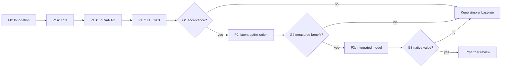

# رودمپ جامع پژوهش و اجرای DEC

این نسخه، برنامه کنترل‌شده پژوهش و اجرا با درجه شواهد E0 است. هیچ مدل DEC، متخصص LoRA آموزش‌دیده، شورای کامل سه‌سطحی، بنچمارک عملی یا معماری عصبی جدیدی در این مرحله اجرا و اثبات‌شده اعلام نمی‌شود.

## 1. وضعیت موجود و دامنه

**واقعیت E0:** پرونده پژوهشی عمومی وجود دارد و ۳۹ اقدام قبلی به ۳۵ بسته کاری نگاشت شده‌اند؛ هنوز بنچمارک اجرایی DEC نداریم.

**دامنه:** یک حوزه شناختی محلی مورد اعتماد، یک پرونده فعال، LLM کوچک قابل تعویض، LoRA، RAG اختصاصی و Cross-RAG مجاز و قابل خاموشی، سه سطح L1/L2/L3 و ارتباط نهفته همراه شواهد. ادغام آتی مشروط است؛ چندکاربره و چندسروری معوق‌اند.

## 2. فازها و مدت‌های برآوردی

| فاز | مدت برآوردی | گیت | وضعیت | نتیجه |
|---|---:|---|---|---|
| P0 | 2-4 هفته | G0 | planned | محیط معتبر، داده آزمون و حاکمیت |
| P1A | 3-5 هفته | G1A | planned | مبنای هسته، ابزار و Router |
| P1B | 4-6 هفته | G1B | planned | LoRA، RAG و مسیر شواهد |
| P1C | 4-6 هفته | G1 | planned | نمونه سه‌سطحی و پذیرش |
| P2 | 6-10 هفته | G2 | conditional | ادغام محلی نهفته و Cache با سنجش |
| P3 | 12-20 هفته | G3 | conditional | مدل درونی آموزش‌پذیر مشروط |
| CONT | پیوسته | G-PUB | ongoing | انتشار علمی دوزبانه پیوسته |
| FUTURE | زمان‌بندی‌نشده | G-FUT | deferred | توسعه معوق |

## 3. مسیر بحرانی و وابستگی‌ها

مسیر بحرانی: داده مرجع دوزبانه دارای حق استفاده و ممیزی واقعی سخت‌افزار ← انتخاب مدل کوچک با آزمون منصفانه ← LoRA واقعی و RAG و قرارداد شواهد ← L1/L2/L3 قابل اجرا ← تصمیم مبتنی بر سنجش با منابع برابر ← بهینه‌سازی نهفته و Cache فقط در صورت منفعت ← پژوهش مشروط معماری درونی یادگرفتنی. عبور از فاز بدون شواهد گیت مجاز نیست.

## 4. ساختار شکست کار و معیارهای پذیرش

### P0 — پایه پژوهش

#### DEC-WP-001 — منشور، حاکمیت و ریسک

**مسئله قابل پیگیری در GitHub:** [DEC-WP-001](https://github.com/khosravimm/dec-research/issues/3)

**دامنه و روش:** تثبیت دامنه DEC، اختیارات تصمیم، الزامات، مدیریت تغییر و ریسک‌ها.

**خروجی قابل تحویل:** منشور، دفتر تصمیم، دفتر ریسک و خط مبنا.

**شاهد پذیرش:** هر الزام دارای شناسه، فاز، مسئول و شاهد پذیرش باشد.

**پیش‌نیاز:** ندارد

**شناسه اقدام قبلی:** ندارد

**نقش مسئول:** project-owner | **نفرروز برآوردی:** 3 نفرروز | **وضعیت:** planned (E0)

#### DEC-WP-002 — ممیزی LDI و بازیابی موجود

**مسئله قابل پیگیری در GitHub:** [DEC-WP-002](https://github.com/khosravimm/dec-research/issues/4)

**دامنه و روش:** بررسی فقط‌خواندنی API، شاخص، حقوق اسناد و نسخه‌های LDI بدون انتشار داده خصوصی.

**خروجی قابل تحویل:** فهرست رابط‌های واقعی و ADR استفاده مجدد یا جایگزینی.

**شاهد پذیرش:** رفتار بازیابی با اسناد مجاز آزموده و مجهولات ثبت شوند.

**پیش‌نیاز:** DEC-WP-001

**شناسه اقدام قبلی:** DEC-BK-001

**نقش مسئول:** research-engineering | **نفرروز برآوردی:** 4 نفرروز | **وضعیت:** planned (E0)

#### DEC-WP-003 — صحت‌سنجی سخت‌افزار و مدل‌ها

**مسئله قابل پیگیری در GitHub:** [DEC-WP-003](https://github.com/khosravimm/dec-research/issues/5)

**دامنه و روش:** ثبت تازه CPU، GPU، RAM، دیسک، نسخه مدل‌ها و Runtimeهای محیط آزمایش.

**خروجی قابل تحویل:** موجودی خصوصی دارای هش و خلاصه عمومی ایمن.

**شاهد پذیرش:** حداقل یک میزبان و دو مدل از نظر ظرفیت و نسخه تأیید شوند.

**پیش‌نیاز:** DEC-WP-001

**شناسه اقدام قبلی:** DEC-BK-002, DEC-BK-032

**نقش مسئول:** research-engineering | **نفرروز برآوردی:** 3 نفرروز | **وضعیت:** planned (E0)

#### DEC-WP-004 — مجموعه مرجع آزمون دوزبانه

**مسئله قابل پیگیری در GitHub:** [DEC-WP-004](https://github.com/khosravimm/dec-research/issues/6)

**دامنه و روش:** تهیه موارد فارسی، انگلیسی و ترکیبی در شبکه، امنیت، نرم‌افزار، مدیریت، تعارض و امتناع.

**خروجی قابل تحویل:** داده، پاسخ مرجع و Rubric نسخه‌دار با مجموعه نهایی مستقل.

**شاهد پذیرش:** هدف مقدماتی حداقل ۱۶۰ مورد با ۴۰٪ فارسی و ۳۰٪ انگلیسی، پس از تأیید داور.

**پیش‌نیاز:** DEC-WP-001

**شناسه اقدام قبلی:** DEC-BK-003

**نقش مسئول:** evaluation | **نفرروز برآوردی:** 9 نفرروز | **وضعیت:** planned (E0)

#### DEC-WP-005 — ابزار آزمون و بازتولید

**مسئله قابل پیگیری در GitHub:** [DEC-WP-005](https://github.com/khosravimm/dec-research/issues/7)

**دامنه و روش:** تثبیت محیط و وابستگی، ثبت هش، زمان، حافظه، کیفیت و شکست؛ بررسی MLflow در صورت نیاز.

**خروجی قابل تحویل:** ابزار اجرای آزمون محلی و Trace استاندارد.

**شاهد پذیرش:** پیکربندی ثابت خروجی قابل تکرار دهد؛ مقدار نامعلوم Null باشد.

**پیش‌نیاز:** DEC-WP-003, DEC-WP-004

**شناسه اقدام قبلی:** DEC-BK-012

**نقش مسئول:** evaluation | **نفرروز برآوردی:** 6 نفرروز | **وضعیت:** planned (E0)

#### DEC-WP-006 — مرور پیشینه، مجوز و حقوق

**مسئله قابل پیگیری در GitHub:** [DEC-WP-006](https://github.com/khosravimm/dec-research/issues/8)

**دامنه و روش:** ماتریس مقاله و محصول با نسخه و مجوز دقیق؛ بررسی حق انتشار و اختراع احتمالی.

**خروجی قابل تحویل:** ماتریس قابل ردیابی منابع و گیت حقوقی افشا.

**شاهد پذیرش:** برای هر نامزد، منبع، نسخه، مجوز، ریسک و سطح انتشار مشخص باشد.

**پیش‌نیاز:** DEC-WP-001

**شناسه اقدام قبلی:** ندارد

**نقش مسئول:** research-governance | **نفرروز برآوردی:** 5 نفرروز | **وضعیت:** planned (E0)

### P1A — انتخاب هسته و ابزار

#### DEC-WP-007 — مقایسه هسته‌های مدل کوچک

**مسئله قابل پیگیری در GitHub:** [DEC-WP-007](https://github.com/khosravimm/dec-research/issues/1)

**دامنه و روش:** مقایسه MiniCPM5، Qwen3.5، Granite و LFM3 با داده و سخت‌افزار یکسان.

**خروجی قابل تحویل:** ماتریس پارتوی کیفیت/هزینه و ADR انتخاب موقت.

**شاهد پذیرش:** کیفیت فارسی، تأخیر، حافظه و هش مدل ثبت و نتیجه محدود به آزمون باشد.

**پیش‌نیاز:** DEC-WP-003, DEC-WP-004, DEC-WP-005, DEC-WP-006

**شناسه اقدام قبلی:** DEC-BK-004, DEC-BK-026, DEC-BK-033

**نقش مسئول:** research-engineering | **نفرروز برآوردی:** 10 نفرروز | **وضعیت:** planned (E0)

#### DEC-WP-008 — فراخوانی ابزار و کنترل Thinking

**مسئله قابل پیگیری در GitHub:** [DEC-WP-008](https://github.com/khosravimm/dec-research/issues/9)

**دامنه و روش:** بررسی Chat Template، Parser، مرز فراخوانی، لغو و حالت‌های تفکر مدل‌ها.

**خروجی قابل تحویل:** رابط ساختاریافته ابزار و آزمون بازپخش.

**شاهد پذیرش:** صحت ابزار و رد ایمن اندازه‌گیری شود؛ کنترل استدلال خصوصی ادعا نشود.

**پیش‌نیاز:** DEC-WP-007

**شناسه اقدام قبلی:** DEC-BK-006, DEC-BK-027

**نقش مسئول:** research-engineering | **نفرروز برآوردی:** 5 نفرروز | **وضعیت:** planned (E0)

#### DEC-WP-009 — Router تطبیقی و سیاست توقف

**مسئله قابل پیگیری در GitHub:** [DEC-WP-009](https://github.com/khosravimm/dec-research/issues/10)

**دامنه و روش:** مقایسه Router قطعی با مدل کوچک برای انتخاب L1، L2 و L3 بر اساس هزینه و ریسک.

**خروجی قابل تحویل:** مشخصات Router، ماتریس خطا و محدودیت حلقه.

**شاهد پذیرش:** خطای تشدید، امتناع و مصرف منابع ثبت و حلقه نامحدود قطع شود.

**پیش‌نیاز:** DEC-WP-004, DEC-WP-005, DEC-WP-007

**شناسه اقدام قبلی:** DEC-BK-007, DEC-BK-029, DEC-BK-034

**نقش مسئول:** research-engineering | **نفرروز برآوردی:** 7 نفرروز | **وضعیت:** planned (E0)

### P1B — تخصص و بازیابی دانش

#### DEC-WP-010 — RAG تخصصی و Cross-RAG

**مسئله قابل پیگیری در GitHub:** [DEC-WP-010](https://github.com/khosravimm/dec-research/issues/11)

**دامنه و روش:** استفاده از LDI تأییدشده یا مقایسه pgvector، Qdrant و LightRAG؛ ثبت منشأ سند.

**خروجی قابل تحویل:** رابط بازیابی و گزارش کیفیت و ADR.

**شاهد پذیرش:** استناد به نسخه سند متصل و Cross-RAG قابل خاموش‌کردن باشد.

**پیش‌نیاز:** DEC-WP-002, DEC-WP-004, DEC-WP-005

**شناسه اقدام قبلی:** DEC-BK-009, DEC-BK-011

**نقش مسئول:** research-engineering | **نفرروز برآوردی:** 8 نفرروز | **وضعیت:** planned (E0)

#### DEC-WP-011 — آموزش LoRAهای تخصصی واقعی

**مسئله قابل پیگیری در GitHub:** [DEC-WP-011](https://github.com/khosravimm/dec-research/issues/12)

**دامنه و روش:** مقایسه Prompt و RAG با دست‌کم دو LoRA آموزش‌دیده روی نسخه ثابت مدل؛ آزمون GGUF.

**خروجی قابل تحویل:** وزن و هش Adapter در فضای مجاز، کارت آموزش و گزارش کیفیت.

**شاهد پذیرش:** بهبود یا شکست روی داده نهایی ثبت و سازگاری و حافظه اندازه‌گیری شود.

**پیش‌نیاز:** DEC-WP-007, DEC-WP-010

**شناسه اقدام قبلی:** DEC-BK-005, DEC-BK-028

**نقش مسئول:** research-engineering | **نفرروز برآوردی:** 10 نفرروز | **وضعیت:** planned (E0)

#### DEC-WP-012 — پروتکل همکاری و دفتر شواهد

**مسئله قابل پیگیری در GitHub:** [DEC-WP-012](https://github.com/khosravimm/dec-research/issues/13)

**دامنه و روش:** پیاده‌سازی PROPOSE، CHALLENGE، REVISE، VERIFY، DISSENT، ABSTAIN و رویدادهای تخصصی.

**خروجی قابل تحویل:** ماشین حالت و قرارداد رویداد با بازپخش قطعی.

**شاهد پذیرش:** گذارها قابل ردیابی و رویداد معیوب و حلقه مهار شوند.

**پیش‌نیاز:** DEC-WP-005

**شناسه اقدام قبلی:** DEC-BK-008

**نقش مسئول:** research-engineering | **نفرروز برآوردی:** 7 نفرروز | **وضعیت:** planned (E0)

#### DEC-WP-013 — صحت KV و مرز آزمایشگاه

**مسئله قابل پیگیری در GitHub:** [DEC-WP-013](https://github.com/khosravimm/dec-research/issues/14)

**دامنه و روش:** کنترل چرخه پرونده، اعتبار Cache در تغییر LoRA، نسخه مدل و خروجی بیرونی.

**خروجی قابل تحویل:** تست منفی Cache و Trace پالایش‌شده.

**شاهد پذیرش:** Cache پرونده دیگر دوباره استفاده نشود و عملیات ممنوع رد شود.

**پیش‌نیاز:** DEC-WP-008, DEC-WP-012

**شناسه اقدام قبلی:** DEC-BK-013, DEC-BK-014

**نقش مسئول:** research-engineering | **نفرروز برآوردی:** 6 نفرروز | **وضعیت:** planned (E0)

#### DEC-WP-014 — مقایسه کنترلرهای شورا

**مسئله قابل پیگیری در GitHub:** [DEC-WP-014](https://github.com/khosravimm/dec-research/issues/15)

**دامنه و روش:** مقایسه ماشین حالت سبک با LangGraph، Microsoft Agent Framework و CrewAI.

**خروجی قابل تحویل:** ADR انتخاب کنترلر و سنجش CPU، تأخیر و بازیابی.

**شاهد پذیرش:** انتخاب بر اساس هزینه و صحت واقعی، نه شهرت ابزار باشد.

**پیش‌نیاز:** DEC-WP-012, DEC-WP-005

**شناسه اقدام قبلی:** DEC-BK-039

**نقش مسئول:** research-engineering | **نفرروز برآوردی:** 4 نفرروز | **وضعیت:** planned (E0)

### P1C — نمونه شناختی سه‌سطحی

#### DEC-WP-015 — سطح یک: پاسخ مستقیم متخصص

**مسئله قابل پیگیری در GitHub:** [DEC-WP-015](https://github.com/khosravimm/dec-research/issues/16)

**دامنه و روش:** پاسخ مستقیم یک متخصص همراه شواهد، عدم‌قطعیت و امتناع با سربار کم.

**خروجی قابل تحویل:** مسیر اجرایی L1 و تست ردیابی پاسخ.

**شاهد پذیرش:** تست پایه پاس شود و شورای غیرضروری فعال نشود.

**پیش‌نیاز:** DEC-WP-007, DEC-WP-010, DEC-WP-012

**شناسه اقدام قبلی:** ندارد

**نقش مسئول:** research-engineering | **نفرروز برآوردی:** 4 نفرروز | **وضعیت:** planned (E0)

#### DEC-WP-016 — سطح دو: استدلال تعاملی

**مسئله قابل پیگیری در GitHub:** [DEC-WP-016](https://github.com/khosravimm/dec-research/issues/17)

**دامنه و روش:** حلقه محدود ابزار، بازیابی، تأیید و اصلاح یک متخصص همراه امکان لغو.

**خروجی قابل تحویل:** مسیر L2 و سناریوهای چندمرحله‌ای.

**شاهد پذیرش:** ادامه استدلال، کران زمان و تکرار و Trace درست باشد.

**پیش‌نیاز:** DEC-WP-008, DEC-WP-009, DEC-WP-013, DEC-WP-015

**شناسه اقدام قبلی:** ندارد

**نقش مسئول:** research-engineering | **نفرروز برآوردی:** 6 نفرروز | **وضعیت:** planned (E0)

#### DEC-WP-017 — سطح سه: شورای پویای متخصصان

**مسئله قابل پیگیری در GitHub:** [DEC-WP-017](https://github.com/khosravimm/dec-research/issues/18)

**دامنه و روش:** فعال‌سازی انتخابی متخصص، نقد مستقل، حفظ اختلاف و حافظه مشترک محدود.

**خروجی قابل تحویل:** مسیر L3 و سناریوهای تعارض میان‌رشته‌ای.

**شاهد پذیرش:** اثر واقعی شورا ثبت و اجماع اجباری و حلقه نامحدود حذف شود.

**پیش‌نیاز:** DEC-WP-011, DEC-WP-013, DEC-WP-014, DEC-WP-016

**شناسه اقدام قبلی:** ندارد

**نقش مسئول:** research-engineering | **نفرروز برآوردی:** 8 نفرروز | **وضعیت:** planned (E0)

#### DEC-WP-018 — Ablation منصفانه سه سطح

**مسئله قابل پیگیری در GitHub:** [DEC-WP-018](https://github.com/khosravimm/dec-research/issues/19)

**دامنه و روش:** مقایسه Prompt، RAG، LoRA، تفکر عمیق، شورای ثابت و پویا در بودجه برابر.

**خروجی قابل تحویل:** گزارش Trace و نتیجه آزمون فرضیه‌ها.

**شاهد پذیرش:** صحت، شواهد، امتناع، p95 و حافظه همراه عدم‌قطعیت گزارش شود.

**پیش‌نیاز:** DEC-WP-015, DEC-WP-016, DEC-WP-017, DEC-WP-005

**شناسه اقدام قبلی:** DEC-BK-010

**نقش مسئول:** evaluation | **نفرروز برآوردی:** 9 نفرروز | **وضعیت:** planned (E0)

#### DEC-WP-019 — گیت پذیرش و بازتولید P1

**مسئله قابل پیگیری در GitHub:** [DEC-WP-019](https://github.com/khosravimm/dec-research/issues/20)

**دامنه و روش:** داوری مستقل شواهد، نشت داده، هزینه محاسبات و توجیه ورود به P2.

**خروجی قابل تحویل:** تصمیم ادامه، اصلاح یا توقف با ریسک باقیمانده.

**شاهد پذیرش:** P2 فقط پس از تصمیم مستند مبتنی بر کیفیت و منابع آغاز شود.

**پیش‌نیاز:** DEC-WP-018

**شناسه اقدام قبلی:** ندارد

**نقش مسئول:** project-owner | **نفرروز برآوردی:** 4 نفرروز | **وضعیت:** planned (E0)

### P2 — یکپارچه‌سازی نهفته

#### DEC-WP-020 — انتقال نهفته بین متخصصان

**مسئله قابل پیگیری در GitHub:** [DEC-WP-020](https://github.com/khosravimm/dec-research/issues/2)

**دامنه و روش:** ممیزی کد LatentMAS-SLoRA و مقایسه پیام کوتاه با Hidden State روی مدل مشترک.

**خروجی قابل تحویل:** گزارش بازتولیدپذیر کیفیت، زمان، حافظه و سازگاری.

**شاهد پذیرش:** نسخه و Shape مدل/Adapter سازگار باشد و منفعت نهایی سنجیده شود.

**پیش‌نیاز:** DEC-WP-019

**شناسه اقدام قبلی:** DEC-BK-015, DEC-BK-030, DEC-BK-035

**نقش مسئول:** research-engineering | **نفرروز برآوردی:** 10 نفرروز | **وضعیت:** planned (E0)

#### DEC-WP-021 — فشرده‌سازی حافظه نهفته

**مسئله قابل پیگیری در GitHub:** [DEC-WP-021](https://github.com/khosravimm/dec-research/issues/21)

**دامنه و روش:** مقایسه حالت کامل، Slot محدود، LatCom/CondenseFlow و پیام کوتاه.

**خروجی قابل تحویل:** Ablation کیفیت و حافظه در بار آزمون.

**شاهد پذیرش:** افت کیفیت یا هزینه بیش از منفعت موجب رد روش شود.

**پیش‌نیاز:** DEC-WP-020

**شناسه اقدام قبلی:** DEC-BK-016

**نقش مسئول:** research-engineering | **نفرروز برآوردی:** 8 نفرروز | **وضعیت:** planned (E0)

#### DEC-WP-022 — KV اشتراکی و Cache وابسته به LoRA

**مسئله قابل پیگیری در GitHub:** [DEC-WP-022](https://github.com/khosravimm/dec-research/issues/22)

**دامنه و روش:** آزمون LRAgent، RelayCaching و LMCache نسبت به Cache داخلی با تعویض Adapter.

**خروجی قابل تحویل:** قرارداد Cache و گزارش صحت و منابع.

**شاهد پذیرش:** بازاستفاده ناسازگار در آزمون صفر و منفعت از سربار بیشتر باشد.

**پیش‌نیاز:** DEC-WP-019

**شناسه اقدام قبلی:** DEC-BK-017, DEC-BK-037

**نقش مسئول:** research-engineering | **نفرروز برآوردی:** 7 نفرروز | **وضعیت:** planned (E0)

#### DEC-WP-023 — Routing یادگرفتنی در برابر قطعی

**مسئله قابل پیگیری در GitHub:** [DEC-WP-023](https://github.com/khosravimm/dec-research/issues/23)

**دامنه و روش:** مقایسه Arrow، Router سطح وظیفه و MoLE سطح لایه یا توکن.

**خروجی قابل تحویل:** کارت Router و Ablation کیفیت/هزینه.

**شاهد پذیرش:** ارزش افزوده و سازگاری ثابت شود؛ پیچیدگی کافی نیست.

**پیش‌نیاز:** DEC-WP-019

**شناسه اقدام قبلی:** DEC-BK-018

**نقش مسئول:** research-engineering | **نفرروز برآوردی:** 7 نفرروز | **وضعیت:** planned (E0)

#### DEC-WP-024 — C2C محلی و بلوک‌های شناختی

**مسئله قابل پیگیری در GitHub:** [DEC-WP-024](https://github.com/khosravimm/dec-research/issues/24)

**دامنه و روش:** آزمون Projector جفت مدل در یک میزبان و Review/Vote/Plan در برابر رویداد متنی.

**خروجی قابل تحویل:** گزارش پیشینه و بازتولید همراه دلایل رد/قبول.

**شاهد پذیرش:** نسخه جفت مدل مشخص و اجرای واقعی یا عدم اجرا روشن باشد.

**پیش‌نیاز:** DEC-WP-020

**شناسه اقدام قبلی:** DEC-BK-019, DEC-BK-021, DEC-BK-038

**نقش مسئول:** research-engineering | **نفرروز برآوردی:** 7 نفرروز | **وضعیت:** planned (E0)

#### DEC-WP-025 — معماری بازگشتی و کم‌بیت

**مسئله قابل پیگیری در GitHub:** [DEC-WP-025](https://github.com/khosravimm/dec-research/issues/25)

**دامنه و روش:** پروفایل RWKV، Mamba، Granite و BitNet نسبت به گلوگاه واقعی DEC.

**خروجی قابل تحویل:** گزارش تناسب معماری و هزینه.

**شاهد پذیرش:** کیفیت، سازگاری و منابع آزموده یا صریحاً نامعلوم ثبت شود.

**پیش‌نیاز:** DEC-WP-019

**شناسه اقدام قبلی:** DEC-BK-020, DEC-BK-036

**نقش مسئول:** research-engineering | **نفرروز برآوردی:** 6 نفرروز | **وضعیت:** planned (E0)

#### DEC-WP-026 — بهینه‌سازی Runtime مبتنی بر گلوگاه

**مسئله قابل پیگیری در GitHub:** [DEC-WP-026](https://github.com/khosravimm/dec-research/issues/26)

**دامنه و روش:** Kernel، Buffer، Batching و Runtime جایگزین فقط در صورت نیاز اندازه‌گیری‌شده.

**خروجی قابل تحویل:** پروفایل و ADR مهاجرت با Rollback.

**شاهد پذیرش:** بهبود تکرارپذیر، بدون پسرفت و با بازگشت آزموده باشد.

**پیش‌نیاز:** DEC-WP-020, DEC-WP-022

**شناسه اقدام قبلی:** ندارد

**نقش مسئول:** research-engineering | **نفرروز برآوردی:** 7 نفرروز | **وضعیت:** planned (E0)

#### DEC-WP-027 — گیت P2 و تصمیم معماری نو

**مسئله قابل پیگیری در GitHub:** [DEC-WP-027](https://github.com/khosravimm/dec-research/issues/27)

**دامنه و روش:** ارزیابی سود ادغام نهفته در برابر قوی‌ترین خط مبنای ماژولار.

**خروجی قابل تحویل:** گزارش تصمیم ادامه یا توقف و ریسک‌ها.

**شاهد پذیرش:** داوری مستقل با عدم‌قطعیت و کنترل حقوق پیش از P3.

**پیش‌نیاز:** DEC-WP-021, DEC-WP-022, DEC-WP-023, DEC-WP-024, DEC-WP-025, DEC-WP-026

**شناسه اقدام قبلی:** ندارد

**نقش مسئول:** project-owner | **نفرروز برآوردی:** 5 نفرروز | **وضعیت:** planned (E0)

### P3 — معماری مدل یکپارچه

#### DEC-WP-028 — تقطیر شورا به مدل دانش‌آموز

**مسئله قابل پیگیری در GitHub:** [DEC-WP-028](https://github.com/khosravimm/dec-research/issues/28)

**دامنه و روش:** مطالعه OPD و AgentArk با آزمون معلم/دانش‌آموز و حفظ نقد و امتناع.

**خروجی قابل تحویل:** داده Trace مجاز، مدل دانش‌آموز و آزمون نهایی.

**شاهد پذیرش:** کیفیت و اختلاف نظر حفظ یا شکست ثبت شود؛ بودجه برابر مقایسه گردد.

**پیش‌نیاز:** DEC-WP-027, DEC-WP-006

**شناسه اقدام قبلی:** DEC-BK-022, DEC-BK-031

**نقش مسئول:** research-engineering | **نفرروز برآوردی:** 12 نفرروز | **وضعیت:** planned (E0)

#### DEC-WP-029 — مدل شناختی درونی یادگرفتنی

**مسئله قابل پیگیری در GitHub:** [DEC-WP-029](https://github.com/khosravimm/dec-research/issues/29)

**دامنه و روش:** آزمون Routing آموزش‌پذیر، حافظه محدود و سیگنال کنترل در قیاس با مبنای ماژولار.

**خروجی قابل تحویل:** نمونه مدل یکپارچه یا نتیجه منفی قابل بازتولید.

**شاهد پذیرش:** مکانیزم متمایز با Ablation، کیفیت، هزینه و پایداری ارزیابی شود.

**پیش‌نیاز:** DEC-WP-028

**شناسه اقدام قبلی:** DEC-BK-023

**نقش مسئول:** research-engineering | **نفرروز برآوردی:** 16 نفرروز | **وضعیت:** planned (E0)

#### DEC-WP-030 — نوآوری و حقوق مالکیت فکری

**مسئله قابل پیگیری در GitHub:** [DEC-WP-030](https://github.com/khosravimm/dec-research/issues/30)

**دامنه و روش:** ثبت پیشینه، سهم پدیدآوران، سابقه خصوصی اختراع و زنجیره حقوق.

**خروجی قابل تحویل:** پرونده خصوصی مالکیت و خلاصه عمومی پالایش‌شده.

**شاهد پذیرش:** بدون بررسی حقوق اشخاص و قراردادها ادعای ثبت و انحصار مطرح نشود.

**پیش‌نیاز:** DEC-WP-006, DEC-WP-029

**شناسه اقدام قبلی:** ندارد

**نقش مسئول:** project-owner | **نفرروز برآوردی:** 6 نفرروز | **وضعیت:** planned (E0)

#### DEC-WP-031 — نسخه پژوهشی و تصمیم تجاری‌سازی

**مسئله قابل پیگیری در GitHub:** [DEC-WP-031](https://github.com/khosravimm/dec-research/issues/31)

**دامنه و روش:** بررسی بازتولید، کارت مدل، منابع، حقوق و گزینه همکاری یا واگذاری فناوری.

**خروجی قابل تحویل:** نسخه پژوهشی یا پیشنهاد توقف و نمایشی دارای حق انتشار.

**شاهد پذیرش:** گیت علمی و حقوقی پاس شود و تجاری‌سازی مجوز مستقل بگیرد.

**پیش‌نیاز:** DEC-WP-029, DEC-WP-030

**شناسه اقدام قبلی:** ندارد

**نقش مسئول:** project-owner | **نفرروز برآوردی:** 7 نفرروز | **وضعیت:** planned (E0)

### CONT — حاکمیت و انتشار پیوسته

#### DEC-WP-034 — انتشار علمی و تغییرات دوزبانه

**مسئله قابل پیگیری در GitHub:** [DEC-WP-034](https://github.com/khosravimm/dec-research/issues/34)

**دامنه و روش:** هماهنگی اسناد فارسی و انگلیسی، Issue، Release، شواهد پالایش‌شده و نتایج منفی.

**خروجی قابل تحویل:** گزارش دوره‌ای، Changelog و نتیجه قابل انتشار.

**شاهد پذیرش:** هر انتشار دارای دو زبان، CI، منبع و گیت حقوقی باشد.

**پیش‌نیاز:** DEC-WP-001, DEC-WP-006

**شناسه اقدام قبلی:** ندارد

**نقش مسئول:** research-governance | **نفرروز برآوردی:** 3 نفرروز | **وضعیت:** planned (E0)

#### DEC-WP-035 — همکاری و ارزیابی تجاری

**مسئله قابل پیگیری در GitHub:** [DEC-WP-035](https://github.com/khosravimm/dec-research/issues/35)

**دامنه و روش:** کانال عمومی غیرمحرمانه و مذاکره خصوصی برای قرارداد و حقوق مشارکت ایجاد شود.

**خروجی قابل تحویل:** راهنمای همکاری و پیگیری درخواست‌ها بدون وعده منفعت.

**شاهد پذیرش:** بدون توافق حقوقی، کد و داده دیگران ادغام یا افشا نشود.

**پیش‌نیاز:** DEC-WP-034

**شناسه اقدام قبلی:** ندارد

**نقش مسئول:** project-owner | **نفرروز برآوردی:** 3 نفرروز | **وضعیت:** planned (E0)

### FUTURE — آینده معوق

#### DEC-WP-032 — چندکاربره و چندوظیفه‌ای آینده

**مسئله قابل پیگیری در GitHub:** [DEC-WP-032](https://github.com/khosravimm/dec-research/issues/32)

**دامنه و روش:** پس از موفقیت مدل و مجوز مالک، جداسازی نشست، صف، سهمیه و هم‌زمانی بررسی شود.

**خروجی قابل تحویل:** منشور مستقل و مدل تهدید و بار آینده.

**شاهد پذیرش:** اکنون اجرا نشود؛ تصمیم مستقل پس از P3 لازم است.

**پیش‌نیاز:** DEC-WP-031

**شناسه اقدام قبلی:** DEC-BK-024

**نقش مسئول:** research-engineering | **نفرروز برآوردی:** 0 نفرروز | **وضعیت:** planned (E0)

#### DEC-WP-033 — C2C توزیع‌شده آینده

**مسئله قابل پیگیری در GitHub:** [DEC-WP-033](https://github.com/khosravimm/dec-research/issues/33)

**دامنه و روش:** چندسروری فقط پس از منفعت C2C محلی و تأیید توپولوژی پژوهش شود.

**خروجی قابل تحویل:** طرح معماری و آزمون مستقل انتقال و امنیت.

**شاهد پذیرش:** مجوز مالک و شواهد اجرای محلی شرط آغاز باشد.

**پیش‌نیاز:** DEC-WP-031

**شناسه اقدام قبلی:** DEC-BK-025

**نقش مسئول:** research-engineering | **نفرروز برآوردی:** 0 نفرروز | **وضعیت:** planned (E0)

## 5. برآورد منابع و مفروضات

مدت فازها و نفرروز بسته‌ها فرض اولیه با ظرفیت یک پژوهشگر تمام‌وقت متمرکز به همراه داوری فنی و حقوقی مقطعی است؛ نه بودجه مصوب یا موعد تعهدآور. P2 یا P3 ممکن است رد شوند. پس از P0 باید متناسب با ظرفیت واقعی و گلوگاه‌ها بازبرنامه‌ریزی کرد.

- برآورد مدت و نفرروز، تعهد اجرایی نیست. فرض یک پژوهشگر تمام‌وقت با داوری فنی و حقوقی مقطعی است؛ سخت‌افزار، شبکه، داده و آموزش می‌تواند مسیر بحرانی را تغییر دهد.
- آستانه کمی موفقیت هنوز تصویب نشده و باید پیش از مشاهده نتیجه در P0 شامل اثر ارزشمند، نمونه، روش آماری، بودجه منابع و افت غیرقابل قبول تثبیت شود.
- مکانیزم احتمالی قابل ثبت، کد و وزن منتشرنشده، اسناد خصوصی LDI و نتایج محرمانه تا بررسی حقوقی از مخزن عمومی جدا می‌مانند.

**برآورد اولیه:** 216 نفرروز (P0-P3 if all gates pass); P0-P1C: 118 نفرروز. No funded commitment.

## 6. سنجش و اعتبار آماری

طرح پیشنهادی پیش‌ثبت آزمون (هنوز تصویب نشده): حداقل ۱۶۰ پرونده قابل داوری مستقل فارسی و انگلیسی، با دست‌کم ۴۰٪ فارسی و ۳۰٪ انگلیسی و موارد دوزبانه، منفی و امتناع. مقایسه صحت و وفاداری به شواهد با کل منابع برابر. ثبت تأخیر نهایی p50/p95، TTFT سرد و گرم، بیشینه RAM/VRAM شامل LoRA و KV، توکن، حجم Tensor، خطا و امتناع. در P0 حداقل بهبود ارزشمند و حد مجاز افت پیش‌ثبت شود. آزمون جفتی و برآورد عدم‌قطعیت (از جمله بازه ۹۵٪ Bootstrap جفتی در صورت تناسب) و دست‌کم سه تکرار کنترل‌شده زمان اجرا شود. مقدار ناموجود، مجهول است نه صفر.

## 7. دروازه‌های تصمیم و شواهد

### G0 / P0

**شاهد پذیرش:** داده مرجع دارای حق انتشار، موجودی منابع، پروتکل تصویب‌شده و ابزار سنجش آماده باشد.

**نقش مسئول:** project-owner + independent technical reviewer

**بازگشت یا توقف:** revise P0; no model tuning before benchmark freeze

### G1A / P1A

**شاهد پذیرش:** مدل‌های پایه با داده و سخت‌افزار برابر سنجیده و سازگاری ابزار و Adapter مشخص شود.

**نقش مسئول:** project-owner + evaluation reviewer

**بازگشت یا توقف:** keep 2 candidates, obtain improved benchmark or smaller core

### G1B / P1B

**شاهد پذیرش:** RAG تخصصی، Cross-RAG قابل خاموشی، LoRA واقعی یا شکست مستند و Cache سازگار ارائه شود.

**نقش مسئول:** technical lead + evaluation reviewer

**بازگشت یا توقف:** retain prompt+RAG baseline if adapters fail

### G1 / P1C

**شاهد پذیرش:** سه سطح قابل اجرا و آزمون منصفانه کیفیت/منابع با داوری مستقل انجام شود.

**نقش مسئول:** project-owner

**بازگشت یا توقف:** retain best simpler level; revise hypotheses or stop branch

### G2 / P2

**شاهد پذیرش:** حداقل یک مسیر ادغام نهفته نسبت به مبنای ساختاریافته بهبود تکرارپذیر نشان دهد.

**نقش مسئول:** project-owner + independent technical reviewer

**بازگشت یا توقف:** stay with modular proven runtime; publish scoped negative findings

### G3 / P3

**شاهد پذیرش:** معماری یادگرفتنی با Ablation و بررسی مستقل نوآوری، حقوق و مجوزها سنجیده شود.

**نقش مسئول:** project-owner + technical/IP specialist

**بازگشت یا توقف:** publish modular science only or continue scoped research privately

### G-PUB / CONT

**شاهد پذیرش:** انتشار عمومی با دو زبان، منشأ، رده شواهد، مجوز، CI و سابقه تغییر انجام شود.

**نقش مسئول:** project maintainer

**بازگشت یا توقف:** withhold disclosure or publish redacted status

### G-FUT / FUTURE

**شاهد پذیرش:** چندکاربره و چندسروری نیازمند محدوده و مجوز مستقل و ارزیابی ریسک است.

**نقش مسئول:** project-owner

**بازگشت یا توقف:** defer

## 8. دفتر ریسک

| ID | ریسک | شدت | کنترل |
|---|---|---|---|
| R01 | نشت داده آزمون یا پاسخ مرجع جانبدار | high | تقسیم مستقل داده، هش مجموعه، داور دوم و توقف ادعای فاقد اعتبار. |
| R02 | ضعف مدل پایه در زبان فارسی | high | خط مبنای فارسی، امتناع، RAG و مقایسه مدل دیگر؛ عدم جعل بهبود. |
| R03 | گلوگاه حافظه GPU و پردازنده CPU | high | ممیزی ظرفیت واقعی، Context محدود، QLoRA و پروفایل. |
| R04 | ناسازگاری LoRA، KV Cache و وضعیت نهفته | high | ثبت نسخه و قرارداد سازگاری، آزمون منفی و بازگشت به پیام ساختاریافته. |
| R05 | نبود ارزش افزوده شورای متخصصان | high | مقایسه با متخصص واحد با هزینه برابر و حذف فعال‌سازی بی‌دلیل شورا. |
| R06 | سربار بیش از حد Tensor نهفته | high | سنجش زمان و حافظه کل، محدودیت Slot و رد مسیر کم‌فایده. |
| R07 | تعارض مجوز یا زنجیره مالکیت فکری | critical | بررسی هر Artifact و نگهداری اسناد حقوق خصوصی پیش از افشا. |
| R08 | افشای زودهنگام مکانیزم قابل ثبت | critical | کنترل حقوقی پیش از انتشار و عدم درج جزئیات نو در Issue عمومی. |
| R09 | گسترش نامجاز محدوده و نشت داده داخلی | high | تفکیک مخزن خصوصی، انتشار پالایش‌شده و مدیریت تغییر. |
| R10 | نتیجه غیرقابل تکرار یا متکی به سازنده | high | نسخه و داده ثابت، سنجه خام، داوری مستقل و ثبت شکست. |
| R11 | پیچیدگی زودهنگام چندکاربره و چندسروری | medium | تعویق تا تأیید مستقل پس از آزمایش موفق. |
| R12 | ادعای تجاری زودهنگام | high | تفکیک پژوهش، حقوق، پایلوت و محصول؛ پرهیز از ارزش‌گذاری ساختگی. |

## 9. حاکمیت پژوهش، انتشار، حقوق و تغییر

انتشار عمومی باید فارسی و انگلیسی، دارای منبع، رده شواهد E0 تا E3 و نتایج منفی معتبر باشد. سازوکار احتمالی ابداعی، اختراع ثبت‌نشده، اسناد خصوصی LDI، زیرساخت حساس، داده فاقد مجوز و جزئیات نیازمند تصویب در مخزن خصوصی بمانند. Commit گیت‌هاب سند قطعی مالکیت یا حق اختراع نیست. هر انتشار گیت حقوقی مستقل دارد و ارزش تجاری یا مجوز متن‌باز نباید بدون مبنا ادعا شود.

روزانه: تکمیل کار یا آزمون مشخص با Trace پیش از تغییر زمینه. هفتگی: گزارش مانع، شواهد، کارایی و وضعیت بسته‌ها. هر دو هفته: مرور گیت‌ها و منابع توسط مالک. ماهانه: انتشار دوزبانه پس از کنترل منبع و حق افشا. تغییر وضعیت فقط بر اساس نتیجه یا تصمیم پیوندخورده است، نه درصد ظاهری.

## 10. ترتیب اقدام‌های فوری

کار را از P0 آغاز می‌کنیم: حاکمیت، ممیزی فقط‌خواندنی LDI، موجودی واقعی مدل و منابع، داده مرجع، ابزار بازتولید و کنترل منابع و حقوق. خود رودمپ به معنای تکمیل این اقدامات نیست.

- **DEC-WP-001** — منشور، حاکمیت و ریسک: منشور، دفتر تصمیم، دفتر ریسک و خط مبنا.
- **DEC-WP-002** — ممیزی LDI و بازیابی موجود: فهرست رابط‌های واقعی و ADR استفاده مجدد یا جایگزینی.
- **DEC-WP-003** — صحت‌سنجی سخت‌افزار و مدل‌ها: موجودی خصوصی دارای هش و خلاصه عمومی ایمن.
- **DEC-WP-004** — مجموعه مرجع آزمون دوزبانه: داده، پاسخ مرجع و Rubric نسخه‌دار با مجموعه نهایی مستقل.
- **DEC-WP-005** — ابزار آزمون و بازتولید: ابزار اجرای آزمون محلی و Trace استاندارد.
- **DEC-WP-006** — مرور پیشینه، مجوز و حقوق: ماتریس قابل ردیابی منابع و گیت حقوقی افشا.

## 11. منابع هنجاری و فنی

- [ISO/IEC/IEEE 29119-1:2022 — Software testing](https://www.iso.org/standard/81291.html)
- [NIST AI RMF Generative AI Profile](https://www.nist.gov/publications/artificial-intelligence-risk-management-framework-generative-artificial-intelligence)
- [GitHub Milestones](https://docs.github.com/en/issues/using-labels-and-milestones-to-track-work/about-milestones)
- [MLflow evaluation datasets](https://mlflow.org/docs/latest/genai/datasets)

- [Research catalogue / کاتالوگ](../../research/catalogue.json)
- [Experiments / آزمایش‌ها](../../research/experiment-register.json)
- [Machine-readable roadmap / رودمپ ماشین‌خوان](../../research/roadmap.json)

تمام بسته‌ها در وضعیت برنامه‌ریزی‌شده‌اند و موارد آینده مجوز اجرا ندارند. این سند از research/roadmap.json تولید می‌شود و نباید دستی با منبع اصلی متفاوت شود.
