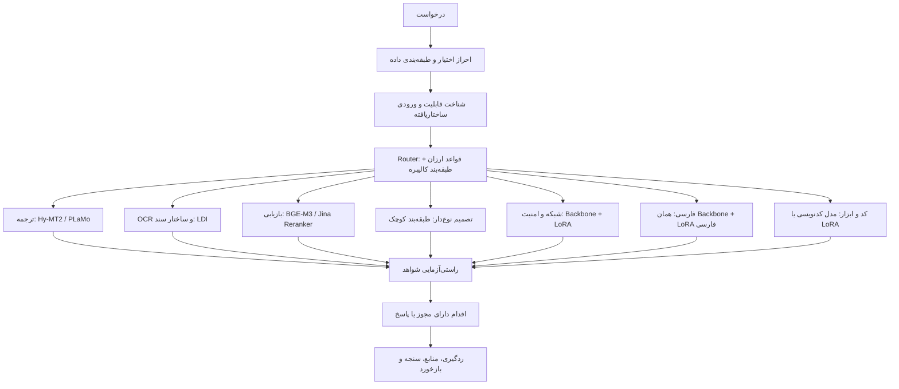

# نتایج پژوهش روش‌های ترکیب چند مدل و چند Adapter در DEC Research
**تاریخ:** ۱۶ نوامبر ۲۰۲۶ | **سطح اعتبار:** E0 برای مرور منابع؛ در این مطالعه آزمایش محلی تازه‌ای برای مقایسهٔ روش‌های ترکیب اجرا نشده است.

> ادعاهای مقاله‌ها و Model Cardها از بنچمارک‌های محلیِ محدود جدا هستند. هیچ معماری یکپارچهٔ اختصاصی DEC اثبات نشده است.

**دامنه:** انتخاب مدل‌های تخصصی، Pipeline مرحله‌ای عامل‌ها، تأیید گروهی، تعویض LoRA، ترکیب وزن‌دار و Merge، Routing یادگرفتنی Adapter، Backendهای سرویس‌دهی، محدودیت CPU، کنترل‌های امنیتی، ارزیابی و ADR. این سند یکی از جریان‌های تحقیق است و دامنهٔ کل پروژه را محدود نمی‌کند؛ کاتالوگ مدل‌ها جدا نگهداری می‌شود.

## یافته‌های کلیدی

## یافته‌های اجرایی و علمی

۱. **Router انتخاب مدل کامل** با **Router انتخاب Adapter روی Backbone مشترک**، انتخاب Expert در سطح توکن، Merge وزن و گردش کار چندمرحله‌ای عامل‌ها متفاوت است و نمی‌توان آن‌ها را جایگزین مفهومی یکدیگر دانست.

۲. **QLoRA** روش آموزش LoRA روی مدل پایهٔ کوانتیزه است، نه نوع مستقل Adapter. مدل‌های دارای معماری یا Tokenizer متفاوت معمولاً نمی‌توانند یک LoRA یکسان را ایمن به اشتراک بگذارند.

۳. در نمونهٔ CPU می‌توان از **llama.cpp server** و Registry فقط‌خواندنی برای دو یا سه LoRA مبتنی بر **همان مدل پایهٔ دقیق** شروع کرد. مقیاس‌دهی وزن‌دار `lora` برای هر درخواست وجود دارد، ولی پیکربندی‌های متفاوت به‌طور عادی در یک Batch یکسان سرور ترکیب نمی‌شوند.

۴. Routing معنایی در سطح مدل باید ابتدا با **نشانه‌های قطعی و طبقه‌بندی ارزان** مقایسه شود؛ تصمیم‌گیر یادگرفتنی هزینه/کیفیت یک آزمایش جداست. اجرای یک مدل ۲میلیاردپارامتری صرفاً برای انتخاب مدل ۲میلیاردپارامتری دیگر در هر درخواست لزوماً مقرون‌به‌صرفه نیست.

۵. Router یک **سطح کنترلی و امنیتی جدید** ایجاد می‌کند. پژوهش Route-to-Rome در ACL 2026 نشان می‌دهد ورودی مهاجم می‌تواند مسیر را به مدل‌های گران‌تر منحرف کند. فهرست مسیر مجاز، سقف منابع، عدم پاسخ خارج از دامنه، تصمیم نسخه‌دار و تفکیک دسترسی لازم است.

## پنج الگوی معماری و امکان اجرا

| الگو | دانه‌بندی انتخاب | مزیت | ریسک | بلوغ اجرای CPU |
|---|---|---|---|---|
| انتخاب مدل بر اساس مأموریت | هر درخواست | امکان معماری، Tokenizer و Modalities متفاوت؛ جداسازی آسان | وزن‌های متعدد، بارگذاری سرد و تأخیر | بالا با Gateway مبتنی بر Ollama/llama.cpp؛ Router نیاز به کالیبراسیون دارد |
| گراف وظیفه و جریان عامل‌ها | هر مرحله یا گام | زنجیرهٔ مستقل OCR ← Parse ← RAG ← Verify با مصنوع نوع‌دار و ممیزی | انتشار خطا و مجموع تأخیر سریالی | بالا از نظر امکان ابزار؛ کیفیت باید اثبات شود |
| Backbone مشترک و تعویض LoRA | هر درخواست | یک مجموعه وزن اصلی و Adapterهای کوچک؛ جداسازی مناسب | سازگاری، هزینهٔ تعویض و افت تخصص | مستند در PEFT و llama.cpp |
| ترکیب LoRA یا Merge | وزن‌دهی در درخواست یا Merge آفلاین | پاسخ چندحوزه‌ای با بارگذاری کمتر مدل کامل | تداخل، تغییر عددی و انحراف معنایی | PEFT/llama.cpp؛ عملکرد وابسته به Backend |
| Routing یادگرفتنی Adapter | هر توکن یا لایه | انتخاب متخصص بدون K مدل کامل | Kernel اختصاصی، آموزش Router و پیچیدگی داوری | پژوهشی؛ سرعت CPU تضمین نشده است |

## منابع اصلی و تفسیر محدود آن‌ها

- **MoLoRA، ICML 2026:** https://proceedings.mlr.press/v306/shah26d.html — Routing یادگرفتنی در سطح توکن. نویسندگان روی چهار آزمون استدلالی، Qwen3-1.7B را بهتر از 8B مقایسه کرده‌اند؛ شاهد موفقیت DEC نیست. تقریب N در برابر K×N مبتنی بر فرض اجرای مجدد مدل‌های کامل است و سربار Router را صفر نمی‌کند.
- **LoRA-Mixer، ICLR 2026:** https://proceedings.iclr.cc/paper_files/paper/2026/hash/18610cbcd1da57854aa05ebdc5cd3168-Abstract-Conference.html — Routing روی Projectionهای توجه، واحدهای LoRA متخصص و زیان تخصصی‌سازی Routing. نویسندگان ۴۸٪ پارامتر آموزشی نسبت به مرجع و بهبودهای 3.79/2.90/3.95 روی وظایف منتخب گزارش کرده‌اند. سازگاری LoRAهای نامرتبط تضمین نمی‌شود.
- **MoA، ACL 2026:** https://aclanthology.org/2026.acl-long.965/ و کد https://github.com/DCDmllm/MoA — در حالت Soft خروجی Adapterهای ناهمگون وزن‌دار و در Sparse زیرمجموعه انتخاب می‌شود. ادعای افت ناچیز نویسندگان باید از نظر کیفیت و تأخیر مستقل آزمایش شود.
- **VIA-SD، ICML 2026:** https://proceedings.mlr.press/v306/xian26a.html — ترتیب Draft Model ← Verifier سبک ← Verifier کامل. بهبود ادعایی ۱۰ تا ۲۰٪ نسبت به خطوط مبنای قوی Speculative Decoding فقط برای تأیید احتمالی سازگار است، نه مناظرهٔ عمومی چندمدلی.
- **Route-to-Rome/R2A، ACL 2026:** https://aclanthology.org/2026.acl-long.2051/ — حملهٔ انحراف Routing برای افزایش هزینه؛ مبنای مدل تهدید Router.
- **X-LoRA:** https://huggingface.co/docs/peft/en/package_reference/xlora — LoRAهای ثابت همراه ضرایب یادگرفتنی در سطح توکن/لایه/توالی؛ **دو Forward از مدل در هر گام تولید** می‌خواهد و برای CPU کم‌تأخیر ممکن است نامناسب باشد.
- **PEFT و تعویض Adapter:** https://huggingface.co/docs/transformers/peft و https://huggingface.co/docs/peft/package_reference/hotswap — Hotswap برای LoRA و لایه‌های هدف یکسان یا زیرمجموعه؛ ترکیب Adapterهای نوع متفاوت محدودیت سازگاری دارد: https://huggingface.co/docs/peft/developer_guides/mixed_models
- **Merge در PEFT:** https://huggingface.co/docs/peft/en/developer_guides/model_merging و https://huggingface.co/docs/peft/main/package_reference/lora — روش‌های `SVD`، `linear`، `cat`، `TIES` و `DARE`. روش `cat` رتبه‌ها را جمع می‌کند و می‌تواند حافظه را افزایش دهد؛ TIES/DARE تداخل را با قیود مدیریت می‌کنند، نه با تضمین بهبود.
- **llama.cpp server:** https://github.com/ggml-org/llama.cpp/blob/master/tools/server/README.md — Endpoint `/lora-adapters` و مقیاس‌های `lora [{id,scale}]` برای هر درخواست. درخواست‌های دارای ترکیب متفاوت در یک Batch معمولی تجمیع نمی‌شوند؛ ویژگی‌های دقیق باید با Commit ثابت بررسی شوند.
- **vLLM Multi-LoRA:** https://docs.vllm.ai/en/latest/features/lora/ و https://docs.vllm.ai/en/stable/cli/serve/ — چند Adapter در Batch و بارگذاری پویا؛ مستندات در زمینهٔ تولید اخطار اعتماد/ایزوله‌سازی دارند. Backend عمدتاً GPUمحور است و تناسب CPU روی `sal-ai` اثبات نشده است.
- **SGLang Multi-LoRA:** https://github.com/sgl-project/sglang/blob/main/docs/docs/advanced_features/lora.mdx — مبتنی بر فناوری GPU مانند S-LoRA/Punica؛ جایگزینی خودکار برای CPU نیست.
- **S-LoRA، MLSys 2024 (پیشینهٔ قدیمی):** https://proceedings.mlsys.org/paper_files/paper/2024/hash/906419cd502575b617cc489a1a696a67-Abstract-Conference.html — صفحه‌بندی یکپارچه و Batch هزاران LoRA روی GPU؛ معیار CPU محسوب نمی‌شود.
- **RouteLLM:** https://github.com/lm-sys/RouteLLM — خط مبنای قدیمیِ انتخاب مدل قوی/ضعیف؛ اعداد صرفه‌جویی عمومی قابل انتقال نیستند. بعضی Routerها به Embedding بیرونی و کلید سرویس نیاز دارند؛ حریم خصوصی باید ارزیابی شود.
- **vLLM Semantic Router:** https://vllm-sr.ai/docs/next/overview/semantic-router-overview/ — جداسازی Gateway، انتخاب مدل معنایی و زمان‌بندی استنتاج، با سیاست‌ها و خانواده‌های مختلف.
- **LiteLLM Router:** https://docs.litellm.ai/docs/routing — Retry، Failover، Cooldown و اولویت؛ به‌خودی‌خود متخصص یادگرفتنی نیست.
- **RouterArena:** https://github.com/RouteWorks/RouterArena — ارزیابی ۹ حوزه و ۴۴ رده با هزینه، تأخیر، مقاومت و دقت؛ بدون توسعهٔ دامنه، بنچمارک امنیت فارسی محسوب نمی‌شود.

## طراحی پیشنهادی معماری DEC — نه ادعای پیاده‌سازی

نام مدل‌های نمونه، **نامزد پژوهشی** است؛ نصب، دانلود، امکان استفادهٔ عملیاتی یا صحت عملکرد آن‌ها روی سرور مفروض نیست.

خروجی Router می‌تواند شامل `model_id`، `adapter_ids`، `adapter_scales`، نسخهٔ Tokenizer/Runtime، نوع وظیفه، ارجاعات شواهد، سقف هزینه، ردهٔ حریم خصوصی و مجوز، ریسک و عدم‌قطعیت باشد. مسیرهای خارج از مجوز مستقل از پیش‌بینی مدل رد می‌شوند.

## ماتریس مقایسهٔ کیفی پیش از بنچمارک

| معیار | مدل‌های مستقل | یک Base و LoRAهای تعویض‌شونده | MoLoRA یادگرفتنی در سطح توکن |
|---|---|---|---|
| معماری و Modalities گوناگون | بله | فقط در صورت پشتیبانی Base | محدود به Base |
| حافظهٔ مقیم CPU | وزن‌های متعدد یا تعویض سرد | یک Base با Adapter کوچک | Base، Adapterها و سربار Router/Kernel |
| به‌روزرسانی مستقل | قوی | قوی در Base مشترک | ممکن است، اما انتقال Router نیاز به آزمون دارد |
| جداسازی شکست متخصص | قوی | اشتراک نسبی Backbone | اشتراک شدید بازنمایی |
| جداسازی سیاست داده و ابزار | هویت سرویس مستقل ممکن | کنترل بیرونی لازم | کنترل بیرونی لازم |
| بلوغ عملیاتی | بالا | متوسط تا بالا، وابسته به Runtime | پژوهشی |
| ردیابی تصمیم | در سطح درخواست نسبتاً آسان | در سطح درخواست آسان | در سطح توکن پیچیده‌تر |
| نقش اولیهٔ پژوهش | متخصص مستقل و چندوجهی | Adapter امنیت و فارسی | مقایسهٔ پژوهشی بعدی |

## برنامهٔ بنچمارک و اعتبارسنجی

**خطوط مبنا:** (A) بهترین مدل عمومی واحد؛ (B) انتخاب مدل با قاعدهٔ قطعی؛ (C) Router طبقه‌بند ارزان با امکان عدم پاسخ؛ (D) Base با یک LoRA؛ (E) Base با دو LoRA وزن‌دار؛ (F) Merge آفلاین با TIES/DARE/SVD؛ (G) MoLoRA یا LoRA-Mixer آموزش‌دیده **پس از** اثبات امکان در مراحل پیشین.

**پیکرهٔ یکسان:** پرسش و پاسخ مستند فارسی/انگلیسی شبکه و امنیت، استدلال دستورها، اعتبار Python، Schema دستور، Prompt مبهم Routing، زنجیرهٔ OCR→RAG→پاسخ، متن ترکیبی، تزریق Prompt و حملهٔ افزایش هزینهٔ مسیر.

**معیارها:** موفقیت مأموریت، پذیرش اشتباه، وفاداری منبع، دقت مسیر کالیبره، عدم پاسخ خارج از دامنه، مصرف توکن، TTFT و p50/p95، Throughput، تعویض سرد/گرم، RSS کل به‌علاوهٔ Adapter و KV، هزینهٔ پاسخ موفق، تخلف دسترسی و کامل‌بودن Trace.

**اعتبار آزمایش:** Seed ثابت و تکرار روی کار واقعی، بودجهٔ برابر، Hash دقیق Base/Adapter، جداسازی اسناد و مجموعهٔ ندیده. هیچ ادعای E2/E3 بدون آزمایش متناظر مجاز نیست.

## پیشنهادهای مشروط مرحله‌ای

- **P0:** قبل از افزودن کد جدید، Repository/ADR و موجودی Ollama بررسی شوند. طبقه‌بندی وظایف، دادهٔ برچسب‌خوردهٔ Router، ماتریس قابلیت و Gate امنیتی ساخته شود؛ Pipeline قاعده‌محور خط مبنا باشد.
- **P1:** یک Runner ایزولهٔ CPU مانند llama.cpp و یک Base دارای سازگاری واقعی LoRA انتخاب شود؛ دو Adapter فارسی و شبکه/امنیت با منشأ دادهٔ مشترک و Backbone ثابت آموزش ببینند. یک Adapter در برابر ترکیب وزن‌دار مقایسه و Rollback به Base-only ممکن باشد.
- **P2:** Mergeهای PEFT، Router یادگرفتنی ارزان و تعویض Adapter در سطح درخواست آزمایش شوند.
- **P3:** فقط در صورت شواهد منفعت کیفیت/تأخیر، MoLoRA یا LoRA-Mixer نمونه‌سازی و با جریان سادهٔ دو مدل مستقل و Verifier مقایسه شوند.

این مراحل **طرح آزمایش** هستند؛ تکمیل اجرایی آن‌ها ادعا نمی‌شود و امکان سخت‌افزار و داده باید احراز شود.

## سوءبرداشت‌های کلیدی و محدودیت‌ها

- LoRA آموزش‌دیده با QLoRA همچنان LoRA است؛ کوانتیزه‌سازی Base بر تنظیمات اجرا اثر دارد.
- تغییر Adapter **حین تولید** یا Gating در سطح توکن، قابلیت رایگان APIهای معمول هر درخواست در llama.cpp/vLLM نیست.
- Merge بین واژگان یا معماری‌های نامرتبط معمولاً نامعتبر است؛ برای LoRA هم Base و لایه‌های هدف باید سازگار باشند.
- نتایج مقیاس‌پذیری GPU به CPU بدون بررسی پهنای باند حافظه و تعویض مدل قابل تعمیم نیست.
- Router خودش ممکن است از وظیفهٔ اصلی بزرگ‌تر و کندتر باشد؛ با Regex و طبقه‌بند کلاسیک مقایسه شود.
- همکاری می‌تواند به‌دلیل انتشار خطا و سوگیری اجماع کیفیت را بدتر کند؛ چند عامل لزوماً بهتر از یک متخصص مناسب نیست.

## پژوهش‌های مرتبط در کاتالوگ اصلی

- [LoRA-Mixer](https://proceedings.iclr.cc/paper_files/paper/2026/hash/18610cbcd1da57854aa05ebdc5cd3168-Abstract-Conference.html)، [MoLoRA](https://proceedings.mlr.press/v306/shah26d.html)، [MoA](https://aclanthology.org/2026.acl-long.965/)، [LayerRoute](https://arxiv.org/abs/2609.13682).
- [MobileMoE](https://arxiv.org/abs/2605.27358) انتخاب Expert داخلی است، نه Router خارجی.
- [KV1](https://huggingface.co/klein-ml/KV1-1.2B) فشرده‌سازی KV Cache است، نه انتخاب Adapter.
- MorphBPE، Parity-aware BPE و گسترش واژگان در سند مستقل پژوهش Tokenizer بررسی شده‌اند.
- Rayline ARC، Strands Decider، LemonDecider و OpenThai-SystemOne نام **مدل‌ها** در کاتالوگ‌اند؛ استفاده از آن‌ها به‌عنوان تصمیم‌گیر Routing یک **روش** محسوب می‌شود.
- آرشیو آمیخته و اولیه: `SLM_CATALOG_2026-11-16.md` بدون دست‌کاری حفظ شده است.
