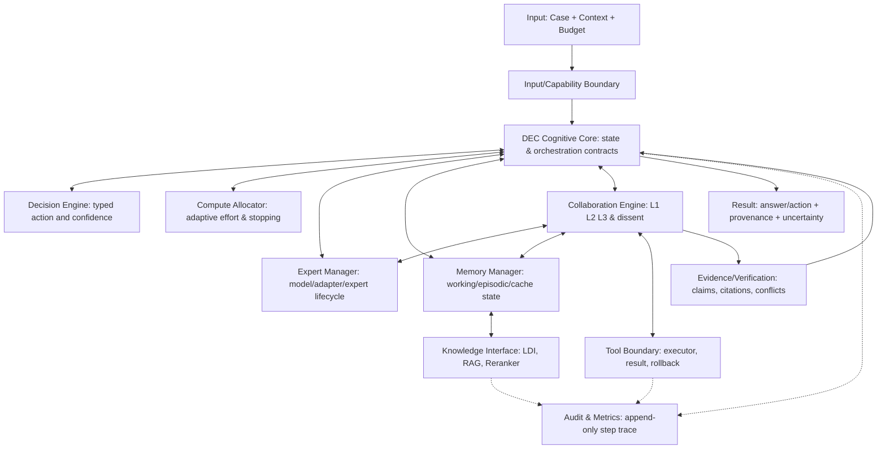
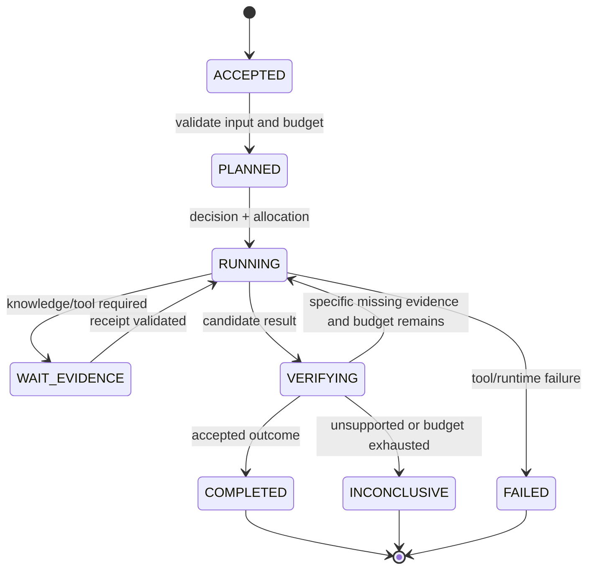

# DEC-CRA v1.0 — Reference Architecture (فارسی)
**Date:** 2026-11-16 | **Status:** Proposed research reference (E0) | **Authority:** PROJECT-CHARTER.md and ADR-001 (model OR ecosystem)
**Scope:** Technology-neutral, single-case CPU-first research baseline. This is a design artifact; components are NOT claimed implemented.

## 1. Mission and non-negotiable architectural neutrality
> تحقیق، طراحی و ارزیابی معماری یک مدل هوشمند یا یک اکوسیستم کارآمد که بتواند تصمیم‌گیری، تخصیص محاسبات، حافظه و تخصص‌های مختلف را به‌صورت هماهنگ در هسته خود مدیریت کند؛ با امکان اجرا روی منابع محدود و پشتیبانی از زبان فارسی و مأموریت‌های فنی.

Three implementation candidates remain open: A = unified learnable model; B = coordinated independent models/services; C = hybrid. This architecture specifies behavior and semantic interfaces, **not** where every capability must reside.

### Prior research preserved
- Cognitive levels L1 direct, L2 iterative/tool-assisted, L3 evidence-based multi-expert council.
- Two complementary paths: fast cognitive/state plane and independently auditable evidence plane.
- Typed events with trace, evidence, provenance, uncertainty, rejected alternatives and disagreement.
- CPU/RAM budget and model revision, adapter revision, bounded memory and no automatic KV compatibility.
- DEC experimental evidence E0–E3, separated from product/model-card claims.
- Multiuser, multitask and distributed execution remain separate future requirements, not achieved claims.

## 2. Context and domain model
A **Case** is the durable unit of a user request or research task, identified by case_id, with an objective, constraints, resources and a bounded sequence of **Steps**. A **Decision** selects action, expert, compute budget, evidence request or stopping. Each Step may request a **KnowledgeArtifact**, **ToolAction**, **ExpertResult** or **MemoryOperation**. Each event references a trace_id and immutable revisions of relevant models/knowledge.

**Success** is correct completed task under bounded resources with source faithfulness, not length of reasoning or count of model calls.

## 3. Logical architecture

### Responsibilities and invariants
| Component | Owns | Input → Output | Cannot silently do |
|---|---|---|---|
| Capability Boundary | case admission, input trust class, executable action allowance | CaseRequest → CaseContext | interpret retrieved text as privileged instructions |
| Cognitive Core | case lifecycle, dependencies, step graph, budget coordination | state/events → selected operation | bypass budget or erase dissent |
| Decision Engine | typed action/role/stop selection and uncertainty | DecisionContext → DecisionProposal | claim calibrated confidence without validation |
| Compute Allocator | CPU/RAM/token/time budget, effort escalation, early stop | Budget + progress → Allocation | spend resources beyond recorded ceiling |
| Expert Manager | model/adapter catalog, compatible versions, cold/warm loading | ExpertInvocation → ExpertResult | reuse incompatible adapter/KV state |
| Memory Manager | bounded working state, episodic events, knowledge references, cache handles | MemoryOperation → MemoryReceipt | treat KV or embedding as durable semantic memory |
| Collaboration Engine | select L1/L2/L3; causal graph, review and dissent | task graph → expert hypotheses | default to running every expert or forced consensus |
| Knowledge Interface | OCR/parse/retrieval/rerank and source revision | KnowledgeRequest → EvidenceRefs | invent attribution or execute source instructions |
| Tool Boundary | typed action execution, access boundary, status/rollback evidence | ToolAction → ToolReceipt | infer successful side effect from model intent |
| Verification | check claims, task completion, evidence consistency | claims/evidence → VerificationResult | equate an LLM judge with objective truth |
| Audit & Metrics | trace, versions, latency, allocations, outcome | event → append-only record | silently alter prior observation |

## 4. Two planes, four semantically different memories
**Cognitive/state plane:** ephemeral reasoning state, optionally latent tensors, model-specific KV, expert-invocation handles; may be optimized but no guarantee of portability.
**Evidence/event plane:** structured, portable, versioned events with source IDs, confidence status, revision, verification findings, human-readable reasons where possible. Mandatory even if core is end-to-end learned.

Memory taxonomy:
1. WorkingState: case-local, TTL/lease, bounded context; can be structured or latent; not stable across incompatible model revisions.
2. EpisodicMemory: event-level prior actions, results, decisions and feedback, append-only with retention control.
3. KnowledgeMemory: external retrievable corpus (LDI/KB) with document revisions and embeddings as indexes, not truth stores.
4. ExecutionCache: KV/prompt/model cache governed by exact model, tokenizer, adapter, position encoding and runtime revision; discard on ambiguity.

**Model weights** are a fifth, trainable form of learned representation and must not be updated as if they were a transactional document database.

## 5. One-case state machine

Every transition must create an event with prior_state, new_state, cause, budget_snapshot and trace_id. No unlimited retries; every loop consumes measured budget. A model-generated claim is a proposal until corroborated.

## 6. Mode-agnostic contracts
All transports must preserve the canonical semantics in CONTRACTS.json. Key records:
- CaseRequest: case_id, objective, language, requested_capabilities, constraints, budget, user_input_refs.
- DecisionProposal: action in {respond, call_expert, retrieve, invoke_tool, deliberate, request_input, stop}; expert_id optional; allocation_request; uncertainty status and rationale_ref.
- Allocation: tokens, wall_ms, cpu_ms, rss_mib and max_steps, with consumed values.
- ExpertInvocation/Result: model_id, model_revision, adapter_revision, tokenizer_revision, task, evidence_refs, raw output artifact references, status.
- MemoryHandle: representation in {structured, latent, kv, embedding_index}, lineage revisions, TTL, permitted_operations and compatibility fingerprint.
- KnowledgeRequest/Result: query, collections, source_revision, retrieval scores, citation handles.
- ToolAction/Receipt: tool_id, parameters_ref, authorization_context_ref, status, effect_ref, rollback_ref.
- EvidenceEvent: event_id, case_id, trace_id, sequence, timestamp, source_refs, claim_refs, decision_ref, validation_state, SHA-256 integrity.
- CaseResult: outcome in {completed, incomplete, failed}, claims, citations, dissent, uncertainty and consumed budget.

Referential integrity: all referenced artifacts must exist; no secret or raw sensitive data in public audit payloads. Versioning is immutable for stored results; adapters and model backbones are compared by canonical hashes/revisions.

## 7. Three concrete deployments of the SAME reference architecture
| Logical role | A: Unified | B: Ecosystem | C: Hybrid |
|---|---|---|---|
| Decision | learned typed head | external small decider or rule router | learned local head + external policy |
| Compute allocation | depth/loop/halting module | scheduler/case controller | model early exit + scheduler |
| Experts | internal MoE/adapters | discrete models or per-call adapters | shared backbone + external specialists |
| Memory | recurrent/latent state + external source references | structured events + retrieval + separate caches | bounded internal state + episodic and KB |
| Cooperation | learned inter-expert signals | explicit task graph L1/L2/L3 | internal specialist mixing + selective external council |
| Evidence & tools | independently auditable interfaces remain external | independent components | independent components |
| Main research cost | training, custom kernel and attribution | context/transport/cold-load overhead | interface complexity and compatibility |

**Rule:** Same test task, hardware reservation, evidence corpus, authorization boundary and cost measure for A/B/C. A prototype may use stubs for testing contracts, but stub passing does not prove cognitive benefits.

## 8. Candidate mapping — no forced product selection
| Needed mechanism | Research candidates / precedent | Required falsifiable test |
|---|---|---|
| typed decisions | Strands Decider, LemonDecider, ARC | routing accuracy, calibration, OOD, downstream tool success |
| adaptive compute | Dory, Nanbeige, ALoDLM, LayerRoute | completed-task quality per total CPU time/energy, appropriate stopping |
| expert adaptation | MobileMoE, Ling, MoLoRA, LoRA-Mixer, MoA; PEFT/llama.cpp | quality and interference under same base/split, peak RAM |
| bounded state | MemT, Hy-Memory, KV1 | recall, stale state, transfer across compatible revisions, resident RSS |
| agent/tool path | Mellum, TMax, FrogNano, Holo | held-out successful end-to-end tool tasks and recovery |
| Persian/technical | IbnSina, Dorna, LFM, MiniCPM; MorphBPE, Parity-aware BPE | code/English regression, Persian morphology, frozen evaluation set |
| source-grounded knowledge | LDI, Nemotron Parse, WeVisDoc, BGE-M3, Jina Reranker | real-document extraction, traceable answer and retrieval quality |
| efficient execution | Ternary-Bonsai, MobileMoE QAT, ExecuTorch, speculative decoding | actual CPU p95 latency and total peak memory |

This is a technology landscape linkage, not a claim that all listed models implement the whole mechanism or work on the same CPU backend.

## 9. Security, audit and failure semantics
- Trust boundaries at input, external documents, model artifacts, tools and publication; source text is evidence, never authority.
- The cognitive core may propose actions; effectful tool calls are evaluated by a separate executable authorization gate with least privileges and traceable identity, scope and parameters.
- Model predictions do not silently mutate knowledge or policy. Approved learned components and independently versioned policy may coexist.
- Each external request has timeout, bounded retries, circuit/failure handling, idempotency key when available, and a receipt before reporting success.
- Prompt injection, false citation, poisoned memory, invalid adapter/kv reuse, uncontrolled model routing, unbounded loops, data leakage and failed rollback are mandatory regression cases.
- Publication uses a separate allowlist: no proprietary model weights, credentials, private networks, raw real-world logs, unreviewed datasets or latent dumps from sensitive input.

## 10. Quality attributes and measurable acceptance
Do not invent universal targets. Freeze thresholds in each experiment registration *before* comparing candidates.
| Category | Measure | Evidence artifact |
|---|---|---|
| Task accuracy | independently adjudicated success, partial, unsupported, false action | labeled eval set and receipts |
| Decisions | route accuracy, ECE/Brier, OOD/abstain, wasted escalations | route traces and labels |
| Adaptive compute | quality vs consumed CPU sec, end-to-end p50/p95, final answer delivery | profiler and trace |
| Memory | retrieval correctness, contamination, forgetting, recovery, compatibility invalidation | state matrix and replay tests |
| Experts | delta vs raw base/Prompt/RAG/LoRA, interference, switch penalty | held-out ablations |
| Source fidelity | grounded claim rate, citation coverage, parsing CER/WER | independent annotations |
| Resource | peak total RSS, model residency, cold/warm, disk+KV, energy if possible | external host measurement |
| Audit/security | 100% expected events in trace, executable action gated, no leaked secrets | contract/negative tests |
| Maintainability | independent version updates, schema migrations, rollback and cost | release/ADR log |

## 11. Experiment sequence and roadmap trace
- P0 (WP-001..006): freeze corpus, reference architecture, source register and evaluation harness.
- P1A/B/C (WP-007..019): build common logical contracts, rule-based controller, model selection, L1/L2/L3 baselines and ablations.
- Parallel, bounded architecture spikes: typed decision, adaptive compute, memory, expert compatibility. No declaration of completed P2.
- P2 (WP-020..027): latent transfer, learned routing, cache-safe adapters, recurrent/low-bit tests and architecture comparison gate.
- P3 (WP-028..031): **architecture-neutral continuation**: unified, ecosystem or hybrid as selected only by evidence. Existing public roadmap labels P3 "Integrated model research", which conflicts with charter; tracked as documentation change, not silently revised here.
- For each option register: hypothesis, counterfactual, canonical models, revisions, dataset split, budgets, quality metrics, gates, failure result and rollback.

## 12. Architectural decisions, open questions and explicit nonclaims
**Decided:** scope neutrality; five capability semantics; independent evidence plane; versioned memory/adapter contracts; bounded runtime and audited tool boundary; benchmark-conditional implementation.
**Not decided:** base model; runtime/vendor; tokenizer; whether decider or memory is learned vs external; how latent tensors are shared; which final architecture is superior.
**Not implemented:** model integrations, typed learned heads, bounded latent transport, multi-expert training, A/B/C comparator, E3 quality claims.
**Open ADR topics:** state/trace envelope format, model-specific KV compatibility fingerprints, decision confidence calibration, authenticated tool boundary, adapter compatibility and registry, P3 neutral roadmap refresh.

## 13. Source anchors
- PROJECT-CHARTER.md and ADR-001-MODEL-OR-ECOSYSTEM-20261116.md (authority)
- integration-synthesis-20261116/CAPABILITY_ALIGNMENT.json (12 mapped capabilities, WP lineage)
- model-landscape-2026/MODEL_RESULTS_2026-11-16.md, COMPOSITION_METHODS_RESULTS_2026-11-16.md, PERSIAN_TOKENIZER_RESEARCH_2026-11-16.md
- GitHub research/roadmap.json (35 work packages), docs/fa/problem.md (RQ01..08), docs/fa/architecture.md (L1..L3, two planes), research-master benchmark reports (operational evidence only).

**RQ traceability:** RQ-01..RQ-08 are carried by VALIDATION_PLAN.md and the linked official problem statement; status E0.
