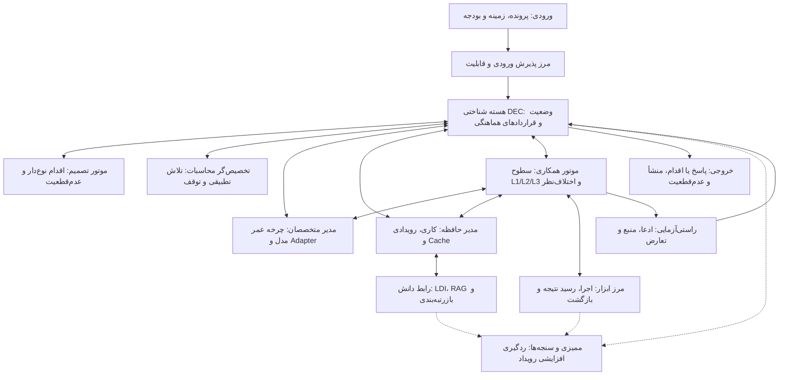
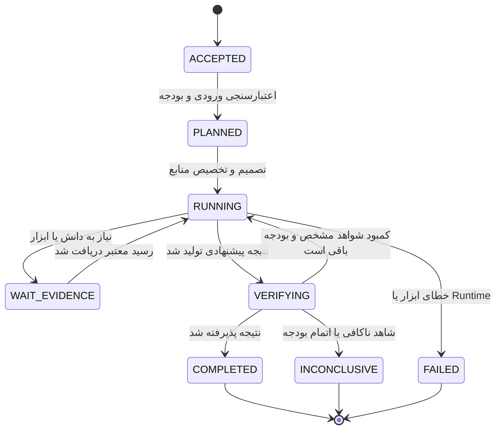

# معماری مرجع شناختی DEC — نسخهٔ ۱٫۰
**تاریخ:** ۱۶ نوامبر ۲۰۲۶ | **وضعیت:** معماری مرجع پیشنهادی (E0) | **مرجع بالادست:** `PROJECT-CHARTER.md` و `ADR-001`
**دامنه:** طراحی مستقل از فناوری، مناسب آزمون اولیه روی CPU، با یک پروندهٔ فعال. این سند طراحی است و به معنی پیاده‌سازی یا اثبات موفقیت مؤلفه‌ها نیست.

## ۱. مأموریت و بی‌طرفی معماری

> تحقیق، طراحی و ارزیابی معماری یک مدل هوشمند یا یک اکوسیستم کارآمد که بتواند تصمیم‌گیری، تخصیص محاسبات، حافظه و تخصص‌های مختلف را به‌صورت هماهنگ در هسته خود مدیریت کند؛ با امکان اجرا روی منابع محدود و پشتیبانی از زبان فارسی و مأموریت‌های فنی.

سه گزینهٔ نهایی همچنان باز هستند: **الف) مدل یکپارچهٔ یادگرفتنی، ب) اکوسیستم هماهنگ از مدل‌ها و خدمات مستقل، پ) معماری ترکیبی**. این معماری مرجع، رفتار و قراردادهای معنایی را مشخص می‌کند؛ محل استقرار هر قابلیت را از پیش تعیین نمی‌کند.

### اصول پژوهشی حفظ‌شده
- سه سطح شناختی: **L1** پاسخ مستقیم، **L2** استدلال مرحله‌ای با ابزار و دانش، **L3** شورای متخصصان مستقل همراه با شواهد و ثبت اختلاف‌نظر.
- دو مسیر مکمل: **مسیر شناختی و وضعیت داخلی** برای پردازش سریع، و **مسیر شواهد و رویدادها** برای ممیزی مستقل.
- رویدادهای نوع‌دار دارای شناسهٔ ردیابی، منشأ شواهد، عدم‌قطعیت، گزینه‌های ردشده و اختلاف‌نظرهای حل‌نشده.
- بودجهٔ CPU، حافظه و توکن، ثبت نسخهٔ مدل و Adapter، حافظهٔ محدود و عدم فرض سازگاری خودکار KV Cache.
- تفکیک سطوح شواهد E0 تا E3 و ادعاهای سازندگان از یافته‌های واقعی پروژه.
- پشتیبانی چندکاربره، اجرای هم‌زمان چند مأموریت و توزیع چندسروری، نیازمندی‌های آتی‌اند و تحقق‌یافته محسوب نمی‌شوند.

## ۲. مدل مفهومی دامنه

**پرونده (Case)** واحد پایدار یک درخواست یا مأموریت پژوهشی است که با `case_id` شناخته می‌شود. هر پرونده هدف، محدودیت‌ها، بودجه و مجموعه‌ای محدود از **گام‌ها (Steps)** دارد.
**تصمیم (Decision)** انتخاب نوع اقدام، متخصص، بودجهٔ محاسبه، درخواست شواهد یا توقف است. هر گام می‌تواند یک **مصنوع دانشی**، **اقدام ابزاری**، **نتیجهٔ متخصص** یا **عملیات حافظه** درخواست کند. هر رویداد با `trace_id` و نسخه‌های تغییرناپذیر مدل و منابع مرتبط ثبت می‌شود.

**معیار موفقیت** تکمیل صحیح مأموریت با منابع محدود و استناد معتبر است؛ نه طول زنجیرهٔ استدلال یا تعداد فراخوانی مدل‌ها.

## ۳. معماری منطقی

### مسئولیت‌ها و قواعد غیرقابل نقض

| مؤلفه | مسئولیت | ورودی ← خروجی | اقدام ممنوع بدون کنترل |
|---|---|---|---|
| مرز قابلیت | پذیرش پرونده، تعیین اعتماد ورودی و اختیار اقدام | `CaseRequest` ← `CaseContext` | تبدیل متن بازیابی‌شده به دستور ممتاز |
| هستهٔ شناختی | چرخه عمر پرونده، گراف گام‌ها و هماهنگی بودجه | وضعیت و رویداد ← عملیات منتخب | دورزدن بودجه یا حذف اختلاف‌نظر |
| موتور تصمیم | انتخاب نوع‌دار اقدام، نقش، توقف و عدم‌قطعیت | `DecisionContext` ← `DecisionProposal` | ادعای اعتماد کالیبره بدون آزمایش |
| تخصیص‌گر محاسبات | بودجهٔ CPU/RAM/توکن/زمان، ارتقا و توقف | بودجه و پیشرفت ← `Allocation` | مصرف فراتر از سقف ثبت‌شده |
| مدیر متخصصان | فهرست و سازگاری مدل/Adapter و بارگذاری سرد/گرم | `ExpertInvocation` ← `ExpertResult` | استفادهٔ مجدد از Adapter یا KV ناسازگار |
| مدیر حافظه | وضعیت کاری محدود، رویدادها، دانش و دسته‌های Cache | عملیات حافظه ← رسید حافظه | تلقی KV/Embedding به‌عنوان حافظهٔ معنایی پایدار |
| موتور همکاری | انتخاب L1/L2/L3، بازبینی، گراف علت و اختلاف‌نظر | گراف مأموریت ← فرضیه‌های متخصصان | اجرای همهٔ متخصصان در هر درخواست یا اجماع اجباری |
| رابط دانش | OCR، تجزیهٔ سند، بازیابی، بازرتبه‌بندی و نسخهٔ منبع | `KnowledgeRequest` ← ارجاع شواهد | جعل استناد یا اجرای دستور موجود در سند |
| مرز ابزار | اجرای اقدام نوع‌دار، دامنهٔ دسترسی، وضعیت و بازگشت | `ToolAction` ← `ToolReceipt` | ادعای اثر واقعی تنها بر اساس قصد مدل |
| راستی‌آزمایی | بررسی ادعا، تکمیل مأموریت و سازگاری شواهد | ادعا و شواهد ← نتیجهٔ بررسی | برابرگرفتن داور زبانی با حقیقت عینی |
| ممیزی و سنجه‌ها | ردگیری، نسخه‌ها، تأخیر، منابع و نتیجه | رویداد ← رکورد افزایشی | بازنویسی خاموش مشاهدهٔ قبلی |

## ۴. دو مسیر پردازشی و چهار نوع حافظهٔ متمایز

**مسیر شناختی/وضعیت:** وضعیت موقت استدلال، Tensorهای نهفته در صورت وجود، KV مخصوص مدل و Handleهای فراخوانی متخصص را حمل می‌کند. قابلیت بهینه‌سازی دارد، اما انتقال‌پذیری آن میان مدل‌ها تضمین نمی‌شود.

**مسیر شواهد/رویدادها:** رویدادهای ساختاریافته، نسخه‌دار و قابل انتقال، شامل شناسهٔ منابع، وضعیت اطمینان، نسخه، نتیجهٔ راستی‌آزمایی و دلیل قابل خواندن برای انسان را ثبت می‌کند. حتی در مدل کاملاً یادگرفتنی نیز این مسیر لازم است.

رده‌بندی حافظه:
1. **حافظهٔ کاری (`WorkingState`):** ویژهٔ پرونده، دارای مدت اعتبار یا اجاره، محدود و ساختاریافته یا نهفته؛ با تغییر ناسازگار نسخهٔ مدل اعتبار آن تضمین نمی‌شود.
2. **حافظهٔ رویدادی (`EpisodicMemory`):** تاریخچهٔ تصمیم‌ها، اقدامات، نتایج و بازخورد، با ثبت افزایشی و سیاست نگهداری.
3. **حافظهٔ دانش (`KnowledgeMemory`):** مجموعهٔ خارجی قابل بازیابی مانند LDI/KB همراه نسخهٔ سند؛ Embedding شاخص بازیابی است، نه مرجع قطعی حقیقت.
4. **نهانگاه اجرا (`ExecutionCache`):** Cache مدل، Prompt و KV وابسته به مدل دقیق، Tokenizer، Adapter، کدگذاری موقعیت و نسخهٔ Runtime؛ در ابهام باید نامعتبر شود.

**وزن‌های آموخته‌شدهٔ مدل** نوع پنجم و قابل‌آموزش بازنمایی دانش‌اند؛ نباید مانند پایگاه دادهٔ تراکنشی سند به‌روزرسانی شوند.

## ۵. ماشین حالت یک پرونده

هر تغییر حالت باید رویدادی شامل `prior_state`، `new_state`، علت، `budget_snapshot` و `trace_id` ایجاد کند. تلاش مجدد نامحدود مجاز نیست و هر چرخه بودجهٔ واقعی مصرف می‌کند. **ادعای تولیدی مدل تا پیش از تأیید، فقط یک پیشنهاد است.**

## ۶. قراردادهای مستقل از شیوهٔ پیاده‌سازی

تمام Transportها باید معنای قراردادهای مرجع موجود در `CONTRACTS.json` را حفظ کنند. نام شناسه‌ها و فیلدهای ماشینی ترجمه نمی‌شوند:

- **`CaseRequest`:** شناسهٔ پرونده، هدف، زبان، قابلیت‌های درخواستی، قیود، بودجه و ارجاعات ورودی.
- **`DecisionProposal`:** انتخاب یکی از `respond`، `call_expert`، `retrieve`، `invoke_tool`، `deliberate`، `request_input`، `stop`، همراه با متخصص اختیاری، درخواست بودجه و وضعیت عدم‌قطعیت.
- **`Allocation`:** سقف توکن، زمان دیواری، زمان CPU، حافظه و تعداد گام، همراه مصرف واقعی.
- **`ExpertInvocation` / `ExpertResult`:** شناسه و نسخهٔ مدل/Adapter/Tokenizer، وظیفه، شواهد، ارجاع خروجی خام و وضعیت.
- **`MemoryHandle`:** نوع بازنمایی `structured`، `latent`، `kv` یا `embedding_index`، تبار نسخه‌ها، مدت اعتبار، عملیات مجاز و اثرانگشت سازگاری.
- **`KnowledgeRequest` / `KnowledgeResult`:** پرس‌وجو، مجموعه‌ها، نسخهٔ منبع، امتیاز بازیابی و ارجاع استناد.
- **`ToolAction` / `ToolReceipt`:** ابزار، پارامتر، زمینهٔ مجوز، وضعیت، ارجاع اثر واقعی و بازگشت.
- **`EvidenceEvent`:** شناسهٔ رویداد/پرونده/ردگیری، ترتیب، زمان، منابع، ادعاها، تصمیم، وضعیت اعتبار و SHA-256.
- **`CaseResult`:** وضعیت `completed`، `incomplete` یا `failed`، ادعاها، استنادها، اختلاف‌نظر و بودجهٔ مصرف‌شده.

**یکپارچگی ارجاعات:** همهٔ مصنوع‌های ارجاع‌داده‌شده باید وجود داشته باشند. داده‌های ممیزی عمومی نباید کلید یا دادهٔ حساس خام داشته باشند. نتیجهٔ ذخیره‌شده تغییرناپذیر و مقایسهٔ مدل/Adapter وابسته به شناسه و Hash نسخه است.

## ۷. سه نگاشت اجرایی برای یک معماری مرجع

| نقش منطقی | الف: مدل یکپارچه | ب: اکوسیستم | پ: ترکیبی |
|---|---|---|---|
| تصمیم | Head یادگرفتنی نوع‌دار | تصمیم‌گیر کوچک بیرونی یا Router قاعده‌محور | Head محلی همراه سیاست بیرونی |
| تخصیص محاسبه | ماژول عمق، حلقه یا توقف | زمان‌بند و کنترلر پرونده | توقف درون‌مدلی همراه زمان‌بند |
| متخصصان | MoE یا Adapter درونی | مدل‌های مستقل یا Adapter در هر درخواست | Backbone مشترک و متخصص بیرونی |
| حافظه | حالت بازگشتی/نهفته با ارجاع منابع | رویدادها، بازیابی و Cache مجزا | وضعیت درونی محدود و دانش/رویداد بیرونی |
| همکاری | سیگنال یادگرفتنی بین متخصص‌ها | گراف مأموریت آشکار و شورای L1/L2/L3 | ترکیب درونی و شورای بیرونی انتخابی |
| شواهد و ابزار | رابط مستقل و قابل ممیزی باقی می‌ماند | مؤلفه‌های مستقل | مؤلفه‌های مستقل |
| هزینهٔ اصلی پژوهش | آموزش، Kernel اختصاصی و تبیین رفتار | جابه‌جایی Context، ارتباط و بارگذاری سرد | سازگاری رابط‌ها و وضعیت |

**قاعدهٔ مقایسه:** مأموریت، سخت‌افزار رزروشده، مجموعهٔ شواهد، مرز مجوز و روش محاسبهٔ هزینه باید برای هر سه گزینه قابل‌مقایسه باشند. عبور نمونهٔ نمایشی از تست قرارداد به معنی اثبات مزیت شناختی نیست.

## ۸. نگاشت فناوری‌های نامزد بدون انتخاب پیش‌هنگام محصول

| سازوکار موردنیاز | نامزدهای پژوهشی | آزمون ابطال‌پذیر لازم |
|---|---|---|
| تصمیم نوع‌دار | Strands Decider، LemonDecider، ARC | دقت Routing، کالیبراسیون، خروج از دامنه و موفقیت ابزار |
| محاسبات تطبیقی | Dory، Nanbeige، ALoDLM، LayerRoute | کیفیت مأموریت کامل به‌ازای CPU/انرژی و توقف مناسب |
| ترکیب متخصص | MobileMoE، Ling، MoLoRA، LoRA-Mixer، MoA، PEFT، llama.cpp | کیفیت/تداخل با مدل پایه و داده یکسان، بیشینهٔ RAM |
| وضعیت محدود | MemT، Hy-Memory، KV1 | صحت بازیابی، وضعیت منسوخ، انتقال بین نسخه‌های سازگار و RSS |
| عامل و ابزار | Mellum، TMax، FrogNano، Holo | اجرای واقعی ابزار روی موارد ندیده و بازیابی از خطا |
| فارسی و امور فنی | IbnSina، Dorna، LFM، MiniCPM، MorphBPE، Parity-aware BPE | پس‌رفت انگلیسی/کد، صرف فارسی و آزمون نهایی ثابت |
| دانش مستند | LDI، Nemotron Parse، WeVisDoc، BGE-M3، Jina Reranker | استخراج اسناد واقعی، صحت پاسخ مستند و بازیابی |
| اجرای کارآمد | Ternary-Bonsai، MobileMoE QAT، ExecuTorch، Speculative Decoding | تأخیر p95 روی CPU و بیشینهٔ حافظهٔ کل |

این نگاشت، ارتباط یافته‌های پژوهشی با معماری است؛ نه ادعای اینکه همهٔ مدل‌های نام‌برده تمام این سازوکارها را اجرا می‌کنند یا روی یک Runtime مشترک قابل اجرا هستند.

## ۹. امنیت، ممیزی و رفتار در شرایط خطا

- مرزهای اعتماد در ورودی، اسناد بیرونی، بسته‌های مدل، ابزار و انتشار قرار دارند. متن منبع **شاهد است، نه دستور ممتاز**.
- هسته می‌تواند اقدام پیشنهاد دهد، اما اجرای اقدام اثرگذار از دروازهٔ مجوز مستقل، با حداقل دسترسی و ثبت هویت، محدوده و پارامترها عبور می‌کند.
- پیش‌بینی مدل نباید بی‌صدا دانش یا سیاست را تغییر دهد. مؤلفه‌های یادگرفتنی تأییدشده می‌توانند کنار سیاست مستقل و نسخه‌دار قرار گیرند.
- درخواست بیرونی باید Timeout، تلاش مجدد محدود، مدیریت خطا/قطع سرویس، در صورت امکان کلید Idempotency و **رسید نتیجهٔ واقعی** داشته باشد.
- تزریق Prompt، استناد جعلی، مسمومیت حافظه، استفادهٔ ناسازگار از KV/Adapter، Routing کنترل‌نشده، حلقهٔ نامحدود، نشت داده و بازگشت ناموفق، سناریوهای الزامی Regression هستند.
- انتشار بر اساس فهرست مجاز مستقل انجام می‌شود: وزن اختصاصی، کلید، شبکهٔ خصوصی، لاگ واقعی خام، دادهٔ بررسی‌نشده و Tensor نهفتهٔ حاوی دادهٔ حساس منتشر نشود.

## ۱۰. ویژگی‌های کیفیت و معیار پذیرش

هدف کمّی عمومی و ساختگی تعریف نکنیم؛ آستانهٔ هر آزمایش باید **پیش از مقایسهٔ نامزدها** ثبت شود.

| حوزه | شاخص اندازه‌گیری | شاهد قابل ارائه |
|---|---|---|
| دقت مأموریت | موفقیت داوری مستقل، پاسخ ناقص، بدون شاهد یا اقدام اشتباه | مجموعهٔ برچسب‌خورده و رسید ابزار |
| تصمیم‌گیری | دقت مسیر، ECE/Brier، عدم پاسخ خارج از دامنه و ارتقای بی‌مورد | Trace مسیر و برچسب مرجع |
| محاسبهٔ تطبیقی | کیفیت در برابر CPU مصرفی، تأخیر انتهابه‌انتها p50/p95 و تحویل پاسخ نهایی | Profiler و Trace |
| حافظه | بازیابی درست، آلودگی، فراموشی، بازیابی وضعیت و بی‌اعتبارسازی ناسازگار | ماتریس حالت و آزمون بازپخش |
| متخصصان | تغییر نسبت به Base/Prompt/RAG/LoRA، تداخل و جریمهٔ تعویض | آزمون حذف مؤلفه روی دادهٔ ندیده |
| صحت منابع | نسبت ادعاهای مستند، پوشش استناد و CER/WER اسناد | برچسب‌گذاری مستقل |
| منابع | اوج RSS کل، اقامت وزن‌ها، سرد/گرم، دیسک/KV و انرژی در صورت امکان | اندازه‌گیری بیرونی سیستم |
| ممیزی و امنیت | پوشش کامل رویدادهای مورد انتظار، دروازهٔ اقدام و عدم نشت | تست قرارداد و منفی |
| نگهداری | به‌روزرسانی نسخه‌های مستقل، مهاجرت Schema، Rollback و هزینه | ثبت Release و ADR |

## ۱۱. ترتیب آزمایش‌ها و اتصال به نقشه راه

- **P0 (WP-001 تا 006):** تثبیت پیکره، معماری مرجع، ثبت منابع و ابزار ارزیابی.
- **P1A/B/C (WP-007 تا 019):** قراردادهای منطقی مشترک، کنترلر قاعده‌محور، انتخاب مدل، خط مبنای L1/L2/L3 و آزمون حذف مؤلفه.
- **آزمایش‌های کوتاه موازی:** تصمیم نوع‌دار، محاسبه تطبیقی، حافظه و سازگاری متخصصان؛ بدون ادعای پایان P2.
- **P2 (WP-020 تا 027):** انتقال نهفته، Routing یادگرفتنی، Adapter امن از نظر Cache، معماری بازگشتی/کم‌بیت و دروازهٔ مقایسه.
- **P3 (WP-028 تا 031):** **ادامهٔ بی‌طرف نسبت به معماری**؛ انتخاب مدل واحد، اکوسیستم یا ترکیبی تنها بر اساس شواهد. عنوان قدیمی P3 در نقشه راه عمومی هنوز «Integrated Model Research» است و با منشور تعارض دارد؛ تا اصلاح مستقل نقشه راه، این تعارض ثبت می‌ماند.
- برای هر گزینه باید فرضیه، فرض خلاف، نسخه‌ها، تقسیم داده، بودجه، شاخص‌ها، معیار پذیرش، نتایج ناموفق و مسیر بازگشت ثبت شود.

## ۱۲. تصمیم‌ها، پرسش‌های باز و ادعاهایی که مطرح نمی‌شوند

**تصمیم‌های ثبت‌شده:** بی‌طرفی دامنه؛ پنج قابلیت شناختی؛ مسیر مستقل شواهد؛ قراردادهای نسخه‌دار حافظه و Adapter؛ اجرای محدود به بودجه و مرز ابزار قابل ممیزی؛ تصمیم اجرایی مشروط به بنچمارک.

**تصمیم‌های باز:** مدل پایه، Runtime و سازنده، Tokenizer، درونی یا بیرونی بودن تصمیم‌گیر و حافظه، شیوهٔ تبادل Tensor نهفته و برتری معماری نهایی.

**موارد پیاده‌سازی‌نشده:** ادغام واقعی مدل‌ها، Head تصمیم یادگرفتنی، انتقال نهفتهٔ محدود، آموزش چندمتخصصی، مقایسهٔ A/B/C و ادعای کیفیت E3.

**موضوعات ADR آینده:** قالب Envelope برای وضعیت/ردگیری، اثرانگشت سازگاری KV وابسته به مدل، کالیبراسیون تصمیم، مرز ابزار دارای احراز هویت، Registry و سازگاری Adapter و اصلاح نام‌گذاری بی‌طرف فاز P3.

## ۱۳. منابع و ردیابی

- `PROJECT-CHARTER.md` و `ADR-001-MODEL-OR-ECOSYSTEM-20261116.md`: مبنای رسمی مأموریت.
- `integration-synthesis-20261116/CAPABILITY_ALIGNMENT.json`: نگاشت ۱۲ قابلیت و بسته‌های کاری؛ آرشیو پژوهشی داخلی.
- `model-landscape-2026/MODEL_RESULTS_2026-11-16.md`، `COMPOSITION_METHODS_RESULTS_2026-11-16.md` و `PERSIAN_TOKENIZER_RESEARCH_2026-11-16.md`: پیشینهٔ تحقیق.
- `research/roadmap.json`: ۳۵ بسته کاری؛ `docs/fa/problem.md`: پرسش‌های RQ-01 تا RQ-08؛ `docs/fa/architecture.md`: L1/L2/L3 و دو مسیر داده.
- بنچمارک‌های آرشیوی مدل‌ها فقط شواهد عملیاتی محدودند، نه اثبات معماری DEC.

**ردیابی RQ:** پرسش‌های RQ-01 تا RQ-08 در `VALIDATION_PLAN.md` و سند رسمی صورت مسئله پیگیری شده‌اند و هنوز در سطح E0 هستند.
