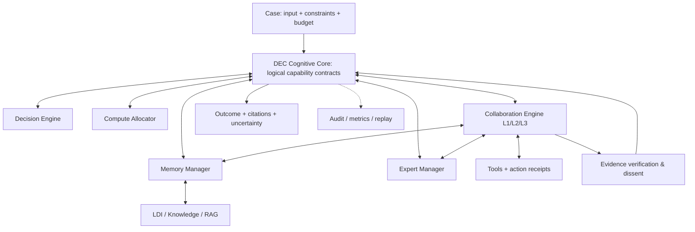

# DEC Cognitive Reference Architecture — DEC-CRA v1.0 (English)
**16 November 2026 | Status:** E0 reference design; contract fixtures E1 (synthetic). No DEC model, expert-sharing engine or architecture-comparison run is claimed.

## Official scope
DEC Research evaluates **an integrated intelligent model, an efficient coordinated model ecosystem, or a hybrid architecture**. The research objective is coordinated decision-making, compute allocation, memory, and specialization, with limited-resource deployment and Persian/technical support. None of the three architectures is selected by default.

## Logical structure

These are functional blocks: in Unified they may be internal neural modules; in Ecosystem they can be separate model/services; in Hybrid they can be mixed. **The diagram is not a deployed topology.**

## The five cognitive capabilities
1. **Decision:** Select action, expert, retrieval, tool invocation, escalation or stop. Emit typed decision and evidence. A learned confidence score is not automatically calibrated.
2. **Compute:** Allocate per-step resources, depth and stopping with finite total budgets. Budget exhausted is an explicit outcome rather than silently truncating reasoning.
3. **Memory:** Distinguish working state, episodic events, external knowledge and execution KV cache. A model's trained weights are not a transactional document store.
4. **Expertise:** Support whole models, shared base + adapters and internal experts. Record canonical model, tokenizer, adapter and runtime revisions. Cross-model KV/latent compatibility is never presumed.
5. **Collaboration:** Select L1 direct, L2 bounded iterative/knowledge/tool-assisted or L3 independent specialists with dissent. Compare to a single model given equivalent budget.

## Supporting services
Knowledge interface (LDI/OCR/parse/retrieval/reranking); effectful tool action executor with independent authorization and actual receipt; independent verification of claims and sources; append-only evidence/audit traces, evaluation and provenance.

## The two planes
- **Cognitive/state plane:** potentially internal latent activations, caches, expert state and local compute.
- **Evidence/event plane:** interoperable typed events: decisions, model/adapter revision, source refs, uncertainty, tool effect receipts, verification and final status.

Information in a retrieved document cannot grant executable privileges. Tool action proposal is not evidence of successful side effect.

## Implementation mappings
| | Unified (A) | Ecosystem (B) | Hybrid (C) |
|---|---|---|---|
| Decision | internal learned head | external deterministic/learned controller | model head + external gate |
| Compute | adaptive depth/halting | case scheduler | mixed |
| Expert | internal MoE/adapters | independent models/services | backbone+external experts |
| Memory | recurrent/latent + source refs | structured events + KB + caches | bounded internal + external |
| Cooperation | learnable interactions | task graph/council | mixed |
| Audit and tool gates | separate observable boundary | separate observable boundary | separate observable boundary |

## Typed schemas and runtime invariants
The JSON Schema draft 2020-12 in [CONTRACTS.json](CONTRACTS.json) defines 12 envelope kinds: CaseRequest, DecisionProposal, Allocation, ExpertInvocation, ExpertResult, MemoryHandle, KnowledgeRequest, KnowledgeResult, ToolAction, ToolReceipt, EvidenceEvent, CaseResult.

A case follows ACCEPTED → PLANNED → RUNNING → VERIFYING → COMPLETED, with explicit WAIT_EVIDENCE, FAILED and INCONCLUSIVE branches. Each transition must be auditable. All loops are bounded. Model, adapter and tokenizer fingerprints govern cache reuse. Output claims require source or deterministic verification before reporting as established.

## Technology candidates are research exemplars, not product picks
- Typed decision: Strands Decider, LemonDecider, ARC.
- Adaptive compute: Dory, Nanbeige, ALoDLM, LayerRoute.
- Experts/adapters: MobileMoE, Ling, PEFT, MoLoRA, LoRA-Mixer, MoA.
- Memory and caches: MemT, Hy-Memory, KV1, LDI/RAG.
- Agent actions: Mellum, TMax, FrogNano, Holo.
- Persian/code: IbnSina, Dorna, LFM/MiniCPM, MorphBPE, Parity-aware BPE.
- Documents: Nemotron Parse, WeVisDoc, BGE-M3, Jina Reranker.
- CPU runtime efficiency: llama.cpp, ExecuTorch, ternary/QAT/quantization options.

These implement different mechanisms and have **not** been integrated and compared as DEC. Do not confuse active MoE weights with total resident RAM, KV Cache with durable memory, or a vendor claim with a measured DEC result.

## Validation and decision criteria
[VALIDATION_PLAN.md](VALIDATION_PLAN.md) defines two independent gates: (1) synthetic schema/state/budget/compatibility tests; (2) real controlled cognitive-system experiments. Metrics include independently adjudicated task completion, source faithfulness, calibrated routing, long-memory correctness, complete-case CPU/RAM/p50/p95 and auditable action receipts. Quality/resource thresholds must be frozen before testing.

The [ADR](ADR-002-REFERENCE-ARCHITECTURE.md) defines scope and alternatives. The [capability index](CAPABILITY_IDS.json) preserves 12 requirement areas and existing DEC-WP IDs. Public roadmap P3 still says “integrated model”; this is a documented inconsistency to correct without rewriting the original work-package history.

## Nonclaims
Architecture E0; synthetic contract QA E1 only. No learned decider, latent transfer, resident memory, model specialization, production security system or validated A/B/C comparison is being claimed.
